# Azure IPAM REST API Overview

Everything you can do in Azure IPAM is also available through its REST API, which is described in OpenAPI v3 format.

The API documentation is at the `/api/docs` path of your Azure IPAM site. It's the complete reference for every endpoint, including its parameters, request body and responses, and you can call the endpoints directly from that page (see [Using the Swagger UI](#using-the-swagger-ui)). This guide covers how to authenticate and how to perform the most common operations.

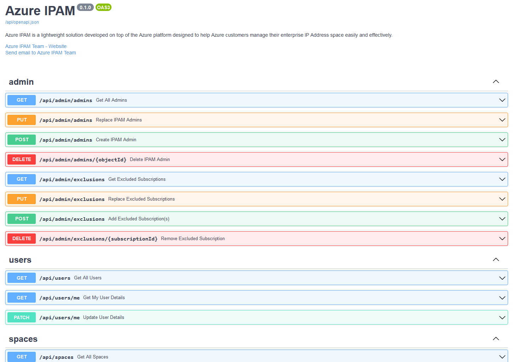

## How to Call the API

You can call the API like any other REST API. The examples in this guide use [Postman](https://www.postman.com) and [Azure PowerShell](https://learn.microsoft.com/powershell/azure/what-is-azure-powershell).

> **NOTE:** The Azure PowerShell examples use `Invoke-RestMethod -Authentication Bearer -Token`, which needs PowerShell 7 or later. Replace `<your-ipam-host>` with the host name of your Azure IPAM site, such as `ipam.contoso.com`, and `<engine-app-id>` with the application (client) ID of the Engine app registration.

<!-- Earlier versions of Azure IPAM link to this anchor from the Swagger UI, so keep it -->
<span id="obtaining-an-azure-ad-token"></span>

## Obtaining an Access Token

Every API call needs an access token. To get one from the Azure IPAM UI, select your user avatar in the upper-right corner, then select **Token**.

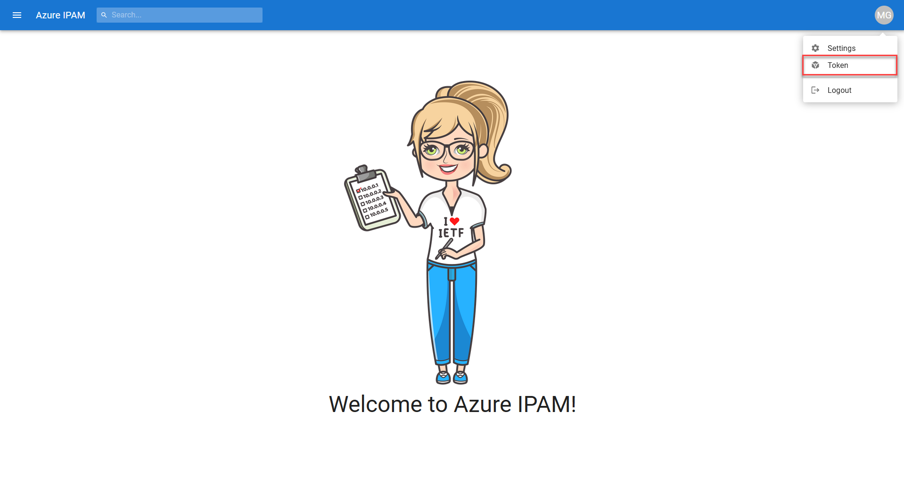

A *Token copied to clipboard!* message confirms that the token is on your clipboard.

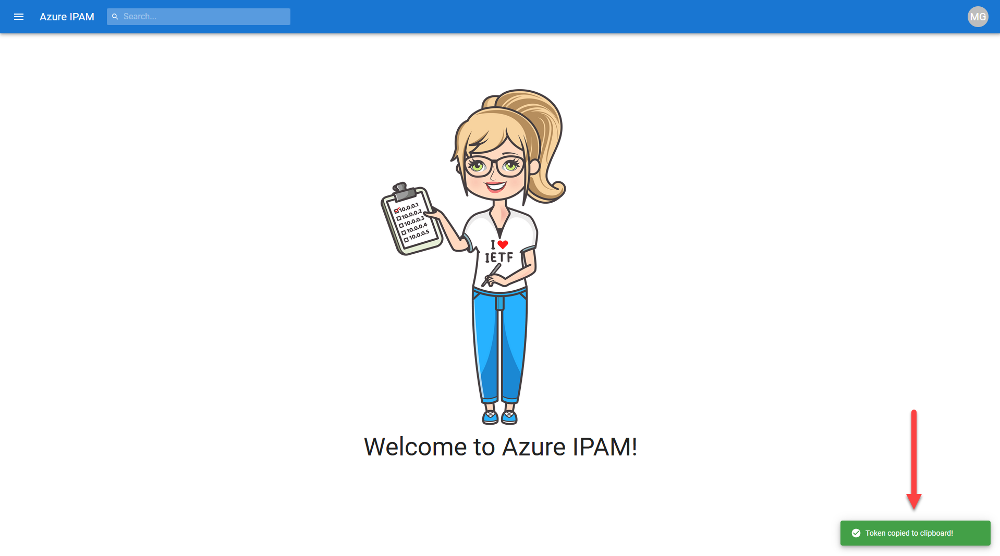

You can also copy your token from **Profile** in the same menu. Profile shows how long your current token has left, and links straight to the [Swagger UI](#using-the-swagger-ui) where you can use it. Either way, a copied token always has at least 10 minutes left, as Azure IPAM fetches a new one when the current token is about to expire.

You can also get an access token with the Azure PowerShell [Get-AzAccessToken](https://learn.microsoft.com/powershell/module/az.accounts/get-azaccesstoken) cmdlet. Request it for the API exposed by the Engine app registration, whose application ID URI is the **ResourceUrl**.

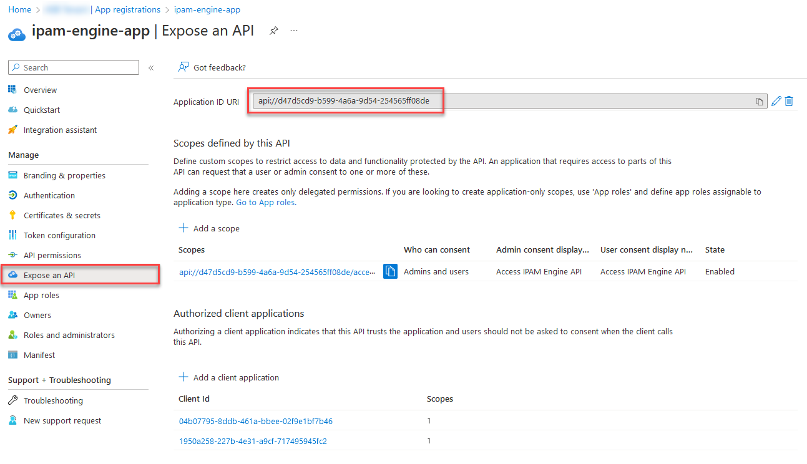

```powershell
$accessToken = (Get-AzAccessToken -ResourceUrl "api://<engine-app-id>").Token
```

> **NOTE:** As of [Azure PowerShell v14](https://learn.microsoft.com/powershell/azure/release-notes-azureps#1400---may-2025), `Get-AzAccessToken` returns the `.Token` property as a `SecureString`, which is the expected type for `Invoke-RestMethod -Token`. If you're using an earlier version, wrap the result with `ConvertTo-SecureString ... -AsPlainText -Force`.

## Using the Swagger UI

The API documentation at `/api/docs` is interactive. You can call any endpoint from your browser with **Try it out**, without a separate REST client. Supply a token first, since every endpoint except `/api/status` needs one.

1. Obtain a token using either of the methods described in [Obtaining an Access Token](#obtaining-an-access-token).

2. Select **Authorize** near the upper right of the page.

   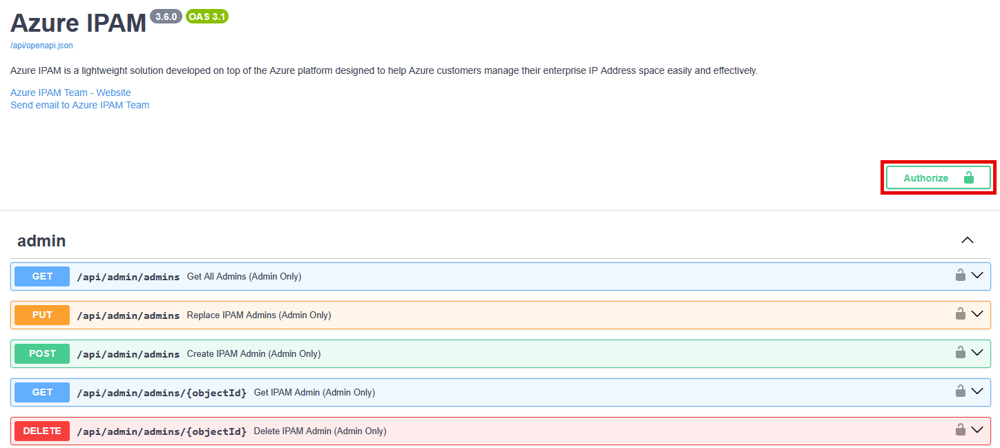

3. Paste your token into the **Value** field and select **Authorize**. Enter only the token itself, since the `Bearer` prefix is added for you.

   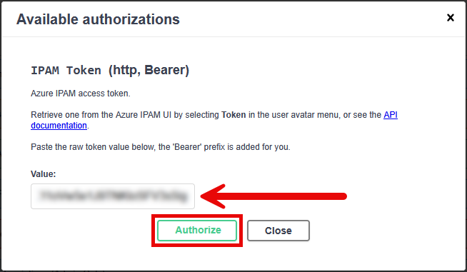

4. Select **Close**. The padlock next to each endpoint now shows as locked, meaning your token is sent with each request.

   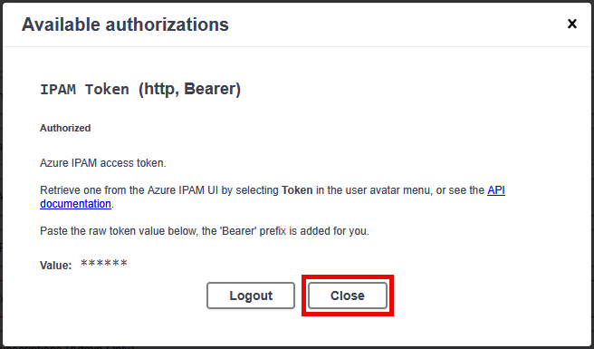

5. Expand any endpoint, select **Try it out**, fill in the required parameters, then select **Execute**.

   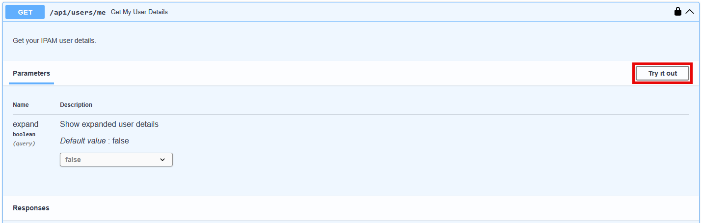
   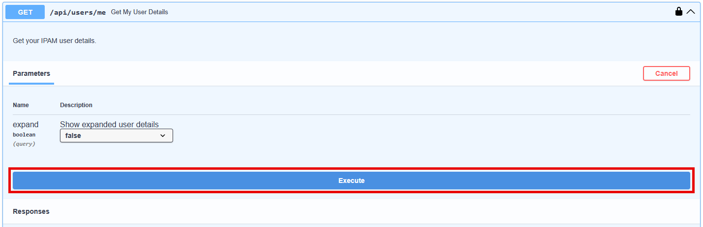
   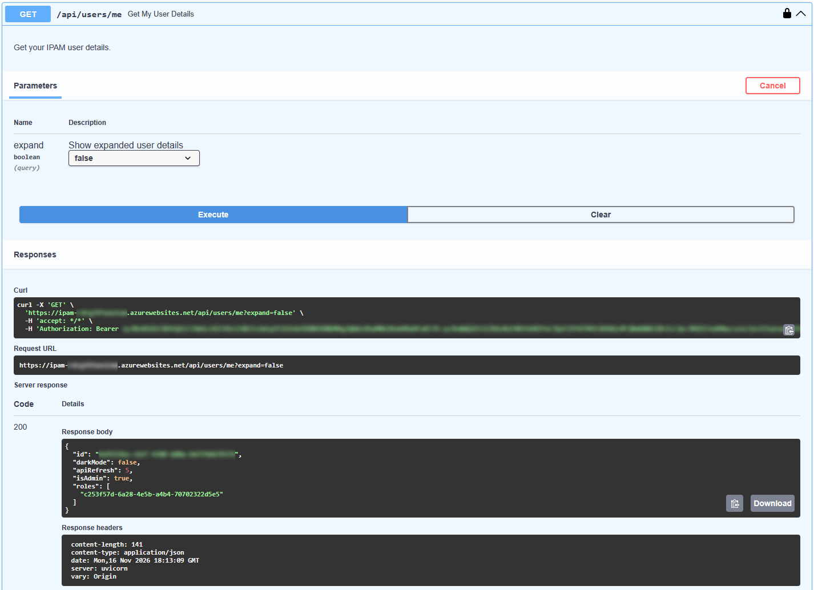

The **Curl** box shown with each response contains the full equivalent command, including the `Authorization` header, which is useful for repeating a call outside the browser.

Your token is held only in the current browser session. Reloading the page clears it, and you can remove it at any time with **Authorize** → **Logout**.

> **NOTE:** Access tokens are short-lived. If requests that worked before start returning `401`, your token has most likely expired. Repeat the steps above with a new one.

## Spaces

Spaces are the top-level organizational unit in Azure IPAM. Each Space represents a logical grouping of non-overlapping IP address Blocks. For more on what Spaces are and how to manage them via the UI, see the [Spaces](/how-to/README.md#spaces) section of the How-To documentation.

All Space management endpoints (create, update, delete) are restricted to Azure IPAM administrators.

### Space Endpoints

| Method | Path | Description |
|--------|------|-------------|
| `GET` | `/spaces` | List all Spaces |
| `POST` | `/spaces` | Create a new Space |
| `GET` | `/spaces/{space}` | Get details of a specific Space |
| `PATCH` | `/spaces/{space}` | Update a Space (JSON Patch) |
| `DELETE` | `/spaces/{space}` | Delete a Space |

> **NOTE:** The `GET` endpoints accept optional `expand` (admin-only) and `utilization` query parameters. Setting `utilization=true` includes size and used address counts. Setting `expand=true` expands all nested network references.

### Example API Calls

```powershell
$engineAppId = "<engine-app-id>"
$ipamHost = "<your-ipam-host>"

$accessToken = (Get-AzAccessToken -ResourceUrl "api://$engineAppId").Token

$headers = @{
    'Accept'       = 'application/json'
    'Content-Type' = 'application/json'
}
```

#### List All Spaces

```powershell
# Get All Spaces
$spaces = Invoke-RestMethod `
    -Method 'Get' `
    -Uri "https://$ipamHost/api/spaces" `
    -Authentication 'Bearer' `
    -Token $accessToken `
    -Headers $headers

# Get All Spaces with Utilization Data
$spacesUtil = Invoke-RestMethod `
    -Method 'Get' `
    -Uri "https://$ipamHost/api/spaces?utilization=true" `
    -Authentication 'Bearer' `
    -Token $accessToken `
    -Headers $headers
```

#### Get a Specific Space

```powershell
$space = 'TestSpace'

$spaceDetails = Invoke-RestMethod `
    -Method 'Get' `
    -Uri "https://$ipamHost/api/spaces/$space" `
    -Authentication 'Bearer' `
    -Token $accessToken `
    -Headers $headers
```

#### Create a Space

Creating a Space requires a name and description. The name must be 1–64 characters and can contain alphanumerics, underscores, hyphens, and periods.

```powershell
$body = @{
    name = 'ProductionSpace'
    desc = 'Production environment IP address space'
} | ConvertTo-Json

$response = Invoke-RestMethod `
    -Method 'Post' `
    -Uri "https://$ipamHost/api/spaces" `
    -Authentication 'Bearer' `
    -Token $accessToken `
    -Headers $headers `
    -Body $body
```

#### Update a Space

You can update a Space's name or description using a JSON Patch. Only the `replace` operation is supported, and allowed paths are `/name` and `/desc`.

```powershell
$space = 'ProductionSpace'

$body = @(
    @{
        op    = 'replace'
        path  = '/desc'
        value = 'Updated production IP space description'
    }
) | ConvertTo-Json -AsArray

$response = Invoke-RestMethod `
    -Method 'Patch' `
    -Uri "https://$ipamHost/api/spaces/$space" `
    -Authentication 'Bearer' `
    -Token $accessToken `
    -Headers $headers `
    -Body $body
```

#### Delete a Space

Deleting a Space fails if it contains Blocks, unless you pass the `force` query parameter.

```powershell
$space = 'ProductionSpace'

# Delete (Fails If Blocks Exist)
Invoke-RestMethod `
    -Method 'Delete' `
    -Uri "https://$ipamHost/api/spaces/$space" `
    -Authentication 'Bearer' `
    -Token $accessToken `
    -Headers $headers

# Force Delete (Removes the Space and All Its Blocks)
Invoke-RestMethod `
    -Method 'Delete' `
    -Uri "https://$ipamHost/api/spaces/$space`?force=true" `
    -Authentication 'Bearer' `
    -Token $accessToken `
    -Headers $headers
```

## Blocks

Blocks represent IPv4 CIDR ranges within a Space. Each Block can contain virtual network associations, CIDR reservations, and external networks. For more on what Blocks are and how to manage them via the UI, see the [Blocks](/how-to/README.md#blocks) section of the How-To documentation.

All Block management endpoints (create, update, delete) are restricted to Azure IPAM administrators.

### Block Endpoints

| Method | Path | Description |
|--------|------|-------------|
| `GET` | `/spaces/{space}/blocks` | List all Blocks in a Space |
| `POST` | `/spaces/{space}/blocks` | Create a new Block |
| `GET` | `/spaces/{space}/blocks/{block}` | Get details of a specific Block |
| `PATCH` | `/spaces/{space}/blocks/{block}` | Update a Block (JSON Patch) |
| `DELETE` | `/spaces/{space}/blocks/{block}` | Delete a Block |
| `GET` | `/spaces/{space}/blocks/{block}/available` | List virtual networks eligible for association |

> **NOTE:** The `GET` endpoints accept optional `expand` (admin-only) and `utilization` query parameters. Setting `utilization=true` includes size and used address counts. Setting `expand=true` expands virtual network references to full network objects. Non-admin users see every pending reservation, but those created by other users have their `id` and `desc` set to `null`, and settled reservations are only included if the caller created them.

### Example API Calls

```powershell
$engineAppId = "<engine-app-id>"
$ipamHost = "<your-ipam-host>"
$space = 'TestSpace'

$accessToken = (Get-AzAccessToken -ResourceUrl "api://$engineAppId").Token

$headers = @{
    'Accept'       = 'application/json'
    'Content-Type' = 'application/json'
}
```

#### List All Blocks in a Space

```powershell
# Get All Blocks
$blocks = Invoke-RestMethod `
    -Method 'Get' `
    -Uri "https://$ipamHost/api/spaces/$space/blocks" `
    -Authentication 'Bearer' `
    -Token $accessToken `
    -Headers $headers

# Get All Blocks with Utilization Data
$blocksUtil = Invoke-RestMethod `
    -Method 'Get' `
    -Uri "https://$ipamHost/api/spaces/$space/blocks?utilization=true" `
    -Authentication 'Bearer' `
    -Token $accessToken `
    -Headers $headers
```

#### Get a Specific Block

```powershell
$block = 'TestBlock'

$blockDetails = Invoke-RestMethod `
    -Method 'Get' `
    -Uri "https://$ipamHost/api/spaces/$space/blocks/$block" `
    -Authentication 'Bearer' `
    -Token $accessToken `
    -Headers $headers
```

#### Create a Block

Creating a Block requires a name and a valid IPv4 CIDR range. The CIDR range can't overlap existing Blocks in the same Space.

```powershell
$block = @{
    name = 'ProductionBlock'
    cidr = '10.0.0.0/16'
} | ConvertTo-Json

$response = Invoke-RestMethod `
    -Method 'Post' `
    -Uri "https://$ipamHost/api/spaces/$space/blocks" `
    -Authentication 'Bearer' `
    -Token $accessToken `
    -Headers $headers `
    -Body $block
```

#### Update a Block

You can update a Block's name or CIDR using a JSON Patch. Only the `replace` operation is supported, and allowed paths are `/name` and `/cidr`. When updating the CIDR, the new range must still contain all currently associated virtual networks, reservations, and external networks.

```powershell
$block = 'ProductionBlock'

$body = @(
    @{
        op    = 'replace'
        path  = '/cidr'
        value = '10.0.0.0/15'
    }
) | ConvertTo-Json -AsArray

$response = Invoke-RestMethod `
    -Method 'Patch' `
    -Uri "https://$ipamHost/api/spaces/$space/blocks/$block" `
    -Authentication 'Bearer' `
    -Token $accessToken `
    -Headers $headers `
    -Body $body
```

#### Delete a Block

Deleting a Block fails if it contains virtual network associations or any Reservations, including fulfilled and canceled ones, unless you pass the `force` query parameter.

```powershell
$block = 'ProductionBlock'

# Delete (Fails If Associations or Reservations Exist)
Invoke-RestMethod `
    -Method 'Delete' `
    -Uri "https://$ipamHost/api/spaces/$space/blocks/$block" `
    -Authentication 'Bearer' `
    -Token $accessToken `
    -Headers $headers

# Force Delete (Removes the Block and Everything in It)
Invoke-RestMethod `
    -Method 'Delete' `
    -Uri "https://$ipamHost/api/spaces/$space/blocks/$block`?force=true" `
    -Authentication 'Bearer' `
    -Token $accessToken `
    -Headers $headers
```

#### List Available Networks for a Block

Query which virtual networks are eligible for association with a given Block. This is useful before creating associations.

```powershell
$block = 'ProductionBlock'

# Get Available Networks with Full Details
$available = Invoke-RestMethod `
    -Method 'Get' `
    -Uri "https://$ipamHost/api/spaces/$space/blocks/$block/available?expand=true" `
    -Authentication 'Bearer' `
    -Token $accessToken `
    -Headers $headers
```

## Virtual Network Associations

Virtual Network Associations map Azure virtual networks (and virtual hubs) to Blocks within Azure IPAM. Associating a network tells Azure IPAM that its address space is allocated from the Block's CIDR range, which drives utilization tracking and overlap prevention. Any signed-in user can list a Block's associations, but adding, replacing and removing them is restricted to Azure IPAM administrators.

For more information on what Virtual Network Associations are, how eligibility rules work, and how to manage them in the UI, see the [Virtual Network Associations](/how-to/README.md#virtual-network-associations) section of the How-To documentation.

The API base path for Virtual Network Association operations is:

```text
/api/spaces/{space}/blocks/{block}
```

### Association Endpoints

| Method | Path | Description |
|--------|------|-------------|
| `GET` | `/spaces/{space}/blocks/{block}/available` | List virtual networks eligible for association |
| `GET` | `/spaces/{space}/blocks/{block}/networks` | List currently associated virtual networks |
| `POST` | `/spaces/{space}/blocks/{block}/networks` | Add a single virtual network association |
| `PUT` | `/spaces/{space}/blocks/{block}/networks` | Replace all associations (full replacement) |
| `DELETE` | `/spaces/{space}/blocks/{block}/networks` | Remove one or more associations |

> **NOTE:** Every signed-in user can call `GET /available` and `GET /networks`. The other association endpoints (`POST`, `PUT` and `DELETE`) are restricted to Azure IPAM administrators, and return `403 Forbidden` to anyone else.
>
> When an administrator calls `GET /available`, the Azure Resource Graph query runs with the application's service principal credentials, returning networks across the entire tenant. When a non-admin user calls the same endpoint, the query runs on behalf of the user (OBO), so only networks in Azure subscriptions the user has RBAC read access to are returned, along with every network already associated with the Block, which is part of the address plan. `GET /networks` only ever returns networks already associated with the Block, which are shared with every user, so with `expand=true` it returns full details for all of them, whoever calls it.

### Query Parameters

The `GET /available` and `GET /networks` endpoints accept an optional `expand` query parameter (default: `false`). When set to `true`, the response includes full network details (name, resource group, subscription, prefixes) rather than just resource IDs.

`GET /available` accepts an additional optional `include_blocked` query parameter (default: `false`). When set to `true`, the response also contains the networks that *can't* be associated with the Block, each with a `blocked_by` array naming the External Network or unsettled Reservation that overlaps each of its prefixes:

```text
blocked_by : {@{type=external; name=DataCenterA; cidr=10.1.4.0/24; prefix=10.1.4.0/24}}
```

Networks which can be associated are returned with an empty `blocked_by` array. A Reservation is named by its ID, so for non-admin users `name` is `null` on Reservations created by someone else. The parameter requires `expand`, as the unexpanded response is an array of resource IDs with nowhere to carry a reason; using it on its own returns `400 Bad Request`.

### Example API Calls

The following examples demonstrate common Virtual Network Association operations using Azure PowerShell. As with the other examples, you'll need to obtain an access token and set up your common variables first.

```powershell
$engineAppId = "<engine-app-id>"
$ipamHost = "<your-ipam-host>"
$space = 'TestSpace'
$block = 'TestBlock'

$accessToken = (Get-AzAccessToken -ResourceUrl "api://$engineAppId").Token

$headers = @{
    'Accept'       = 'application/json'
    'Content-Type' = 'application/json'
}
```

#### List Available Virtual Networks

Before associating virtual networks, you can query which networks are eligible for a given Block. This returns only networks whose address space falls within the Block's CIDR range and does not overlap unfulfilled Reservations or External Networks. For non-admin users, the results are further scoped to networks in Azure subscriptions the caller has RBAC read access to (see note above).

```powershell
# Get Available Networks (IDs Only)
$available = Invoke-RestMethod `
    -Method 'Get' `
    -Uri "https://$ipamHost/api/spaces/$space/blocks/$block/available" `
    -Authentication 'Bearer' `
    -Token $accessToken `
    -Headers $headers

# Get Available Networks with Full Details
$availableExpanded = Invoke-RestMethod `
    -Method 'Get' `
    -Uri "https://$ipamHost/api/spaces/$space/blocks/$block/available?expand=true" `
    -Authentication 'Bearer' `
    -Token $accessToken `
    -Headers $headers
```

The expanded response includes the following fields for each network:

```text
$availableExpanded[0]

name            : my-vnet-01
id              : /subscriptions/.../providers/Microsoft.Network/virtualNetworks/my-vnet-01
prefixes        : {10.1.0.0/24}
resource_group  : rg-networking
subscription_id : xxxxxxxx-xxxx-xxxx-xxxx-xxxxxxxxxxxx
tenant_id       : xxxxxxxx-xxxx-xxxx-xxxx-xxxxxxxxxxxx
```

#### List Current Associations

Retrieve the virtual networks currently associated with a Block.

```powershell
# Get Current Associations (IDs and Active Status)
$networks = Invoke-RestMethod `
    -Method 'Get' `
    -Uri "https://$ipamHost/api/spaces/$space/blocks/$block/networks" `
    -Authentication 'Bearer' `
    -Token $accessToken `
    -Headers $headers

# Get Current Associations with Full Details
$networksExpanded = Invoke-RestMethod `
    -Method 'Get' `
    -Uri "https://$ipamHost/api/spaces/$space/blocks/$block/networks?expand=true" `
    -Authentication 'Bearer' `
    -Token $accessToken `
    -Headers $headers
```

#### Add a Single Virtual Network

Associate a single virtual network with a Block by providing its Azure resource ID.

```powershell
$body = @{
    id = '/subscriptions/xxxxxxxx-xxxx-xxxx-xxxx-xxxxxxxxxxxx/resourceGroups/rg-networking/providers/Microsoft.Network/virtualNetworks/my-vnet-01'
} | ConvertTo-Json

$response = Invoke-RestMethod `
    -Method 'Post' `
    -Uri "https://$ipamHost/api/spaces/$space/blocks/$block/networks" `
    -Authentication 'Bearer' `
    -Token $accessToken `
    -Headers $headers `
    -Body $body
```

The virtual network must meet all eligibility requirements: its address space must fall within the Block's CIDR, it must not overlap existing associations, Reservations, or External Networks, and it must not already be associated with the Block.

#### Replace All Associations

This is what the UI does when you select **Save**. It replaces the Block's entire association list with the provided array of resource IDs. This is useful when you want to set the exact list of associated networks in a single call.

```powershell
$body = @(
    '/subscriptions/.../providers/Microsoft.Network/virtualNetworks/my-vnet-01',
    '/subscriptions/.../providers/Microsoft.Network/virtualNetworks/my-vnet-02',
    '/subscriptions/.../providers/Microsoft.Network/virtualHubs/my-vhub-01'
) | ConvertTo-Json -AsArray

$response = Invoke-RestMethod `
    -Method 'Put' `
    -Uri "https://$ipamHost/api/spaces/$space/blocks/$block/networks" `
    -Authentication 'Bearer' `
    -Token $accessToken `
    -Headers $headers `
    -Body $body
```

The following validations are enforced:

- No duplicate IDs in the list
- Every ID must resolve to a valid Azure virtual network or virtual hub
- Every network must have at least one address prefix within the Block's CIDR
- No CIDR overlap between networks in the list
- No CIDR overlap with unsettled Reservations or External Networks in the Block

> **NOTE:** This replaces the whole list. Any associated virtual network that isn't in the new list is disassociated.

#### Remove Associations

Remove one or more virtual network associations by providing an array of resource IDs to disassociate.

```powershell
$body = @(
    '/subscriptions/.../providers/Microsoft.Network/virtualNetworks/my-vnet-01'
) | ConvertTo-Json -AsArray

Invoke-RestMethod `
    -Method 'Delete' `
    -Uri "https://$ipamHost/api/spaces/$space/blocks/$block/networks" `
    -Authentication 'Bearer' `
    -Token $accessToken `
    -Headers $headers `
    -Body $body
```

All IDs in the list must currently exist in the Block's association list. Removing an ID that isn't associated returns an error.

## Reservations

Reservations allow you to claim address space within a Block before creating an Azure virtual network. For more on what Reservations are, their lifecycle, and how to manage them in the UI, see the [Reservations](/how-to/README.md#reservations) section of the How-To documentation.

You can create a Reservation in a specific Block, or from a list of Blocks, in which case Azure IPAM uses the first Block with enough space.

### Reservation Endpoints

| Method | Path | Description |
|--------|------|-------------|
| `GET` | `/spaces/{space}/reservations` | List reservations across all Blocks in a Space |
| `POST` | `/spaces/{space}/reservations` | Create a reservation from a list of Blocks |
| `GET` | `/spaces/{space}/blocks/{block}/reservations` | List reservations for a specific Block |
| `POST` | `/spaces/{space}/blocks/{block}/reservations` | Create a reservation in a specific Block |
| `GET` | `/spaces/{space}/blocks/{block}/reservations/{reservation}` | Get a specific reservation |
| `DELETE` | `/spaces/{space}/blocks/{block}/reservations` | Delete (cancel) multiple reservations |
| `DELETE` | `/spaces/{space}/blocks/{block}/reservations/{reservation}` | Delete (cancel) a single reservation |

> **NOTE:** The `GET` endpoints accept a `settled` query parameter (default: `false`). Set it to `true` to include fulfilled and canceled Reservations in the results. Non-admin users see every pending reservation, but those created by other users have their `id`, `desc` and `tag` set to `null`, and settled reservations are only included if the caller created them. Getting another user's reservation by ID returns `403 Forbidden`.

### Example API Calls

You'll need to provide the following for each API call:

- Bearer Token
- HTTP Method
- API Request URL
- HTTP Headers
- Request Body (POST/DELETE)

This example creates a Reservation for a new virtual network, with a `POST` to the following request URL:

```text
https://<your-ipam-host>/api/spaces/TestSpace/blocks/TestBlock/reservations
```

The body asks for a **/24**, so Azure IPAM reserves the next available **/24** in the **TestBlock** Block of the **TestSpace** Space, as named in the request URL.

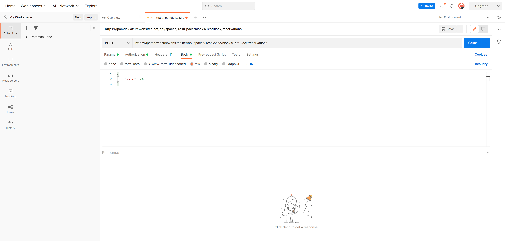

Add the headers on the **Headers** tab.

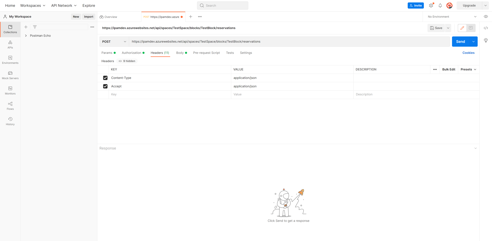

Then add your token on the **Authorization** tab.

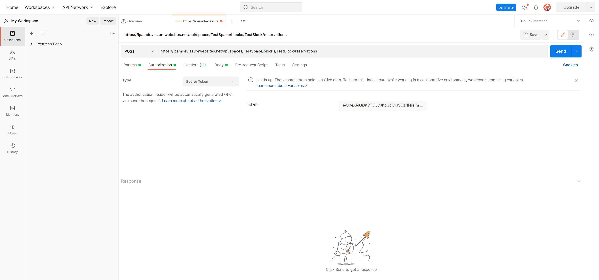

Select **Send**. The response is **201 Created**, with the details of the new Reservation. Make a note of the tag it returns. When you tag your new virtual network with this key and value, Azure IPAM associates it with the **Block** the Reservation came from.

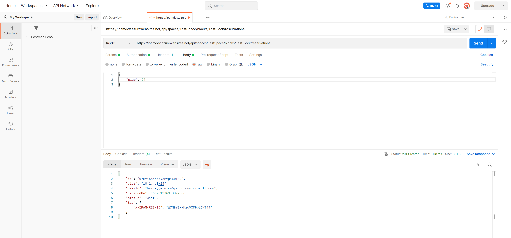

Here is the same example in Azure PowerShell. First, set up the common variables and authentication:

```powershell
$engineAppId = "<engine-app-id>"
$ipamHost = "<your-ipam-host>"
$space = 'TestSpace'
$block = 'TestBlock'

$accessToken = (Get-AzAccessToken -ResourceUrl "api://$engineAppId").Token

$headers = @{
    'Accept'       = 'application/json'
    'Content-Type' = 'application/json'
}
```

#### Create a Reservation by Size

The simplest way to create a Reservation is to give a mask size. Azure IPAM finds the next available CIDR range of that size in the Block.

```powershell
$body = @{
    size = 24
    desc = 'Reservation for Project Alpha virtual network'
} | ConvertTo-Json

$response = Invoke-RestMethod `
    -Method 'Post' `
    -Uri "https://$ipamHost/api/spaces/$space/blocks/$block/reservations" `
    -Authentication 'Bearer' `
    -Token $accessToken `
    -Headers $headers `
    -Body $body
```

The response has the details of the new Reservation. Make a note of its `tag`, which you need to apply to your virtual network.

```text
$response

id        : ABNsJjXXyTRDTRCdJEJThu
space     : TestSpace
block     : TestBlock
cidr      : 10.1.5.0/24
desc      : Reservation for Project Alpha virtual network
createdOn : 1662514052.26623
createdBy : user@contoso.com
settledOn :
settledBy :
status    : wait
tag       : @{X-IPAM-RES-ID=ABNsJjXXyTRDTRCdJEJThu}
```

`createdBy` is the caller's user principal name, or `spn:<object-id>` when a service principal created the Reservation.

You can also control how Azure IPAM chooses the range:

```powershell
# Allocate from the End of the Block and Use the Smallest Fitting Range
$body = @{
    size           = 24
    desc           = 'Reservation at end of block'
    reverse_search = $true
    smallest_cidr  = $true
} | ConvertTo-Json

$response = Invoke-RestMethod `
    -Method 'Post' `
    -Uri "https://$ipamHost/api/spaces/$space/blocks/$block/reservations" `
    -Authentication 'Bearer' `
    -Token $accessToken `
    -Headers $headers `
    -Body $body
```

#### Create a Reservation by CIDR

If you need a specific CIDR range, provide it directly instead of a size. It must be within the Block and can't overlap existing allocations.

```powershell
$body = @{
    cidr = '10.1.10.0/24'
    desc = 'Specific range for DMZ network'
} | ConvertTo-Json

$response = Invoke-RestMethod `
    -Method 'Post' `
    -Uri "https://$ipamHost/api/spaces/$space/blocks/$block/reservations" `
    -Authentication 'Bearer' `
    -Token $accessToken `
    -Headers $headers `
    -Body $body
```

> **NOTE:** The `cidr` and `size` parameters can't be used together. The `reverse_search` and `smallest_cidr` options are only available when using `size`.

#### Create a Reservation from Multiple Blocks

If the Reservation can come from any of several Blocks, give a list of Block names. Azure IPAM tries them in order and creates the Reservation in the first one with enough space.

```powershell
$body = @{
    blocks = @('PrimaryBlock', 'SecondaryBlock', 'OverflowBlock')
    size   = 24
    desc   = 'Flexible reservation across blocks'
} | ConvertTo-Json

$response = Invoke-RestMethod `
    -Method 'Post' `
    -Uri "https://$ipamHost/api/spaces/$space/reservations" `
    -Authentication 'Bearer' `
    -Token $accessToken `
    -Headers $headers `
    -Body $body
```

This uses the Space-level endpoint (`/spaces/{space}/reservations`) rather than the Block-level one.

#### List Reservations

You can list the active Reservations in a Block, or across all Blocks in a Space.

```powershell
# Get Active Reservations for a Specific Block
$reservations = Invoke-RestMethod `
    -Method 'Get' `
    -Uri "https://$ipamHost/api/spaces/$space/blocks/$block/reservations" `
    -Authentication 'Bearer' `
    -Token $accessToken `
    -Headers $headers

# Include Settled (Fulfilled or Canceled) Reservations
$allReservations = Invoke-RestMethod `
    -Method 'Get' `
    -Uri "https://$ipamHost/api/spaces/$space/blocks/$block/reservations?settled=true" `
    -Authentication 'Bearer' `
    -Token $accessToken `
    -Headers $headers

# Get Reservations Across All Blocks in a Space
$spaceReservations = Invoke-RestMethod `
    -Method 'Get' `
    -Uri "https://$ipamHost/api/spaces/$space/reservations" `
    -Authentication 'Bearer' `
    -Token $accessToken `
    -Headers $headers
```

#### Cancel a Reservation

Canceling a Reservation releases its CIDR range for other allocations. You can cancel one Reservation or several at once.

```powershell
# Cancel a Single Reservation by ID
Invoke-RestMethod `
    -Method 'Delete' `
    -Uri "https://$ipamHost/api/spaces/$space/blocks/$block/reservations/ABNsJjXXyTRDTRCdJEJThu" `
    -Authentication 'Bearer' `
    -Token $accessToken `
    -Headers $headers

# Cancel Several Reservations at Once
$body = @(
    'ABNsJjXXyTRDTRCdJEJThu',
    'CDPtKkYYzUSEUSdKFKUViv'
) | ConvertTo-Json -AsArray

Invoke-RestMethod `
    -Method 'Delete' `
    -Uri "https://$ipamHost/api/spaces/$space/blocks/$block/reservations" `
    -Authentication 'Bearer' `
    -Token $accessToken `
    -Headers $headers `
    -Body $body
```

> **NOTE:** Canceling a Reservation doesn't delete it. It stays in Azure IPAM with a status of `canceledByUser`, and is returned when you query with `settled=true`. Users who aren't administrators can only cancel Reservations they created.

For a real-world example of automating virtual network creation with Bicep and the Azure IPAM API, see the [Azure Landing Zone integration](https://github.com/Azure/ipam/tree/main/examples/azure-eslz) example in the repository.

## External Networks

External Networks allow you to track IP address space that lives outside of Azure (such as on-premises datacenters, co-location facilities, or other cloud providers) in Azure IPAM. External Networks sit within the Space and Block hierarchy. Any signed-in user can read them, but creating, changing and deleting them is restricted to Azure IPAM administrators.

For more on what External Networks are, how they fit into the Azure IPAM hierarchy, and how to manage them in the UI, see the [External Networks](/how-to/README.md#external-networks) section of the How-To documentation.

The API base path for External Networks is:

```text
/api/spaces/{space}/blocks/{block}/externals
```

### External Network Endpoints

| Method | Path | Description |
|--------|------|-------------|
| `GET` | `/spaces/{space}/blocks/{block}/externals` | List all External Networks in a Block |
| `POST` | `/spaces/{space}/blocks/{block}/externals` | Create a new External Network |
| `GET` | `/spaces/{space}/blocks/{block}/externals/{external}` | Get details of a specific External Network |
| `PATCH` | `/spaces/{space}/blocks/{block}/externals/{external}` | Update an External Network (JSON Patch) |
| `DELETE` | `/spaces/{space}/blocks/{block}/externals/{external}` | Delete an External Network |

### External Subnet Endpoints

| Method | Path | Description |
|--------|------|-------------|
| `GET` | `/spaces/{space}/blocks/{block}/externals/{external}/subnets` | List all Subnets in an External Network |
| `POST` | `/spaces/{space}/blocks/{block}/externals/{external}/subnets` | Create a new Subnet |
| `GET` | `/spaces/{space}/blocks/{block}/externals/{external}/subnets/{subnet}` | Get details of a specific Subnet |
| `PATCH` | `/spaces/{space}/blocks/{block}/externals/{external}/subnets/{subnet}` | Update a Subnet (JSON Patch) |
| `DELETE` | `/spaces/{space}/blocks/{block}/externals/{external}/subnets/{subnet}` | Delete a Subnet |

### External Endpoint Endpoints

| Method | Path | Description |
|--------|------|-------------|
| `GET` | `/spaces/{space}/blocks/{block}/externals/{external}/subnets/{subnet}/endpoints` | List all Endpoints in a Subnet |
| `POST` | `/spaces/{space}/blocks/{block}/externals/{external}/subnets/{subnet}/endpoints` | Create a new Endpoint |
| `PUT` | `/spaces/{space}/blocks/{block}/externals/{external}/subnets/{subnet}/endpoints` | Replace all Endpoints in a Subnet |
| `DELETE` | `/spaces/{space}/blocks/{block}/externals/{external}/subnets/{subnet}/endpoints` | Delete one or more Endpoints |
| `GET` | `/spaces/{space}/blocks/{block}/externals/{external}/subnets/{subnet}/endpoints/{endpoint}` | Get a specific Endpoint |
| `PATCH` | `/spaces/{space}/blocks/{block}/externals/{external}/subnets/{subnet}/endpoints/{endpoint}` | Update an Endpoint (JSON Patch) |
| `DELETE` | `/spaces/{space}/blocks/{block}/externals/{external}/subnets/{subnet}/endpoints/{endpoint}` | Delete a specific Endpoint |

### Example API Calls

The following examples show common External Network operations in Azure PowerShell. As with the Reservation examples, get an access token and set up the common variables first.

```powershell
$engineAppId = "<engine-app-id>"
$ipamHost = "<your-ipam-host>"
$space = 'MySpace'
$block = 'MyBlock'

$accessToken = (Get-AzAccessToken -ResourceUrl "api://$engineAppId").Token

$headers = @{
    'Accept'       = 'application/json'
    'Content-Type' = 'application/json'
}
```

#### Create an External Network

This example creates an External Network with a specific CIDR range, with a `POST` to the following request URL:

```text
https://<your-ipam-host>/api/spaces/MySpace/blocks/MyBlock/externals
```

```powershell
$body = @{
    name = 'OnPrem-DC1'
    desc = 'On-premises datacenter 1 network'
    cidr = '10.0.100.0/24'
} | ConvertTo-Json

$response = Invoke-RestMethod `
    -Method 'Post' `
    -Uri "https://$ipamHost/api/spaces/$space/blocks/$block/externals" `
    -Authentication 'Bearer' `
    -Token $accessToken `
    -Headers $headers `
    -Body $body
```

If you don't need a specific CIDR range, request a size instead, and Azure IPAM allocates the next available range in the Block:

```powershell
$body = @{
    name = 'OnPrem-DC2'
    desc = 'On-premises datacenter 2 network'
    size = 24
} | ConvertTo-Json

$response = Invoke-RestMethod `
    -Method 'Post' `
    -Uri "https://$ipamHost/api/spaces/$space/blocks/$block/externals" `
    -Authentication 'Bearer' `
    -Token $accessToken `
    -Headers $headers `
    -Body $body
```

#### Create an External Subnet

Once you have an External Network, you can add subnets to it. A subnet's CIDR range must be within the External Network's range.

```powershell
$external = 'OnPrem-DC1'

$body = @{
    name = 'ServerSubnet'
    desc = 'Server VLAN in DC1'
    cidr = '10.0.100.0/26'
} | ConvertTo-Json

$response = Invoke-RestMethod `
    -Method 'Post' `
    -Uri "https://$ipamHost/api/spaces/$space/blocks/$block/externals/$external/subnets" `
    -Authentication 'Bearer' `
    -Token $accessToken `
    -Headers $headers `
    -Body $body
```

#### Create an External Endpoint

With a subnet in place, you can add individual endpoints. Give a specific IP address, or pass `$null` to have Azure IPAM assign the next available address in the subnet.

```powershell
$subnet = 'ServerSubnet'

# Create an Endpoint with a Specific IP Address
$body = @{
    name = 'db-server-01'
    desc = 'Primary database server'
    ip   = '10.0.100.5'
} | ConvertTo-Json

$response = Invoke-RestMethod `
    -Method 'Post' `
    -Uri "https://$ipamHost/api/spaces/$space/blocks/$block/externals/$external/subnets/$subnet/endpoints" `
    -Authentication 'Bearer' `
    -Token $accessToken `
    -Headers $headers `
    -Body $body

# Create an Endpoint with an Automatically Assigned IP Address
$body = @{
    name = 'app-server-01'
    desc = 'Application server'
    ip   = $null
} | ConvertTo-Json

$response = Invoke-RestMethod `
    -Method 'Post' `
    -Uri "https://$ipamHost/api/spaces/$space/blocks/$block/externals/$external/subnets/$subnet/endpoints" `
    -Authentication 'Bearer' `
    -Token $accessToken `
    -Headers $headers `
    -Body $body
```

#### Update an External Network

You can update External Network properties using a JSON Patch. The same approach works for updating External Subnets and Endpoints by adjusting the request URL accordingly.

```powershell
$external = 'OnPrem-DC1'

$body = @(
    @{
        op    = 'replace'
        path  = '/desc'
        value = 'Updated description for DC1'
    }
) | ConvertTo-Json -AsArray

$response = Invoke-RestMethod `
    -Method 'Patch' `
    -Uri "https://$ipamHost/api/spaces/$space/blocks/$block/externals/$external" `
    -Authentication 'Bearer' `
    -Token $accessToken `
    -Headers $headers `
    -Body $body
```

#### Bulk Replace Endpoints

You can replace the entire endpoint list for a Subnet in a single operation using the `PUT` method. This is particularly useful for automation scenarios where an external system produces a complete inventory.

```powershell
$body = @(
    @{
        name = 'db-server-01'
        desc = 'Primary database server'
        ip   = '10.0.100.5'
    },
    @{
        name = 'db-server-02'
        desc = 'Secondary database server'
        ip   = '10.0.100.6'
    },
    @{
        name = 'app-server-01'
        desc = 'Application server'
        ip   = $null
    }
) | ConvertTo-Json -AsArray

$response = Invoke-RestMethod `
    -Method 'Put' `
    -Uri "https://$ipamHost/api/spaces/$space/blocks/$block/externals/$external/subnets/$subnet/endpoints" `
    -Authentication 'Bearer' `
    -Token $accessToken `
    -Headers $headers `
    -Body $body
```

#### Delete Endpoints

You can remove one or more Endpoints from a Subnet by passing an array of endpoint names.

```powershell
$body = @(
    'db-server-01',
    'app-server-01'
) | ConvertTo-Json -AsArray

$response = Invoke-RestMethod `
    -Method 'Delete' `
    -Uri "https://$ipamHost/api/spaces/$space/blocks/$block/externals/$external/subnets/$subnet/endpoints" `
    -Authentication 'Bearer' `
    -Token $accessToken `
    -Headers $headers `
    -Body $body
```

#### Delete an External Network

Deleting an External Network fails if it contains subnets, unless you pass the `force` query parameter.

```powershell
# Delete (Fails If Subnets Exist)
Invoke-RestMethod `
    -Method 'Delete' `
    -Uri "https://$ipamHost/api/spaces/$space/blocks/$block/externals/$external" `
    -Authentication 'Bearer' `
    -Token $accessToken `
    -Headers $headers

# Force Delete (Removes the Network Even If Subnets Exist)
Invoke-RestMethod `
    -Method 'Delete' `
    -Uri "https://$ipamHost/api/spaces/$space/blocks/$block/externals/$external`?force=true" `
    -Authentication 'Bearer' `
    -Token $accessToken `
    -Headers $headers
```

## Tools

The Tools endpoints answer planning questions: where the next virtual network of a given size fits, where the next subnet fits within a virtual network, and whether a CIDR range overlaps a network that already exists. They are available to every signed-in user, and none of them change anything in Azure IPAM.

The API base path for the Tools endpoints is:

```text
/api/tools
```

### Tool Endpoints

| Method | Path | Description |
|--------|------|-------------|
| `POST` | `/tools/nextAvailableVNet` | Find the next available CIDR for a virtual network within a list of Blocks |
| `POST` | `/tools/nextAvailableSubnet` | Find the next available CIDR for a subnet within a virtual network |
| `POST` | `/tools/cidrCheck` | List the Azure virtual networks and virtual hubs that overlap a CIDR range |

> **NOTE:** `nextAvailableVNet` finds address space but doesn't hold it, so the same CIDR can be returned to more than one caller until something occupies it. To hold address space within a Block, create a [Reservation](#reservations) instead, which accepts the same search options.

### What Each Caller Receives

The answers don't depend on who is asking. `nextAvailableVNet` takes into account every virtual network associated with each Block, along with unsettled Reservations and External Networks, including those you can't see yourself. `nextAvailableSubnet` takes into account every subnet in the virtual network, and `cidrCheck` checks every Azure virtual network and virtual hub within Azure IPAM's scope.

What differs is how much a caller who isn't an administrator is told about networks that aren't associated with a Block:

- `cidrCheck` returns such a network with its `name`, `id`, `resource_group`, `subscription_id` and `tenant_id` set to `null`. The overlapping `prefixes` are still returned, so you know the range is in use.
- `nextAvailableSubnet` accepts such a virtual network only if you can read it in Azure. Otherwise it returns `400 Bad Request` with `Virtual Network not found.`, exactly as it does for a virtual network that doesn't exist. A service principal that isn't an administrator can only target virtual networks associated with a Block, as explained in [Roles & Permissions](/roles-permissions/README.md#service-principals-and-automation).

> **NOTE:** `cidrCheck` reports existing Azure networks only. It doesn't check Reservations or External Networks, so use `nextAvailableVNet` or a Reservation to find space that is free within a Block.

### Example API Calls

```powershell
$engineAppId = "<engine-app-id>"
$ipamHost = "<your-ipam-host>"

$accessToken = (Get-AzAccessToken -ResourceUrl "api://$engineAppId").Token

$headers = @{
    'Accept'       = 'application/json'
    'Content-Type' = 'application/json'
}
```

#### Find the Next Available Virtual Network

Provide a Space, a list of Blocks and a mask size. The Blocks are evaluated in the order provided, and the first one with room for a network of that size is used.

```powershell
$body = @{
    space  = 'TestSpace'
    blocks = @('TestBlock', 'OverflowBlock')
    size   = 24
} | ConvertTo-Json

$response = Invoke-RestMethod `
    -Method 'Post' `
    -Uri "https://$ipamHost/api/tools/nextAvailableVNet" `
    -Authentication 'Bearer' `
    -Token $accessToken `
    -Headers $headers `
    -Body $body
```

The response names the Block the CIDR was found in:

```text
$response

space : TestSpace
block : TestBlock
cidr  : 10.1.11.0/24
```

The optional `reverse_search` and `smallest_cidr` settings work the same way as they do when [creating a Reservation by size](#create-a-reservation-by-size). If none of the Blocks has room for a network of the requested size, the call returns `409 Conflict`.

#### Find the Next Available Subnet

Provide the resource ID of the target virtual network and a mask size.

```powershell
$body = @{
    vnet_id = '/subscriptions/xxxxxxxx-xxxx-xxxx-xxxx-xxxxxxxxxxxx/resourceGroups/rg-networking/providers/Microsoft.Network/virtualNetworks/my-vnet-01'
    size    = 27
} | ConvertTo-Json

$response = Invoke-RestMethod `
    -Method 'Post' `
    -Uri "https://$ipamHost/api/tools/nextAvailableSubnet" `
    -Authentication 'Bearer' `
    -Token $accessToken `
    -Headers $headers `
    -Body $body
```

```text
$response

vnet_name       : my-vnet-01
resource_group  : rg-networking
subscription_id : xxxxxxxx-xxxx-xxxx-xxxx-xxxxxxxxxxxx
cidr            : 10.1.0.64/27
```

The same `reverse_search` and `smallest_cidr` settings are accepted here. If the virtual network has no room for a subnet of the requested size, the call returns `409 Conflict`.

#### Check a CIDR for Overlaps

Provide a CIDR range to find the Azure virtual networks and virtual hubs that overlap it. The CIDR must be a network address, so `10.1.0.0/16` is accepted but `10.1.0.1/16` returns `400 Bad Request`.

```powershell
$body = @{
    cidr = '10.1.0.0/16'
} | ConvertTo-Json

$response = Invoke-RestMethod `
    -Method 'Post' `
    -Uri "https://$ipamHost/api/tools/cidrCheck" `
    -Authentication 'Bearer' `
    -Token $accessToken `
    -Headers $headers `
    -Body $body
```

Each overlapping network lists the prefixes that overlap the CIDR and the Space and Block it is associated with, if any. In this response, seen by a user who isn't an administrator, the second network isn't associated with a Block, so only its overlapping range is shown:

```text
$response

name            : my-vnet-01
id              : /subscriptions/.../providers/Microsoft.Network/virtualNetworks/my-vnet-01
resource_group  : rg-networking
subscription_id : xxxxxxxx-xxxx-xxxx-xxxx-xxxxxxxxxxxx
tenant_id       : xxxxxxxx-xxxx-xxxx-xxxx-xxxxxxxxxxxx
prefixes        : {10.1.0.0/24}
containers      : {@{space=TestSpace; block=TestBlock}}

name            :
id              :
resource_group  :
subscription_id :
tenant_id       :
prefixes        : {10.1.8.0/24}
containers      : {}
```

## Notifications

Notifications let you know when something about your Azure IPAM deployment needs attention, such as a newer version being available or a problem with Azure IPAM's own access to Azure. For how notifications appear in the UI, see the [Notifications](/how-to/README.md#notifications) section of the How-To documentation.

Every notification describes itself completely: how severe it is, what it means, and what you can do about it. New kinds of notification are added over time, and because each one carries everything needed to understand and act on it, your automation can handle them without knowing about them in advance.

The API base path for the Notifications endpoints is:

```text
/api/notifications
```

### Notification Endpoints

| Method | Path | Description |
|--------|------|-------------|
| `GET` | `/notifications` | List the notifications that currently apply |
| `POST` | `/notifications/{notification_id}/resolve` | Fix the problem a notification describes, where it offers a fix |

> **NOTE:** Every signed-in user can list notifications, but notifications meant for administrators are only returned to administrators. Resolving a notification requires an administrator.

### The Notification Object

`GET /notifications` returns the notifications that currently apply, along with `checkedOn`, the Unix time at which the oldest of them was last checked. `checkedOn` is `null` until Azure IPAM has finished checking for the first time after it starts.

```jsonc
{
  "notifications": [ /* Notification objects, described below */ ],
  "checkedOn": 1794268800.418276
}
```

Every field described below is always included in the response. A field with no value is `null`.

Each notification has the following fields:

| Field | Description |
|-------|-------------|
| `id` | Identifies the notification. The same situation always produces the same `id`, so you can use it to recognize a notification you've already seen. |
| `severity` | `critical`, `warning` or `information` |
| `audience` | `all`, or `admin` for notifications that are only returned to administrators |
| `category` | A short label that groups related notifications |
| `title` | A one-line summary |
| `message` | A full description of what is happening, and what to do about it |
| `dismissible` | Whether the UI lets people hide the notification. It's `false` for problems that stop Azure IPAM from working properly, and has no effect on the API. |
| `data` | Additional values specific to the notification, such as version numbers. Its contents vary from one notification to another, and it's `null` when there are none. |
| `actions` | The actions the notification offers, which may be none |

Each action has an `id`, a `label` describing it, and a `kind` that says what it does. Fields that don't apply to an action's kind are `null`, apart from `requiresAdmin` and `causesRestart`, which are `false`.

| Kind | What It Does | Fields |
|------|--------------|--------|
| `link` | Points to documentation about the notification | `href` is the URL of the documentation |
| `resolve` | Fixes the problem through the Azure IPAM API | `method` and `href` are the request to make. `requiresAdmin` is `true` when only administrators can make it, and `causesRestart` is `true` when Azure IPAM restarts to apply the fix. |
| `navigate` | Opens a page in the Azure IPAM UI | `to` is the path of the page. It's only meaningful in the UI. |

### How Current Notifications Are

Azure IPAM reuses the result of each check for a short time, which varies from one check to another, so a notification can take a few minutes to appear or clear. Use `checkedOn` to see how current the response is. Like `createdOn` on a Reservation, it's a Unix time, and the [List Notifications](#list-notifications) example shows how to convert it to a date.

To check everything again right away, add `refresh=true`. A check that has only just run isn't repeated, so the response may still include some results from moments earlier.

> **NOTE:** If Azure IPAM runs on more than one instance, each one checks independently, so consecutive calls can return slightly different values for `checkedOn`.

### Resolving a Notification

Notifications that Azure IPAM can fix itself offer a `resolve` action. Make the request it describes, using its `method` and `href`, with no request body. Before making any change, Azure IPAM checks again whether the notification still applies.

| Response | Meaning |
|----------|---------|
| `202 Accepted` | The fix has started. The response includes a `status` and a `detail` describing what happens next. |
| `403 Forbidden` | Only administrators can resolve notifications |
| `404 Not Found` | The notification doesn't offer a fix that Azure IPAM can apply |
| `409 Conflict` | The notification no longer applies, for example because it has already been resolved |

When `causesRestart` is `true`, Azure IPAM restarts shortly after accepting the request, and requests fail for a short time while it does.

### Using Notifications in Automation

Notifications are a convenient way to monitor an Azure IPAM deployment, for example from a pipeline or a scheduled job:

- **Act on `severity`.** Treat `critical` as a problem that needs fixing now, and `warning` and `information` as things to look at when convenient.
- **Use `id` to follow a notification over time.** Raise an alert the first time an `id` appears, rather than on every check, and close it when the `id` no longer appears.
- **Don't keep a fixed list of `id` values.** New notifications are added over time. Treat an `id` you haven't seen before as new, and use its `title`, `message` and `link` actions to explain it.
- **There's no need to poll often.** Results are reused for a few minutes anyway, so checking every few minutes is plenty.

### Example API Calls

```powershell
$engineAppId = "<engine-app-id>"
$ipamHost = "<your-ipam-host>"

$accessToken = (Get-AzAccessToken -ResourceUrl "api://$engineAppId").Token

$headers = @{
    'Accept'       = 'application/json'
    'Content-Type' = 'application/json'
}
```

#### List Notifications

```powershell
$response = Invoke-RestMethod `
    -Method 'Get' `
    -Uri "https://$ipamHost/api/notifications" `
    -Authentication 'Bearer' `
    -Token $accessToken `
    -Headers $headers

$response.notifications | Select-Object severity, title, id
```

`checkedOn` is a Unix time. To see when the results were checked as a local date and time:

```powershell
[DateTimeOffset]::FromUnixTimeSeconds([long]$response.checkedOn).LocalDateTime
```

#### Check Everything Again

```powershell
$response = Invoke-RestMethod `
    -Method 'Get' `
    -Uri "https://$ipamHost/api/notifications?refresh=true" `
    -Authentication 'Bearer' `
    -Token $accessToken `
    -Headers $headers
```

#### Fail a Pipeline When Something Is Critical

```powershell
$critical = $response.notifications | Where-Object severity -eq 'critical'

foreach ($notification in $critical) {
    Write-Host "$($notification.title): $($notification.message)"

    foreach ($link in ($notification.actions | Where-Object kind -eq 'link')) {
        Write-Host "  $($link.label): $($link.href)"
    }
}

if ($critical) {
    throw "Azure IPAM reported $(@($critical).Count) critical notification(s)."
}
```

#### Resolve a Notification

Find the notification's `resolve` action, then make the request it describes.

```powershell
$notification = $response.notifications | Where-Object id -eq '<notification id>'
$action = $notification.actions | Where-Object kind -eq 'resolve'

$result = Invoke-RestMethod `
    -Method $action.method `
    -Uri "https://$ipamHost$($action.href)" `
    -Authentication 'Bearer' `
    -Token $accessToken `
    -Headers $headers
```

```text
$result

status : accepted
detail : <a description of what happens next>
```

## Users and Roles

Every signed-in user has a set of preferences in Azure IPAM, such as dark mode and the tables whose layouts they've saved, and holds one or more roles that decide what they can do. For what each role allows, see [Roles & Permissions](/roles-permissions/README.md).

The API base paths for the Users and Roles endpoints are:

```text
/api/users
/api/roles
```

### User and Role Endpoints

| Method | Path | Description |
|--------|------|-------------|
| `GET` | `/users` | List every Azure IPAM user (Admin Only) |
| `GET` | `/users/me` | Get your own preferences and access |
| `PATCH` | `/users/me` | Change your own preferences |
| `GET` | `/roles` | List the roles that can be held in Azure IPAM |

### Your Access

`GET /users/me` reports the roles you hold in `roles`, as a list of role IDs. Look up a role's name and description in `GET /roles`, which every signed-in user can read. Role IDs never change, so use them rather than names in automation.

| Field | Description |
|-------|-------------|
| `roles` | The IDs of the roles you hold. `GET /roles` lists every role with its ID, name and description |
| `isAdmin` | Whether you're an administrator |

Each role in `GET /roles` has an `id`, a `name` and `description` for display, and `builtIn`, which is `true` for the roles defined by Azure IPAM itself.

### Setup Mode

Until at least one administrator is designated, every signed-in user is an administrator. This is a state of the whole deployment rather than of any one user, so it's reported as a [notification](#notifications) with the ID `setup-mode`, rather than by `/users/me`. Its severity is `critical` and it stays until an administrator is designated, so automation can check for it alongside other critical notifications. Removing the last administrator returns Azure IPAM to setup mode.

### Changing Your Preferences

`PATCH /users/me` takes a list of [JSON Patch](https://datatracker.ietf.org/doc/html/rfc6902) operations. Only the following are accepted, and anything else is ignored:

| Operation | Path | Description |
|-----------|------|-------------|
| `replace` | `/darkMode` | `true` or `false` |
| `replace` | `/apiRefresh` | How often the UI refreshes its data, in minutes: `5`, `10`, `15` or `30` |
| `add`, `replace` | `/views/{view}` | Save the layout of a table |
| `remove` | `/views/{view}` | Remove a table's saved layout. Removing a layout that isn't saved returns `409`. |

### Example API Calls

```powershell
$engineAppId = "<engine-app-id>"
$ipamHost = "<your-ipam-host>"

$accessToken = (Get-AzAccessToken -ResourceUrl "api://$engineAppId").Token

$headers = @{
    'Accept'       = 'application/json'
    'Content-Type' = 'application/json'
}
```

#### Check Your Roles

```powershell
$me = Invoke-RestMethod `
    -Method 'Get' `
    -Uri "https://$ipamHost/api/users/me" `
    -Authentication 'Bearer' `
    -Token $accessToken `
    -Headers $headers

$roles = Invoke-RestMethod `
    -Method 'Get' `
    -Uri "https://$ipamHost/api/roles" `
    -Authentication 'Bearer' `
    -Token $accessToken `
    -Headers $headers

$roles | Where-Object id -in $me.roles | Select-Object name, description
```

#### Remove a Saved Table Layout

```powershell
$body = @(
    @{ op = 'remove'; path = '/views/spaces' }
)

Invoke-RestMethod `
    -Method 'Patch' `
    -Uri "https://$ipamHost/api/users/me" `
    -Authentication 'Bearer' `
    -Token $accessToken `
    -Headers $headers `
    -Body (ConvertTo-Json -InputObject $body)
```
