# How to Use Azure IPAM

This guide explains how to use Azure IPAM to plan and track your address space. Some tasks are only available to Azure IPAM administrators, and each section says when that's the case.

## Authentication and Authorization

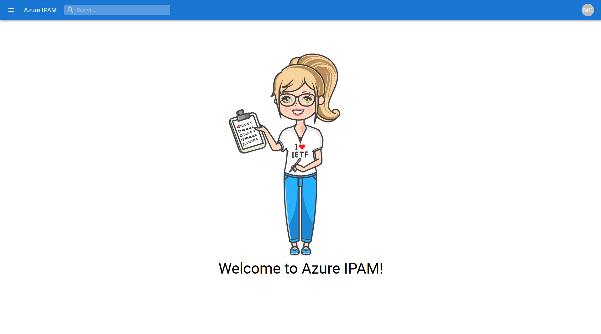

Azure IPAM uses the [Microsoft Authentication Library (MSAL)](https://learn.microsoft.com/entra/identity-platform/msal-overview) to authenticate users with your existing Microsoft Entra ID credentials. What you can do once signed in depends on whether you're an Azure IPAM administrator:

- **Administrators** set up and maintain the address plan. They create and update [Spaces](#spaces), [Blocks](#blocks) and [External Networks](#external-networks), manage [Virtual Network Associations](#virtual-network-associations) and [subscription exclusions](#subscription-exclusioninclusion), and control who else is an administrator. They see Azure resources through the Engine's service principal, which has [Reader](https://learn.microsoft.com/azure/role-based-access-control/built-in-roles/general#reader) on the [Root Management Group](https://learn.microsoft.com/azure/governance/management-groups/overview#root-management-group-for-each-directory), unless a different Management Group was chosen during deployment.
- **Non-administrators** work within the address plan. They can view every Space and Block, find available address space, and create and cancel their own [Reservations](#reservations). They see the networks associated with each Block as part of the address plan, but the **Discover** pages and other Azure resources only show them what their own Azure RBAC permissions allow.

For the full picture of what each role can see and do, see [Roles & Permissions](/roles-permissions/README.md).

> **NOTE:** A new deployment has no administrators. While the list of administrators is empty, **all** users are treated as administrators. This gives you full access to complete the initial setup, so add at least one administrator promptly. Until you do, a critical [notification](#notifications) is shown to everyone, and **Profile** explains why each person is an administrator. Removing the last administrator returns Azure IPAM to this state.

### Managing Administrators

To manage Azure IPAM administrators, expand the **Admin** section of the menu and select **Admins**.


The page shows a table of the current administrators, with a search bar above it. An administrator can be either of the following:

- **User:** a Microsoft Entra ID user account, found by display name or user principal name
- **Principal:** a Microsoft Entra ID service principal (an application identity), found by display name

Select the button to the left of the search bar to switch between searching for users and service principals. Its tooltip shows which one you're searching for.

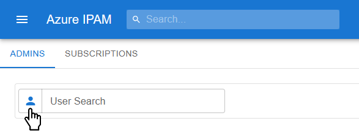

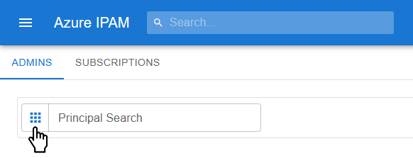

Type a name in the search bar to find matches in Microsoft Entra ID, then select one to add it to the list.

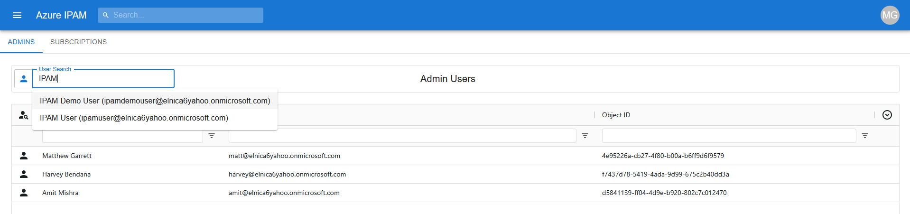

To remove an administrator, select its row, then select **Delete** on that row. The **Save** button in the upper-right corner appears only when you have unsaved changes. Select it to save the updated list.

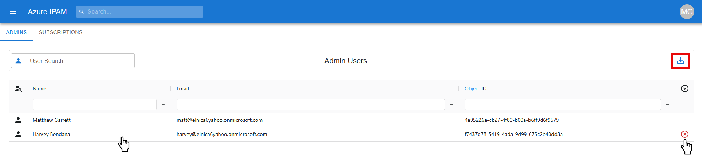

## Subscription Exclusion/Inclusion

Azure IPAM administrators can exclude Azure subscriptions from Azure IPAM. Excluded subscriptions are filtered out of every Azure Resource Graph query, so their virtual networks, subnets, virtual hubs and endpoints don't appear anywhere in the **Discover** or **Configure** sections. This is useful for leaving out subscriptions that contain irrelevant networks (such as sandbox or lab environments) so they don't clutter your IP address management view or skew utilization calculations.

To manage exclusions, expand the **Admin** section of the menu and select **Subscriptions**.

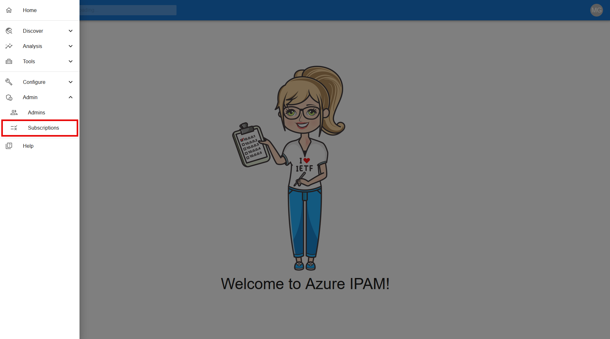

The list shows every subscription visible to Azure IPAM, with its type and Management Group. Select a subscription's row to exclude it, and select it again to include it. Excluded subscriptions are highlighted in red.

The **Save** button in the upper-right corner appears only when you have unsaved changes. Select it to save your changes. You can also use the **Actions** menu, at the right end of the table's header row, to switch between viewing all subscriptions and only the excluded ones.

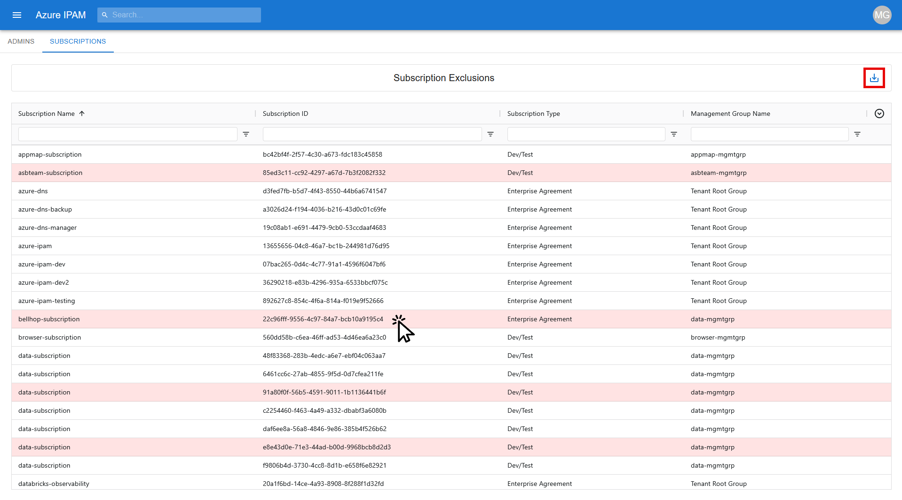

> **NOTE:** Excluding a subscription doesn't affect any existing Space or Block configurations. If a virtual network from an excluded subscription is already associated with a Block, the association is kept, but the network appears as [stale](#stale-associations) because Azure IPAM can no longer find it through Azure Resource Graph.

## Navigating the Discover Section

The **Discover** section of the menu gives a read-only view of your IP address space and Azure network resources. It has six tabs: **Spaces**, **Blocks**, **vNets**, **Subnets**, **vHubs** and **Endpoints**. Each tab shows a table you can sort and filter, and they all work the same way:

- **Utilization bars:** Where it applies, a color-coded bar shows how much of the address space is used. The bar is <span style="color: green">**green**</span> at 70% or below, <span style="color: goldenrod">**yellow**</span> between 71% and 89%, and <span style="color: red">**red**</span> at 90% or above.
- **Details panel:** Select **Details** on any row to open a panel on the right with more information about the resource, a utilization gauge where it applies, and a **VIEW IN PORTAL** button that opens the resource in the Azure portal.
- **Drill-down navigation:** Some values have a button next to them that opens a related tab, filtered to the child or associated resources. Its tooltip names the tab, such as **Show Blocks** next to a Space name. Where there's more than one related tab, the tooltip reads **Show Child Resources** and the button opens a menu to choose one.
- **Hidden columns:** Some columns, such as **Subscription ID**, are hidden by default to keep the table readable. Show them with **Manage Columns** in the table's **Actions** menu.

> **TIP:** The **Discover** section shows what you can see in Azure. Users who aren't administrators see the resources their own Azure permissions allow, while administrators see every resource in Azure IPAM's scope.

## Spaces

A **Space** represents a logical grouping of *unique* IP address space. Spaces can contain both contiguous and non-contiguous CIDR ranges, but not overlapping ones. They are the top-level organizational unit in Azure IPAM's hierarchy.

### Viewing Spaces

Select **Discover** → **Spaces** to see all Spaces. The grid shows each Space's **Space Name** (with a drill-down button to its Blocks), **Utilization** bar, **Description**, **Total IP's**, and **Allocated IP's**.

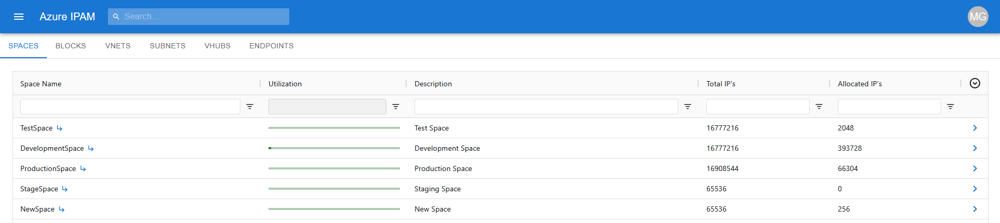

### Managing Spaces

Spaces are managed from the **Configure** → **Basics** page. The upper portion of the page shows the Space data grid.

> **NOTE:** Only Azure IPAM administrators can create, edit and delete Spaces.

**Adding a Space:** Open the **Actions** menu and select **Add Space**. Provide a name and description, then select **Create**.

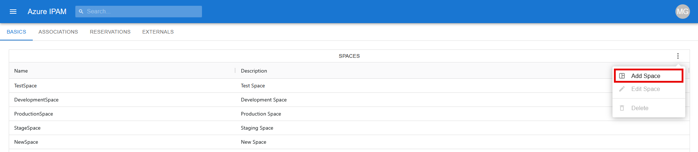

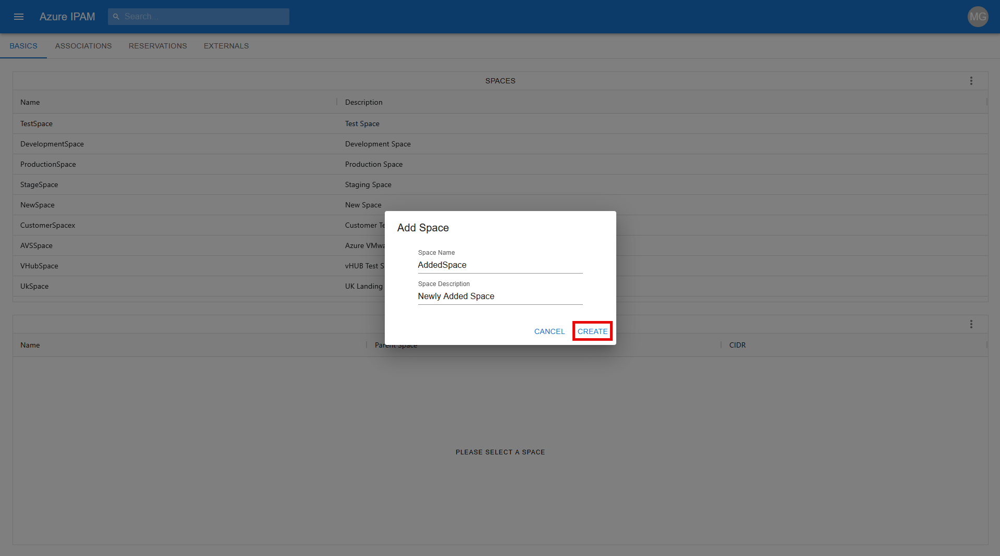

**Editing a Space:** Select a Space in the grid, then choose **Edit Space** from the **Actions** menu. You can update the name or description.

**Deleting a Space:** Select a Space and choose **Delete** from the **Actions** menu. If the Space contains Blocks, enable **Force Delete**, then select **Delete** a second time to confirm. Force-deleting a Space removes all of its Blocks and everything in them: virtual network associations, Reservations and External Networks.

Space names must be 1 to 64 characters and can contain letters, numbers, underscores, hyphens and periods. They can't start or end with a period, underscore or hyphen.

### Managing Spaces via the API

Space operations are also available through the Azure IPAM REST API. For the endpoints and example calls, see the [Spaces](/api/README.md#spaces) section of the API documentation.

## Blocks

A **Block** represents an IPv4 CIDR range within a Space. It can contain Azure virtual networks and virtual hubs whose address space falls within the Block's CIDR range, along with CIDR Reservations and External Networks. Blocks in the same Space can't have overlapping CIDR ranges.

### Viewing Blocks

Select **Discover** → **Blocks** to see all Blocks. The grid shows each Block's **Block Name** (with a drill-down button to its vNets and vHubs), **Utilization** bar, parent **Space**, **Total IP's**, **Allocated IP's**, and **CIDR Block**.

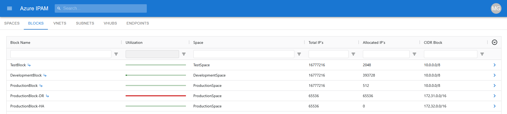

### Managing Blocks

Blocks are managed from the **Configure** → **Basics** page. Select a Space in the upper table to list its Blocks in the lower table.

> **NOTE:** Only Azure IPAM administrators can create, edit and delete Blocks.

**Adding a Block:** Open the **Actions** menu on the Block grid and select **Add Block**. Provide a name and a valid IPv4 CIDR range, then select **Create**.

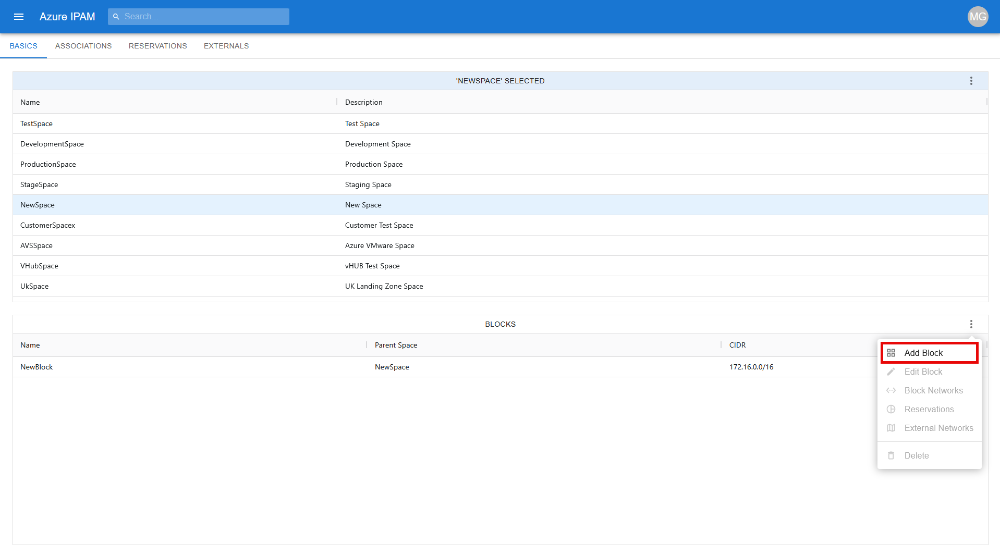

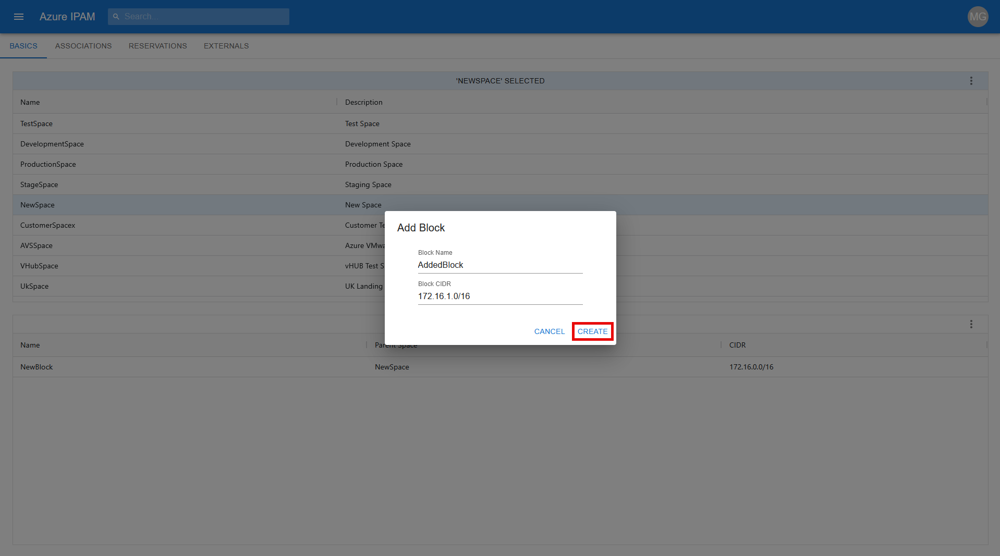

**Editing a Block:** Select a Block and choose **Edit Block** from the **Actions** menu. You can update the name or CIDR range. A new CIDR range must still contain every associated virtual network, Reservation and External Network.

**Deleting a Block:** Select a Block and choose **Delete** from the **Actions** menu. If the Block contains any virtual network associations or Reservations, including fulfilled and canceled ones, enable **Force Delete**, then select **Delete** a second time to confirm. External Networks don't prevent deletion, and are deleted along with the Block.

Block names follow the same rules as Space names.

> **TIP:** The Block's **Actions** menu also provides quick links to **Block Networks** (Associations), **Reservations**, and **External Networks**. Each one opens the matching **Configure** page with the Space and Block already selected.

### Managing Blocks via the API

Block operations are also available through the Azure IPAM REST API. For the endpoints and example calls, see the [Blocks](/api/README.md#blocks) section of the API documentation.

## Azure Network Resources

The **vNets**, **Subnets**, **vHubs** and **Endpoints** tabs in the **Discover** section show the Azure network resources you can read in Azure, with their IP address utilization. Every row has a **Details** button, as described in [Navigating the Discover Section](#navigating-the-discover-section).

### Virtual Networks

The **vNets** tab shows the Azure virtual networks you can see. The table displays the **vNet Name** (with a drill-down button to Subnets), **Utilization** bar, the **Space** and **Block** it's associated with (if any), **Total IP's**, **Allocated IP's**, and **Address Space**. The **Resource Group**, **Subscription Name** and **Subscription ID** columns are hidden by default.

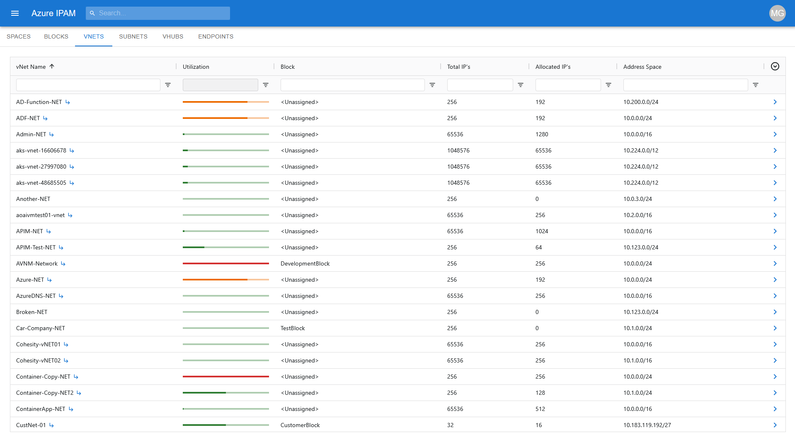

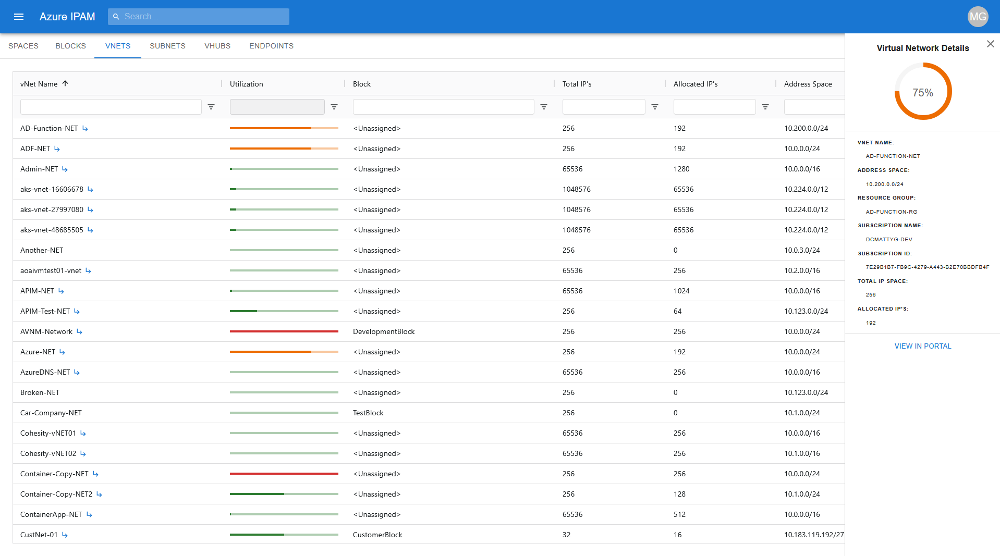

### Subnets

The **Subnets** tab shows all subnets across your visible virtual networks. The grid shows the **Subnet Name** (with a drill-down button to Endpoints), **Utilization** bar, **Parent vNet**, **Total IP's**, **Assigned IP's**, and **Address Space**. The **Resource Group**, **Subscription Name** and **Subscription ID** columns are hidden by default.

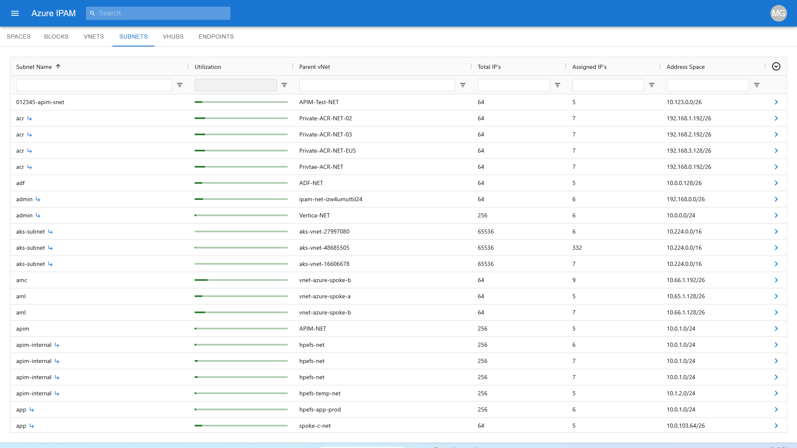

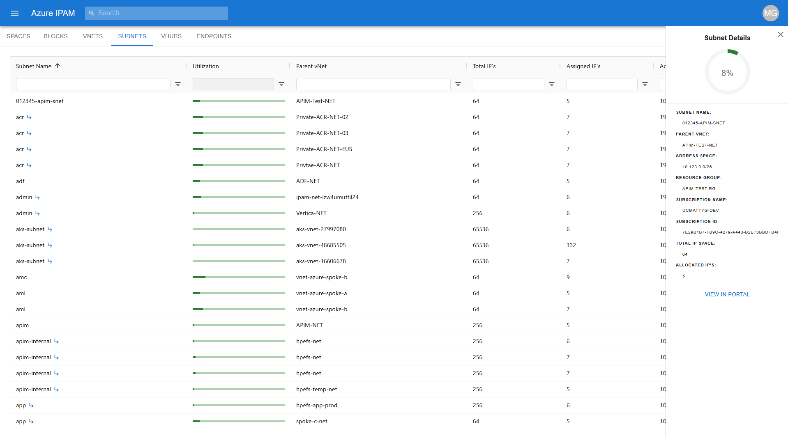

### Virtual Hubs

The **vHubs** tab shows the Azure Virtual WAN hubs you can see, whether or not they're associated with a Block. Virtual hubs are part of [Azure Virtual WAN](https://learn.microsoft.com/azure/virtual-wan/virtual-wan-about) and serve as the central networking point for branch, site-to-site, and point-to-site connectivity.

The grid displays the **vHub Name** (with a drill-down button to Endpoints), **Parent vWAN**, the **Space** and **Block** it's associated with (if any), **Resource Group**, and **Address Space**. The **Subscription Name** and **Subscription ID** columns are hidden by default.

<!-- TODO: Screenshot needed -->
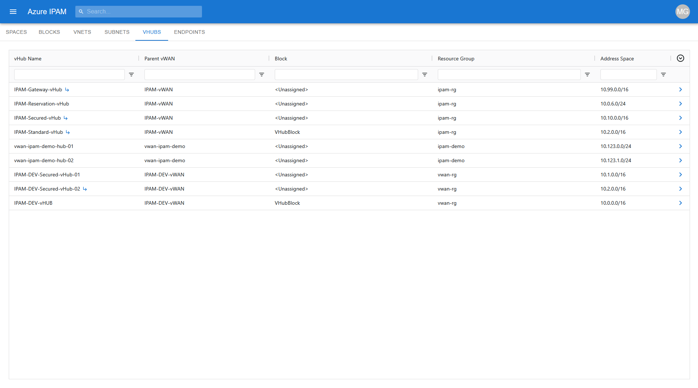

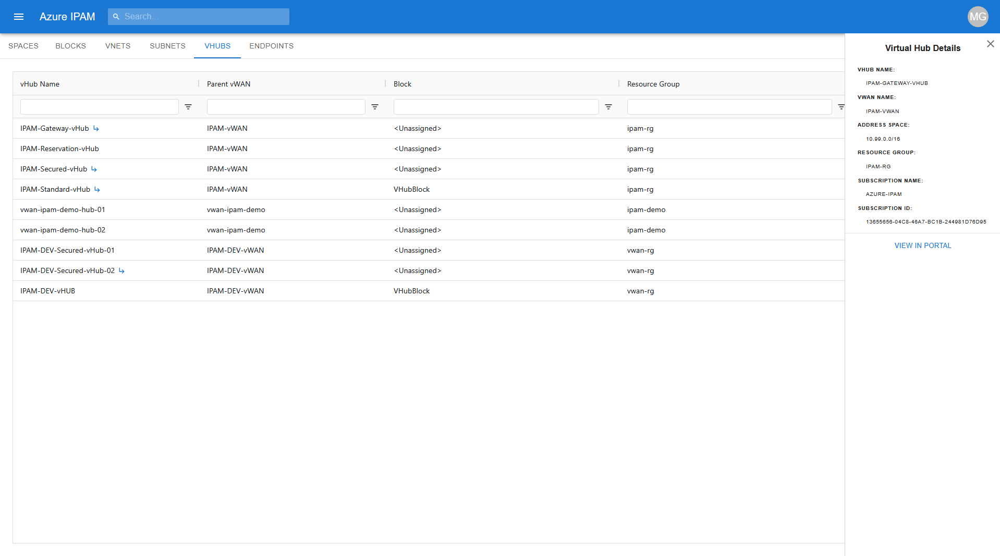

> **NOTE:** Unlike the **vNets** and **Subnets** tabs, the **vHubs** tab doesn't show a utilization bar. Azure manages the address allocation inside a virtual hub, such as for its gateways, routing and firewall, and doesn't report how much of it is used. Azure IPAM can track a hub's address prefix and its Block association, but not how much of that space is used. Virtual hubs are associated with Blocks in the same way as virtual networks, through [Virtual Network Associations](#virtual-network-associations).

### Endpoints

The **Endpoints** tab shows the resources that hold IP addresses in your visible virtual networks: virtual machines and scale sets, private endpoints, Azure Firewalls, Bastion hosts, virtual network gateways, application gateways, API Management instances, load balancers, virtual hub endpoints, and network interfaces that aren't attached to anything. The grid shows the **Endpoint Name**, **Parent Network**, **Parent Subnet**, **Resource Group**, and **Private IP**. The **Subscription Name** and **Subscription ID** columns are hidden by default.

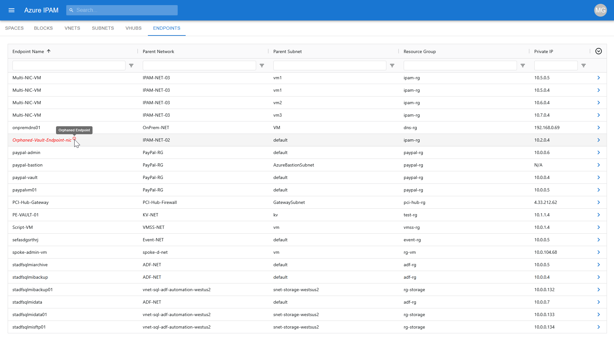

> **NOTE:** Endpoints that have been left behind are considered *orphaned* and are flagged with an informational indicator next to their name. A network interface is orphaned when it's no longer associated with a virtual machine or other compute resource. Private endpoints are described below.

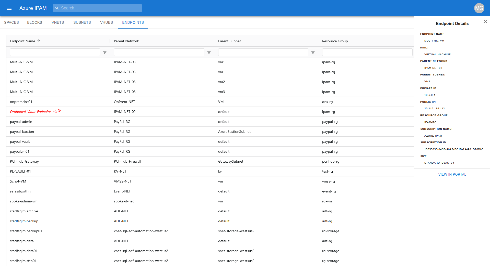

#### Private Endpoints

A private endpoint row describes the service it connects to. Its **Name**, **Resource Group**, and **Subscription** are the service's, while its **Parent Network**, **Parent Subnet**, and **Private IP** are the private endpoint's own. The details panel adds the **Private Endpoint Name** and the **Connection Status**, along with the **Connection Alias** for private endpoints connected by alias.

A private endpoint is **orphaned** when its connection to the service it was created for has been removed, because the service was deleted or soft-deleted, or because its owner removed the connection, while the private endpoint itself still exists. Azure reports this by setting the connection status to **Disconnected**. Recovering a soft-deleted service doesn't restore the connection, so the private endpoint needs to be recreated. A connection that's **Pending** or **Rejected** isn't orphaned, since the private endpoint was never connected, and its status is shown instead.

A few things to keep in mind:

- **Connections made by alias** are shown as the Private Link Service they connect to when you can read that service in Azure. Otherwise, including for services in other tenants, the row shows the private endpoint's own name, and the alias appears as the **Connection Alias**.
- **Only the first connection is shown** if a private endpoint has more than one.
- **Details come from Azure Resource Graph.** A change in connection status usually appears within a few minutes. After a connected service is moved to another resource group or subscription, however, its previous location can continue to appear for an hour or more.

## Virtual Network Associations

Virtual Network Associations map Azure virtual networks and virtual hubs to **Blocks** in Azure IPAM. Associating a virtual network with a Block tells Azure IPAM that the network's address space is allocated from that Block's CIDR range. Azure IPAM tracks IP address utilization through associations. Without them, it has no way of knowing which networks belong to which Blocks.

Associations are used for:

- **Utilization tracking:** Associated virtual networks count toward a Block's used address space, so you can see how much of the Block is used
- **Overlap prevention:** When you create Reservations, External Networks or more associations, Azure IPAM checks them against every associated virtual network to prevent address collisions
- **Shared visibility:** Once associated, a virtual network becomes part of the address plan, so every user can see it on the Block's **Associations** page. In the **Discover** section it's linked to its Space and Block, though each user still only sees the networks their own Azure permissions allow

> **NOTE:** Only Azure IPAM administrators can create or change associations. Every user can view a Block's associations.

### How Associations Work

Each **Block** maintains a list of associated virtual networks. An association is a mapping between an Azure virtual network resource ID and the Block. When Azure IPAM calculates utilization for a Block, it sums the address prefixes of all associated virtual networks that fall within the Block's CIDR range.

The association data is stored within the Block itself, alongside CIDR Reservations and External Networks:

```text
Space
└── Block (e.g. 10.0.0.0/16)
    ├── Virtual Network Associations  ← You are here
    ├── CIDR Reservations
    └── External Networks
```

Azure IPAM's background reconciliation process runs every minute and checks each associated virtual network against Azure to confirm it still exists and still has address space within the Block's CIDR range. If the network has been deleted, or its address space no longer falls within the Block, the association is marked as stale. Stale associations are highlighted in the UI so administrators can clean them up.

### Availability and Eligibility Rules

Not every virtual network in your Azure environment is eligible for association with a given Block. When you open the associations page for a Block, Azure IPAM lists the virtual networks and virtual hubs across your subscriptions that meet these requirements:

1. **CIDR containment:** The virtual network has at least one address prefix within the Block's CIDR range.
2. **No overlap with Reservations:** None of the virtual network's prefixes within the Block overlap an unsettled Reservation.
3. **No overlap with External Networks:** None of the virtual network's prefixes within the Block overlap an External Network.

Rules 2 and 3 apply to the **whole virtual network**, not to individual prefixes. A virtual network with several prefixes inside the Block is ineligible if *any one* of them overlaps a Reservation or an External Network, and the remaining prefixes can't be associated on their own. A Block can't contain overlapping CIDR ranges, and an association covers an entire network rather than a chosen part of it.

Virtual networks already associated with the Block are included in the list, and are already selected. Overlap with existing associations is validated when you save your changes.

Spaces are independent of each other, so a virtual network associated with a Block in one Space can still be available for Blocks in other Spaces. Within one Space, a virtual network with several address prefixes can be associated with different Blocks, since Blocks in a Space can't overlap and each prefix is evaluated on its own.

> **TIP:** If a virtual network or virtual hub you expect to see is missing from the list, first confirm that its address space falls within the Block's CIDR range. If it does, switch the table to **Showing All** to show ineligible networks and the reason each one is ineligible, as described in [Blocked Networks](#blocked-networks).

### Managing Associations via the UI

Virtual Network Associations are managed from the **Configure** section of the menu. There are two ways to get there:

- **From the menu:** Expand the **Configure** section of the menu and select **Associations**, then select a Space and Block.
- **From a Block:** Select **Configure** → **Basics**, select a Space and Block, then open the **Actions** menu and select **Block Networks**. The Associations page opens with the Space and Block already selected.

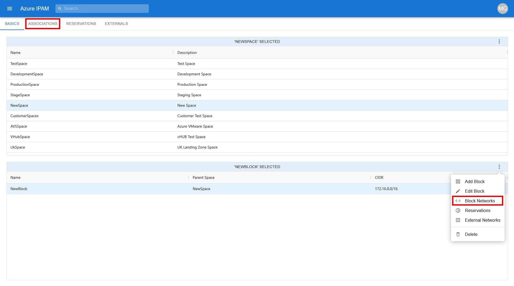

#### The Associations Page

The toolbar at the top of the Associations page has selectors for **Space** and **Block**, a read-only **Network** field showing the Block's CIDR, and a counter showing how many of the available virtual networks are selected. If the Block contains networks that can't be associated, an **Error** count and a **Blocked** count appear alongside the selection counter.

Below the toolbar, a table lists the eligible virtual networks for the selected Block, with these columns:

- **Name:** the name of the virtual network or virtual hub
- **Type:** whether the network is a **vNET** or a **vHUB**
- **Resource Group:** the resource group containing the network
- **Subscription Name:** the subscription containing the network
- **Subscription ID:** the ID of that subscription (hidden by default)
- **Prefixes:** the network's address prefixes

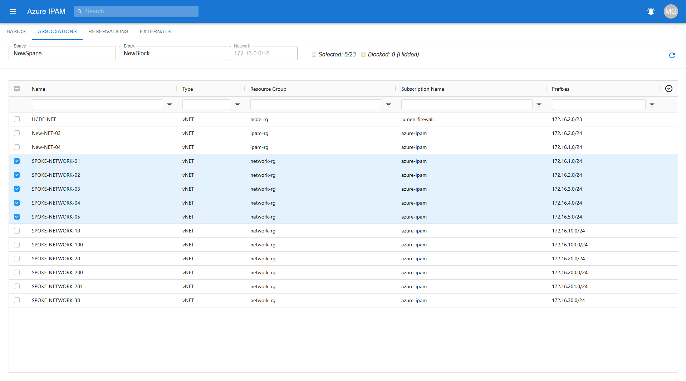

> **NOTE:** Virtual networks already associated with the Block are selected when the page loads.

#### Associating Virtual Networks

To associate virtual networks with a Block, select the check box next to each one. The counter in the toolbar updates as you go. Once your selection differs from the current associations, a **Save** button appears at the right of the toolbar.

Select **Save** to apply your changes. A confirmation message appears once the Block's list of networks is updated. Saving replaces the Block's **entire** list of associated networks with what's selected in the table.

If your selection includes a network that can't be associated, the **Save** button is disabled and its tooltip names the network to clear. Because saving replaces the Block's entire network list, a single ineligible entry would otherwise cause the whole save to be rejected, including any unrelated change made at the same time.

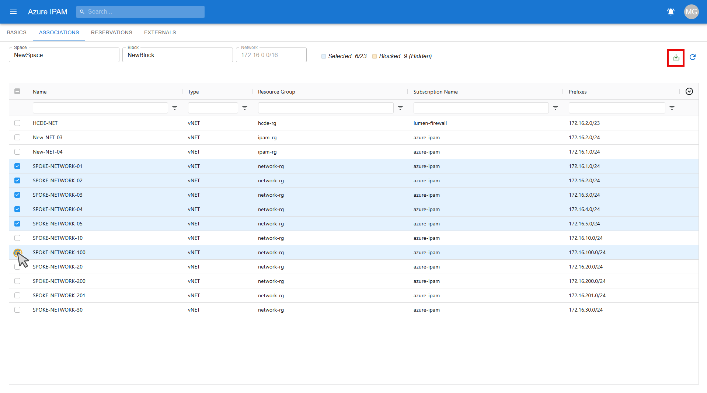

#### Disassociating Virtual Networks

To disassociate a virtual network from a Block, clear its check box and select **Save**. This releases its address prefixes from the Block's utilization, making that space available for new allocations.

#### Blocked Networks

A virtual network can be ineligible for a Block even though its address space falls inside the Block's CIDR range. This happens when one of its prefixes overlaps an **External Network** or an unsettled **CIDR Reservation**, and it disqualifies the entire network rather than the offending prefix alone.

By default, the table hides these networks, so it shows only what can be associated. To view them, open the **Actions** menu and select **Showing Available** to switch to **Showing All**. Select it again to switch back to the available-only view.

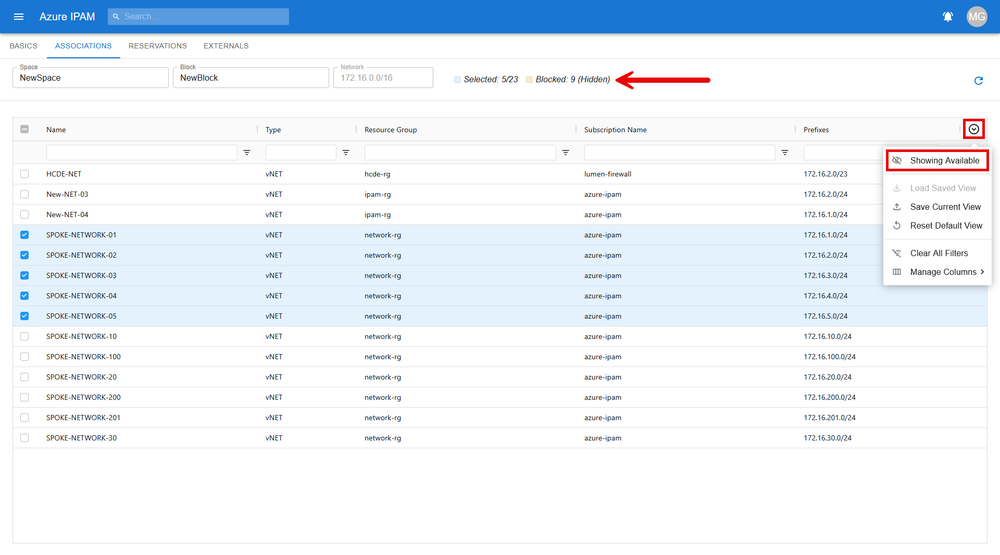

Blocked networks have an amber background. Hover over any cell in the row to see what's in the way, with one line for each overlapping range:

```text
Cannot be associated:
10.1.4.0/24 overlaps External Network 'DataCenterA' (10.1.4.0/24)
10.1.9.0/24 overlaps Reservation 'jXCgmX8Wje7iDSmfRor7KD' (10.1.9.0/24)
```

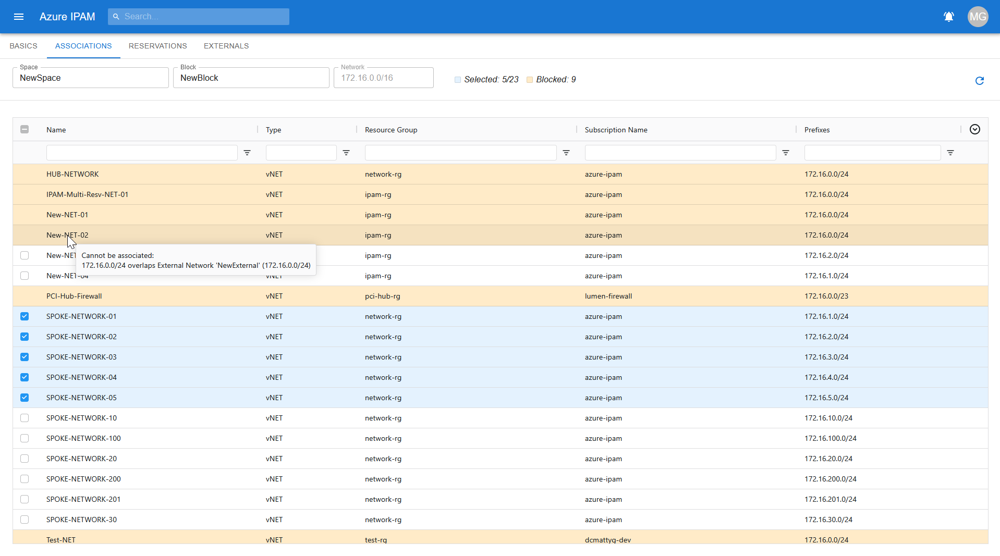

Blocked networks have no check box, since the association would be rejected when saved. The exception is a network that became blocked *after* it was associated, for example because a prefix was added to it in Azure that collides with an External Network. That network stays selected, so you can clear its check box to resolve the conflict.

#### Stale Associations

A virtual network association can become stale for two reasons:

- **Deleted network:** The virtual network or virtual hub has been removed from Azure entirely.
- **Address space mismatch:** The virtual network still exists in Azure, but its address space has been changed so that it no longer falls within the Block's CIDR range.

In both cases the **Prefixes** column shows `ErrNotFound`, since Azure IPAM has no address space to report for the network within this Block.

Azure IPAM's background reconciliation process detects both conditions and marks the affected associations as inactive. Stale associations are shown at the top of the table with a red background. Hover over any cell in the row to see the network either no longer exists or no longer has address space within the Block.

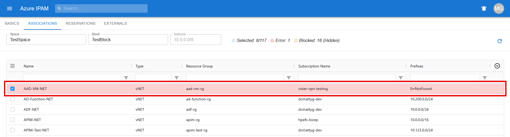

To clean up stale associations, clear their check boxes and select **Save** to remove them from the Block. While a stale entry is still selected, the **Save** button is disabled, since Azure IPAM can't save a list of networks that refers to a resource it can't find.

#### Admin vs. Non-Admin View

Users who aren't administrators can open the Associations page and view the associations for any Block. For them, the table is read-only, with no check boxes or **Save** button. Every network associated with the Block is listed, including networks the user can't see in Azure, because associated networks are part of the address plan. To associate a virtual network they own, they can use a Reservation instead, as described in [Associating an Existing Virtual Network](#associating-an-existing-virtual-network).

### Automatic Association via Reservations

Virtual networks created through the CIDR Reservation workflow are **automatically associated** with their Block, with no manual step. Azure IPAM's background reconciliation detects the tagged network, verifies its address space, and creates the association for you. See the [Reservations](#reservations) section for details on how this works. The same workflow also works for a virtual network that already exists, as described in [Associating an Existing Virtual Network](#associating-an-existing-virtual-network).

### How Associations Affect Utilization

Azure IPAM calculates utilization at three levels: Block, virtual network and subnet. Each one answers a different question about how your address space is used.

#### Block Utilization

Block utilization shows how much of a Block's CIDR range is allocated to virtual networks and External Networks. Only the virtual network prefixes within the Block's CIDR range count. If a virtual network has several address prefixes and only one is within the Block, only that one is included.

```text
Block Utilization = (Associated Virtual Network Prefixes + External Network CIDRs) / Block CIDR Size
```

For example, a Block of `10.0.0.0/16` (65,536 addresses) with two associated virtual networks of `10.0.1.0/24` (256 addresses) and `10.0.2.0/24` (256 addresses) shows a utilization of 512 / 65,536, or about 0.8%.

> **NOTE:** Unsettled Reservations aren't included in the utilization percentage, but they're still taken into account when finding available space for new allocations.

#### Virtual Network Utilization

Virtual network utilization shows how much of a virtual network's address space is divided into subnets. A virtual network with a large address prefix but only a few small subnets shows low utilization, meaning there's room for more subnets.

```text
Virtual Network Utilization = Sum of Subnet Prefix Sizes / Virtual Network Address Space Size
```

#### Subnet Utilization

Subnet utilization shows how many IP addresses in a subnet are in use. It counts the IP configurations, such as network interfaces, private endpoints and other attached resources, plus the 5 addresses Azure reserves in every subnet.

```text
Subnet Utilization = (IP Configurations + 5 Reserved Addresses) / Subnet Prefix Size
```

The 5 reserved addresses account for the network address, default gateway, Azure DNS addresses, and the broadcast address, which Azure reserves in every subnet regardless of size.

### Managing Associations via the API

All Virtual Network Association operations are also available through the Azure IPAM REST API. For the endpoints and example calls, see the [Virtual Network Associations](/api/README.md#virtual-network-associations) section of the API documentation.

### Tips and Best Practices

- **Associate before you plan:** Associate your existing virtual networks with their Blocks as soon as you set up Azure IPAM. This gives you an accurate utilization baseline from the start.
- **Use Reservations for new networks:** Rather than creating a virtual network in Azure and then manually associating it, use the Reservation workflow. The address space is held for you, and the association happens automatically.
- **Clean up stale associations:** Check for stale (red) associations from time to time and remove them. They're networks that no longer exist in Azure, or no longer have address space in the Block.
- **Multi-prefix virtual networks:** Azure virtual networks can have several address prefixes. Because Blocks in a Space can't overlap, each prefix falls under at most one Block in that Space. A virtual network with prefixes in several Blocks can be associated with each of them, and only the prefixes within each Block's CIDR range count toward that Block's utilization.
- **Watch for overlap:** If you can't associate a virtual network, check the Block's Reservations and External Networks for overlaps. An unsettled Reservation holding the same address space blocks the association.

## Reservations

A **Reservation** claims a CIDR range within a **Block** before you create the Azure virtual network. It places a hold on the address space: the reserved CIDR is excluded from other allocations, including new Reservations, virtual network associations and External Networks, until the Reservation is fulfilled or canceled.

Reservations are useful when you need to coordinate network creation across teams or processes. For example, a platform team might reserve a /24 for a project team that isn't ready to deploy their virtual network yet. The reserved space is still available when they need it.

### How Reservations Work

When you create a Reservation, Azure IPAM finds the next available CIDR range of the requested size within the target Block and marks it as reserved. The Reservation gets a unique **Reservation ID** and a status of `wait`. Its status then shows where it is in its lifecycle:

- **Waiting** (`wait`): The Reservation holds the CIDR, and Azure IPAM is watching for a virtual network tagged with its ID.
- **Fulfilled** (`fulfilled`): A virtual network with the Reservation's `X-IPAM-RES-ID` tag was found, its address space matches the reserved CIDR, and it has been associated with the Block.
- **Canceled** (`canceledByUser`): An administrator or the user who created the Reservation canceled it.
- **CIDR mismatch** (`warnCIDRMismatch`): A virtual network with the Reservation's tag was found, but its address space doesn't match the reserved CIDR.
- **CIDR overlap** (`errCIDROverlap`): One of the virtual network's address ranges in this Block overlaps an existing network, External Network or Reservation.

The UI shows each status as an icon in the **Status** column, with a description in its tooltip. The API returns the value in parentheses.

> **TIP:** When you create a Reservation through the API, the response includes a `tag` object containing `X-IPAM-RES-ID`. Apply this tag to your new virtual network, and Azure IPAM detects it, associates the virtual network with the Block and marks the Reservation as fulfilled.

### Reservation Permissions

Both Azure IPAM administrators and regular users can create and manage Reservations. Every user can see all pending Reservations, so everyone knows which address space is already spoken for. However, the ID and description of a Reservation stay with the user who created it, because anyone holding a Reservation's ID could fulfill it by tagging a virtual network of their own. Settled Reservations no longer hold any address space, so non-admin users only see the ones they created. Non-admin users can only cancel Reservations they created. Administrators can view and manage all Reservations across all users.

### Managing Reservations via the UI

Reservations are managed from the **Configure** section of the menu. Select **Configure** → **Reservations** to open the Reservations page.

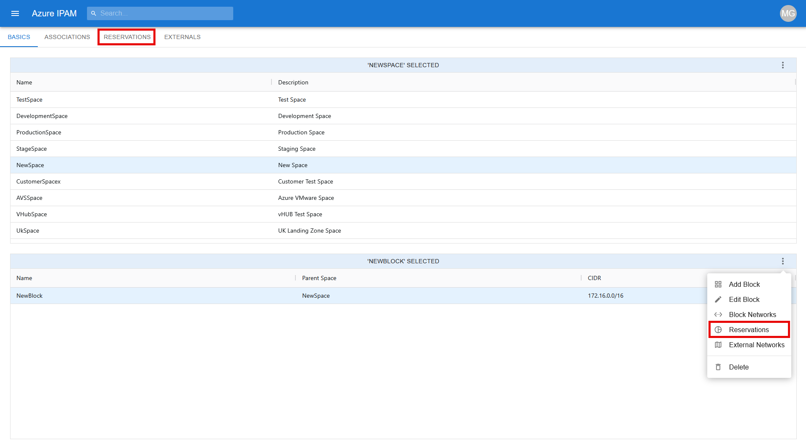

#### The Reservations Page

The Reservations page shows a table of the Reservations in a Block.

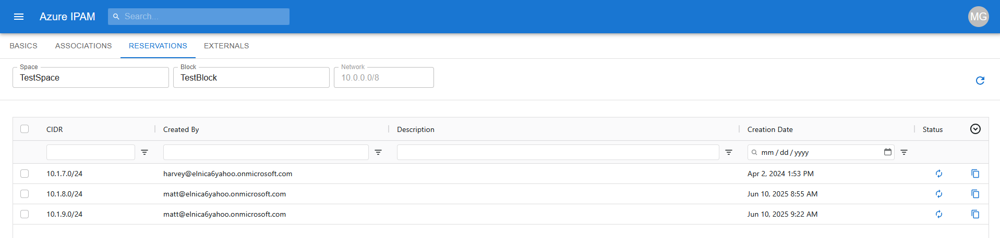

Select a **Space** and a **Block** to view or manage their Reservations.

> **TIP:** You can also open Reservations from the **Configure** → **Basics** page. Select a Block, open its **Actions** menu and choose **Reservations**. The Reservations page opens with the Space and Block already selected.

#### Viewing Reservations

The table shows the following information for each Reservation:

- **CIDR:** the reserved CIDR range
- **Created By:** the user or service principal that created the Reservation
- **Description:** an optional description added when the Reservation was created
- **Creation Date:** when the Reservation was created
- **Settled Date:** when the Reservation was fulfilled or canceled (hidden by default)
- **Settled By:** who or what settled the Reservation (hidden by default)
- **Status:** an icon showing the Reservation's status

For a Reservation created by another user, the description is left blank unless you're an administrator. See [Reservation Permissions](#reservation-permissions).

#### Filtering Active vs. Settled Reservations

By default, the table shows only active (unsettled) Reservations. To view all Reservations, including those that have been fulfilled or canceled, open the **Actions** menu and select **Showing Active** to switch to **Showing All**. Select it again to switch back to the active-only view.

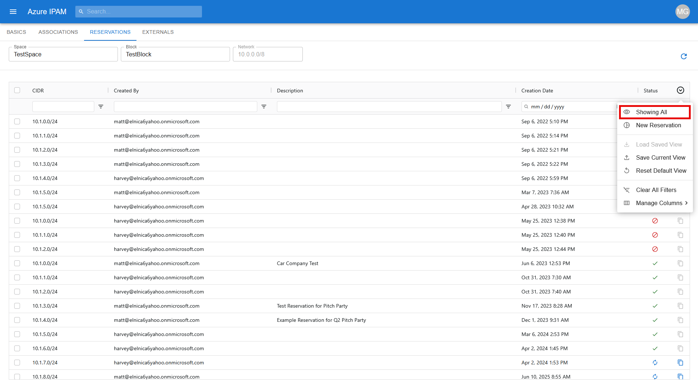

#### Creating a Reservation

To create a new Reservation, open the **Actions** menu and select **New Reservation**. This option is available once you've selected a **Space** and **Block**.

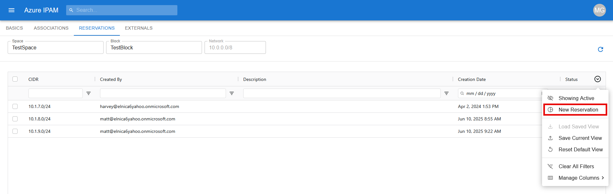

The **Create Reservation** dialog gives you two ways to specify the CIDR range. Use the **Allocation Mode** toggle to switch between them:

**Auto (default):**

Azure IPAM finds the next available CIDR range of the requested size. Choose a **Mask** from the list, which only offers masks that fit the Block's CIDR range. You can also turn on two search options:

- **Reverse Search:** When turned on, Azure IPAM allocates from the *end* of the Block rather than the beginning. This is useful when you want to keep the beginning of the Block available for larger allocations.
- **Smallest CIDR:** When turned on, Azure IPAM uses the *smallest available* contiguous block that fits the requested size, rather than the first one it finds. This helps avoid fragmenting large open ranges.

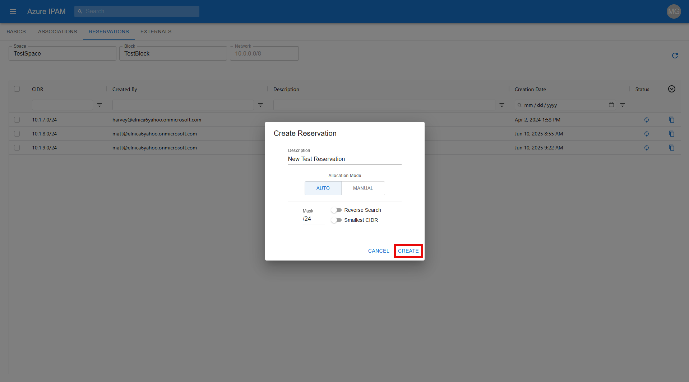

**Manual:**

Enter a CIDR range in standard notation, using its network address, for example `10.1.5.0/24` rather than `10.1.5.1/24`. It must be within the Block's range and can't overlap virtual networks already associated with the Block, unsettled Reservations, or External Networks.

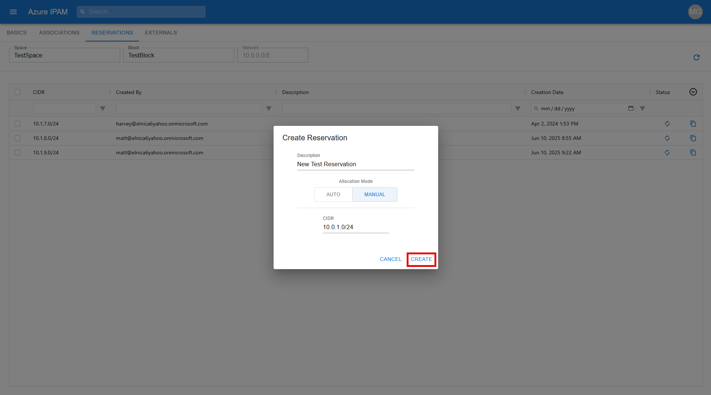

Optionally, you can add a **Description** to help identify the purpose of the Reservation.

Select **Create** to create the Reservation. A confirmation message appears, and the new Reservation is added to the table.

#### Copying a Reservation ID

To copy a Reservation's ID to your clipboard, select the copy button in its row. The button's tooltip reads *Click to Copy* and shows the ID. You need this ID to tag your virtual network, so Azure IPAM can associate it with the Block once it's created.

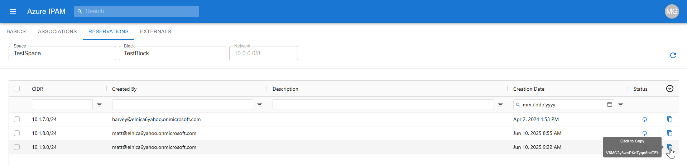

> **TIP:** The copy button is only available for unsettled Reservations, since a fulfilled or canceled Reservation's ID has no further use. It's also unavailable for Reservations created by other users, unless you're an administrator.

#### Canceling Reservations

To cancel one or more Reservations, select their check boxes, then select **Remove** in the upper-right corner of the page. **Remove** appears once you've selected a Reservation. Unless you're an administrator, only the Reservations you created can be selected.

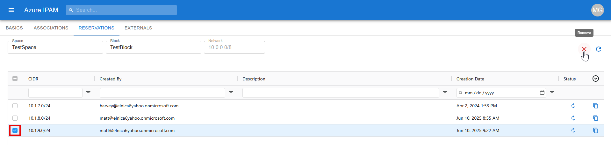

Canceled Reservations aren't deleted. Their status changes to canceled (`canceledByUser`), and they stay visible when you show all Reservations, as an audit trail.

### Using the Reservation Tag

The `X-IPAM-RES-ID` tag is what lets you automate the Reservation workflow. When you create a Reservation through the API, Azure IPAM returns the tag in the response. Apply this tag to the Azure virtual network you create with the reserved CIDR:

```text
Tag Key:   X-IPAM-RES-ID
Tag Value: <reservation-id>
```

Azure IPAM's background reconciliation process periodically scans for virtual networks with this tag. When it finds a match, it:

1. Verifies the virtual network's address space against the reserved CIDR
2. Associates the virtual network with the Block
3. Marks the Reservation as **Fulfilled**

Because it's based on a tag, you can create the Reservation in Azure IPAM and then create the virtual network any way you like: the Azure portal, Azure CLI, Azure PowerShell, Terraform, Bicep or any other infrastructure as code tool.

### Multiple Reservations on a Single Virtual Network

Azure virtual networks support several address spaces (prefixes). If your virtual network has more than one address space, each address space that falls within a Block must have its own Reservation. The `X-IPAM-RES-ID` tag supports this by accepting a **comma-separated list** of Reservation IDs in a single tag value:

```text
Tag Key:   X-IPAM-RES-ID
Tag Value: <reservation-id-1>,<reservation-id-2>,<reservation-id-3>
```

The reconciliation engine strips all whitespace from the tag value before parsing, so spaces around the commas are harmless, but the canonical format is no spaces:

```text
Tag Key:   X-IPAM-RES-ID
Tag Value: ABNsJjXXyTRDTRCdJEJThu,XKp7mQeNvLCsWbYdFgHiRZ
```

Each Reservation ID in the list is evaluated independently. For every ID found, the engine:

1. Looks up the corresponding Reservation
2. Verifies that the virtual network has an address space matching the Reservation's reserved CIDR
3. Associates the virtual network with the Block (if not already associated)
4. Marks that individual Reservation as **Fulfilled**

Because each Reservation ID is processed separately, a virtual network with two address spaces can carry two Reservation IDs in a single tag and both Reservations are fulfilled in the same reconciliation cycle.

> **NOTE:** The IDs don't need to belong to the same Block. A virtual network with two address spaces can have one associated with one Block and the other with a different Block, or even a different Space, each with its own Reservation ID in the list. If a reserved CIDR doesn't match the virtual network's address space, only that Reservation gets the `warnCIDRMismatch` status.

### Associating an Existing Virtual Network

Reservations can also bring a virtual network that already exists into Azure IPAM. This is how users who aren't administrators associate a network they own with a Block:

1. Create a Reservation for exactly the virtual network's address space, using the **Manual** allocation mode (or the `cidr` field in the API).
2. Add the `X-IPAM-RES-ID` tag to the virtual network, with the Reservation ID as its value.

Azure IPAM's background reconciliation then fulfills the Reservation and associates the virtual network with the Block, just as it would for a newly created network.

A few things to keep in mind:

- The Reservation must match the virtual network's address space exactly. A Reservation for a larger or smaller range gets the `warnCIDRMismatch` status.
- A virtual network with more than one address space within a Block needs a Reservation for each one, as described in [Multiple Reservations on a Single Virtual Network](#multiple-reservations-on-a-single-virtual-network).
- The Reservation can only be created if its range doesn't overlap a virtual network already associated with the Block, an unsettled Reservation, or an External Network.
- The Reservation is fulfilled only if none of the virtual network's address ranges within the Block overlap one of those either. Otherwise it gets the `errCIDROverlap` status.

### Managing Reservations via the API

All Reservation operations are also available through the Azure IPAM REST API. For the endpoints and example calls, see the [Reservations](/api/README.md#reservations) section of the API documentation.

### Tips and Best Practices

- **Use descriptions:** Add a description to every Reservation so it's clear what it's for, especially when several teams share Azure IPAM.
- **Copy the ID right away:** After creating a Reservation, copy its ID and keep it somewhere you can find it. You need it to tag your virtual network.
- **Match your CIDR exactly:** Make sure the virtual network's address space matches the reserved CIDR exactly. A mismatch gets a warning status.
- **Check Reservation status:** Check your Reservations from time to time. A Reservation that stays waiting may mean the virtual network was created without the tag.
- **Use Reverse Search for large Blocks:** To avoid fragmenting the start of a large Block, turn on **Reverse Search** to allocate from the end.
- **Use Smallest CIDR to reduce fragmentation:** Turn on **Smallest CIDR** to keep larger contiguous ranges free for later.
- **Use one Reservation per address space:** If your virtual network will have more than one address space, create a Reservation for each and set the `X-IPAM-RES-ID` tag to a comma-separated list of their IDs, for example `id1,id2`.

## External Networks

Azure IPAM is mainly designed to discover and manage IP address space in Azure. Many organizations also need to track address space used **outside of Azure**, such as on-premises datacenters, co-location facilities, other cloud providers or any other part of the enterprise addressing plan that Azure doesn't manage.

**External Networks** let you:

- **Map non-Azure CIDR ranges** in your Blocks, to show that the address space is allocated elsewhere
- **Define subnets** in those External Networks, for the network segments where endpoints live
- **Track individual endpoints** in those subnets, with their names, descriptions and IP addresses
- **Prevent address conflicts** by accounting for externally managed address space when you plan Azure networks or create Reservations

> **NOTE:** Only Azure IPAM administrators can create, change or delete External Networks and their subnets and endpoints. Every user can view them, including in the **Manage External Subnet Endpoints** dialog.

### How External Networks Fit Into the Azure IPAM Hierarchy

External Networks sit within the **Space** → **Block** hierarchy. A **Block** represents a CIDR range and can contain Azure virtual networks, Reservations *and* External Networks. The full hierarchy looks like this:

```text
Space
└── Block (e.g. 10.0.0.0/16)
    ├── Azure Virtual Networks
    ├── CIDR Reservations
    └── External Networks (e.g. 10.0.100.0/24)
        └── External Subnets (e.g. 10.0.100.0/26)
            └── External Endpoints (e.g. 10.0.100.5)
```

When Azure IPAM calculates the available address space in a Block, for example to create a Reservation or to calculate utilization, it includes External Networks alongside Azure virtual networks and existing Reservations. This means address space allocated outside Azure is never assigned twice.

> **IMPORTANT:** Creating an External Network also withdraws the address space it covers from Azure association. Any Azure virtual network with a prefix overlapping the External Network's CIDR becomes ineligible for that Block, in full, even where its other prefixes are free. Use External Networks only for address space that's managed outside of Azure.

### Managing External Networks via the UI

External Networks are managed from the **Configure** section of the menu. Select **Configure** → **Externals** to open the External Networks page.

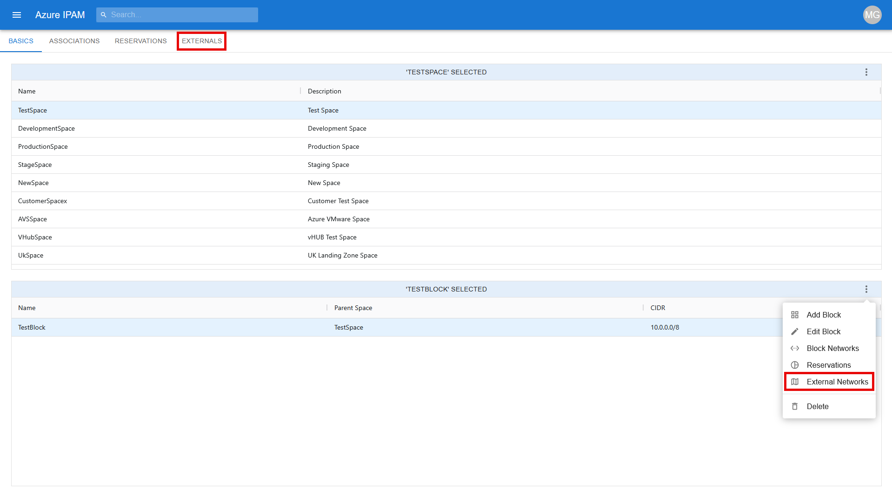

#### The Externals Configuration Page

The upper table on the Externals page lists the **External Networks** in the selected Block, and the lower table lists the **Subnets** of the selected External Network.

Select a **Space** and a **Block** at the top of the page to view or manage their External Networks.

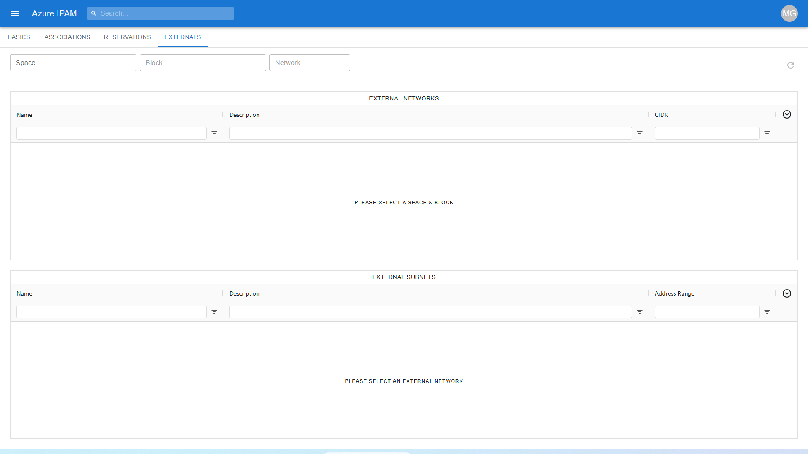

#### Adding an External Network

To add an External Network, select the **Space** and **Block** at the top of the page, then open the **Actions** menu on the External Networks grid and select **Add Network**.

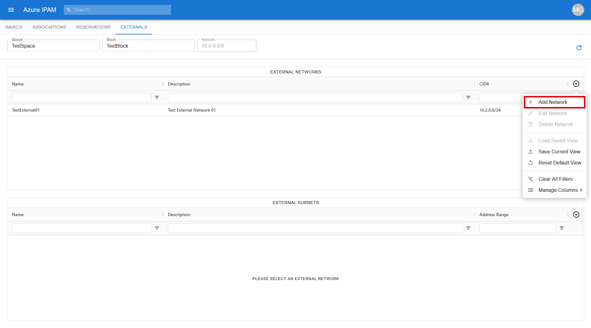

A dialog opens for the new External Network:

- **Name:** a unique name for the External Network, up to 64 characters of letters, numbers, underscores, hyphens and periods
- **Description:** a description of the External Network, up to 128 characters of letters, numbers, spaces, underscores, hyphens, slashes and periods
- **CIDR:** use the **Allocation Mode** toggle to choose how to set the range:
  - **Auto:** choose a **Size**, and Azure IPAM assigns the next available CIDR range in the Block
  - **Manual:** enter an exact CIDR range, which must be within the Block and can't overlap existing virtual networks, Reservations or other External Networks

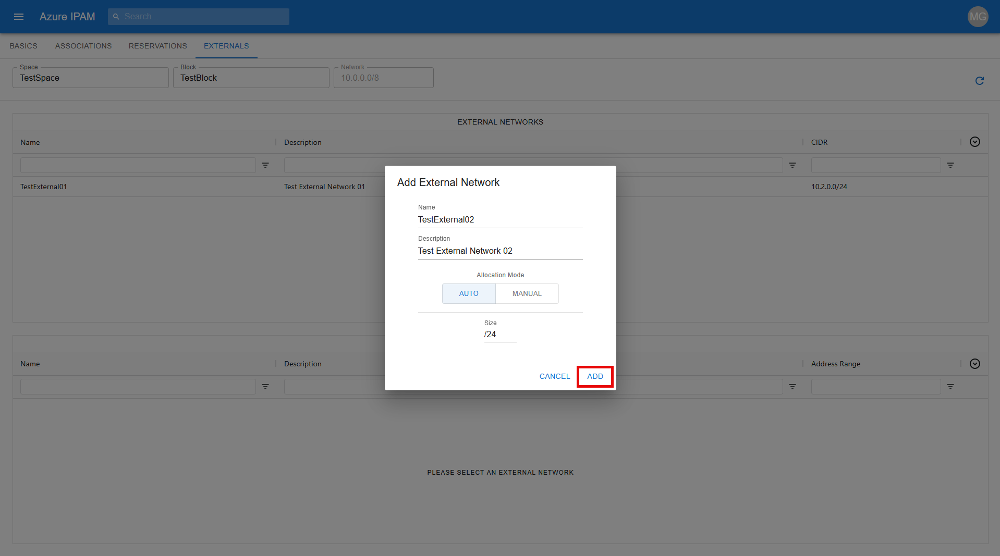

Once it's created, the External Network appears in the table, and its CIDR range counts toward the Block's utilization.

#### Editing an External Network

To edit an External Network, select it in the table, then open the **Actions** menu and select **Edit Network**.

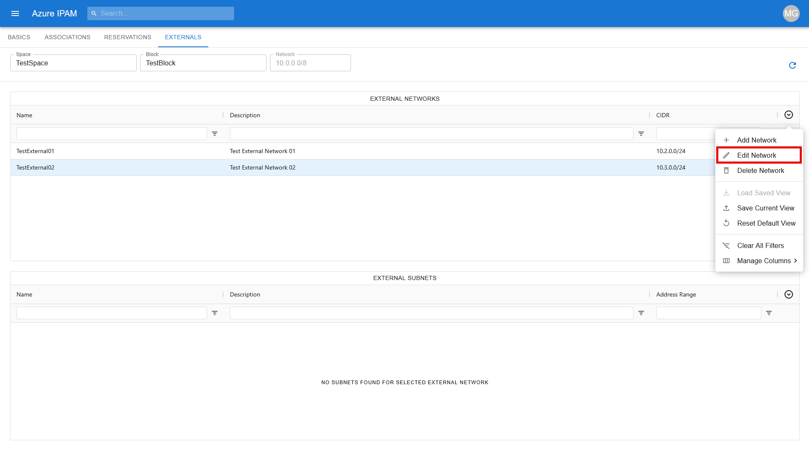

You can update the **Name**, **Description**, and **CIDR** of the External Network. The same rules apply as when you create one: the new CIDR range must stay within the Block and can't overlap virtual networks, other External Networks or unsettled Reservations. If the External Network has subnets, the new range must also contain all of them.

#### Deleting an External Network

To delete an External Network, select it in the table, open the **Actions** menu, and select **Delete Network**.

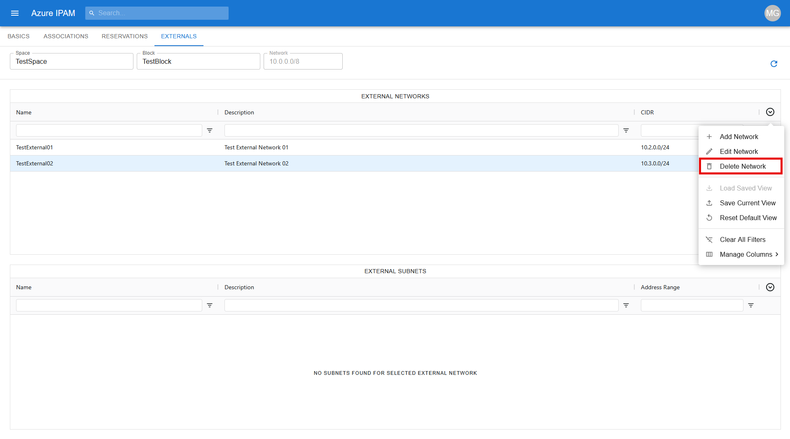

You're asked to confirm the deletion. If the External Network has subnets, enable **Force Delete** and confirm a second time.

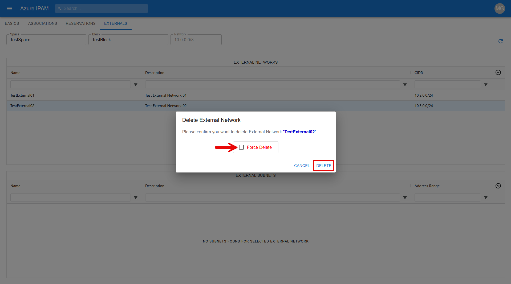

### Managing External Subnets

External Subnets represent the network segments in an External Network, such as physical subnets in an on-premises datacenter, VLANs or any other division of the network.

#### Viewing External Subnets

When you select an External Network in the upper table, the lower table lists its subnets, with their **Name**, **Description** and **Address Range**.

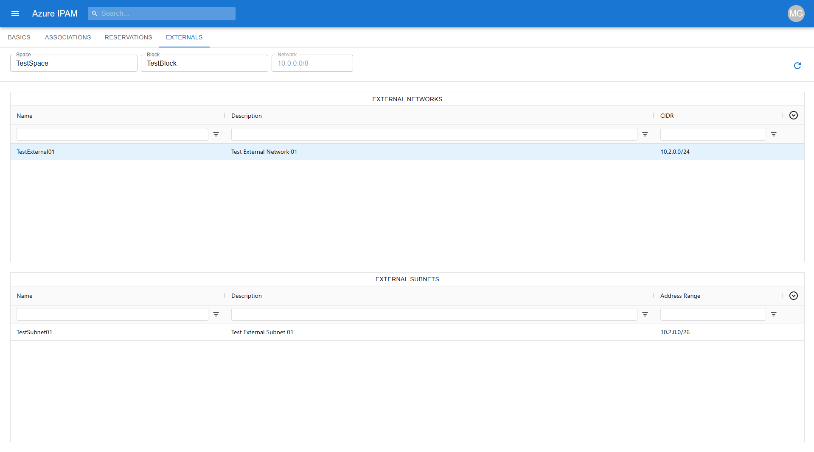

#### Adding an External Subnet

With an External Network selected, open the **Actions** menu on the Subnets table and select **Add Subnet**.

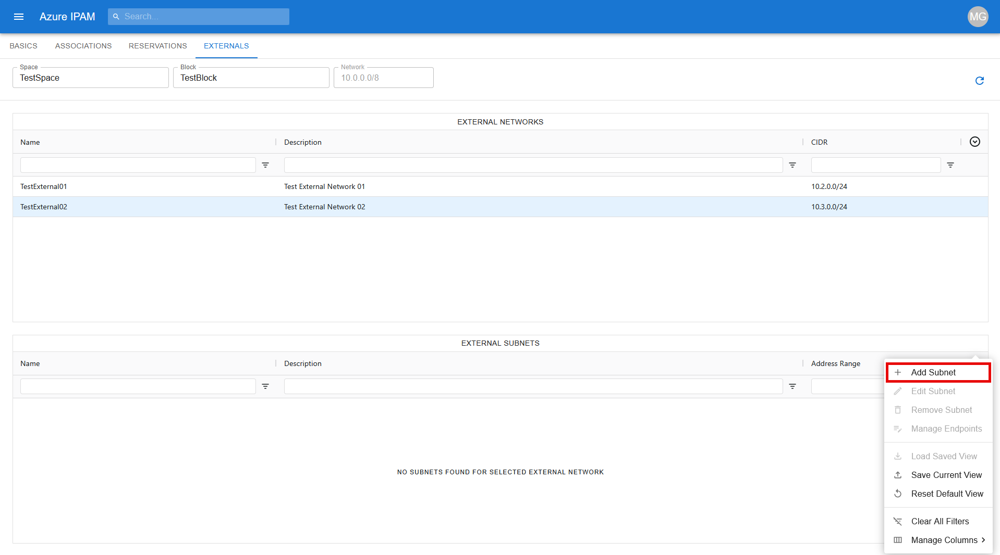

Enter the subnet's details:

- **Name:** a name that's unique within the External Network, up to 64 characters
- **Description:** a description of the subnet, up to 128 characters
- **CIDR:** use the **Allocation Mode** toggle to choose **Auto**, for the next available range, or **Manual**, for a range that must be within the External Network and can't overlap its other subnets

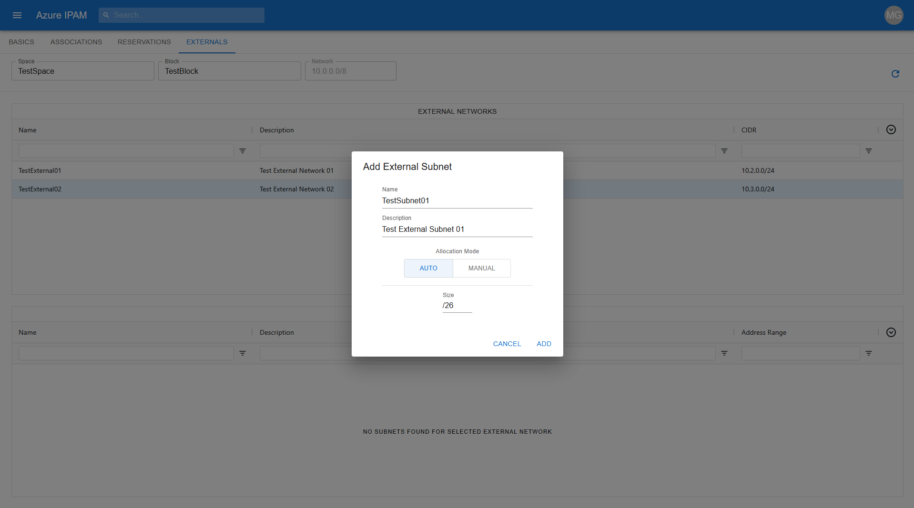

#### Editing an External Subnet

Select a Subnet in the lower table, open the **Actions** menu, and select **Edit Subnet** to change its name, description or CIDR range. The new range must stay within the External Network, can't overlap its other subnets and must contain all of the subnet's endpoints.

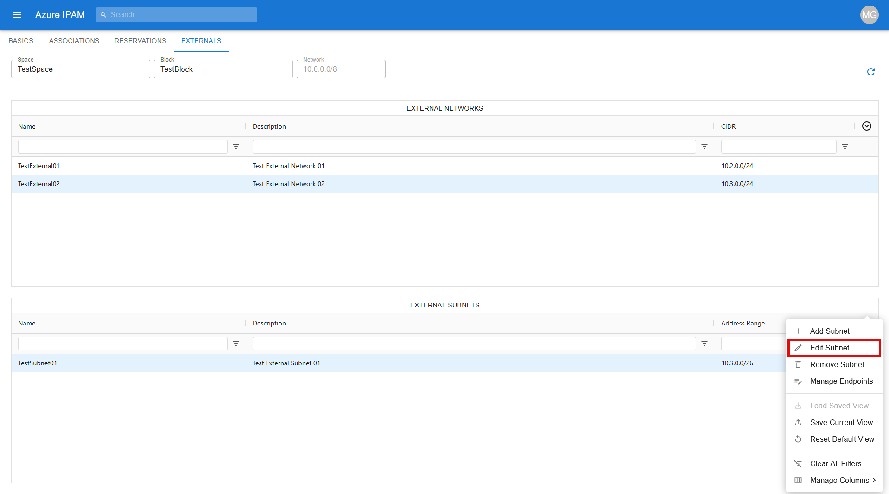

#### Deleting an External Subnet

Select a subnet, open the **Actions** menu and choose **Remove Subnet**.

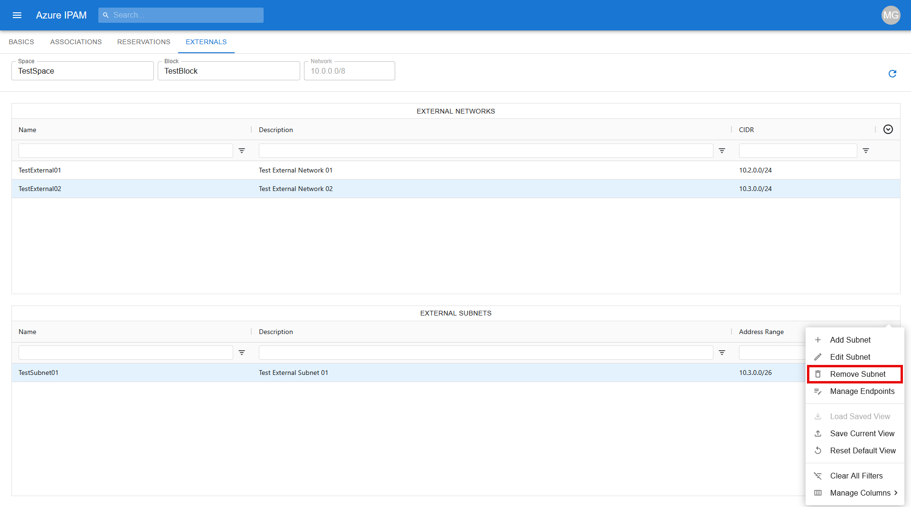

You're asked to confirm the deletion. If the subnet has endpoints, enable **Force Delete** and confirm a second time.

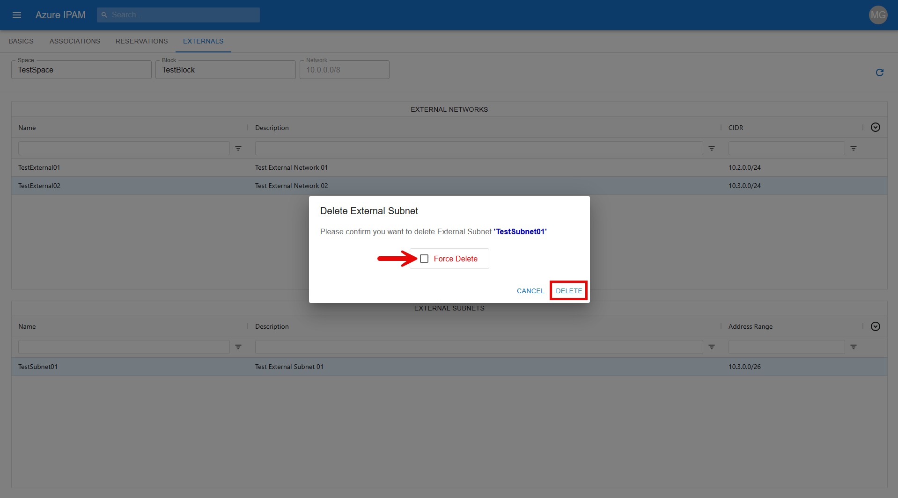

### Managing External Endpoints

External Endpoints represent individual hosts or devices in an External Subnet, so you can track machines, appliances or services and their IP addresses.

#### Opening the Manage Endpoints View

Select a Subnet in the lower table, then open the **Actions** menu and select **Manage Endpoints**. The **Manage External Subnet Endpoints** dialog opens, where you manage all of the subnet's endpoints.

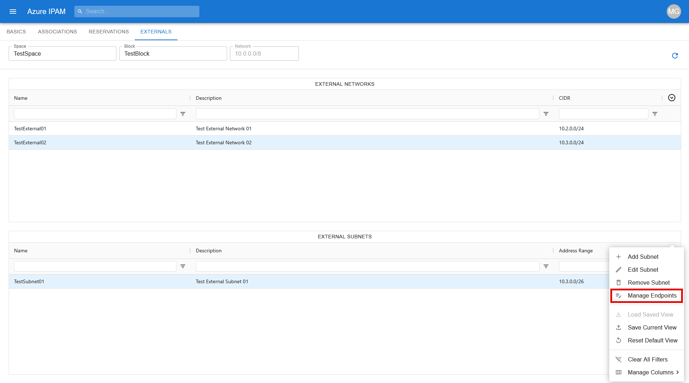

#### The Manage Endpoints Dialog

The dialog has two parts:

- **A form** at the top, with **Name**, **Description** and **IP Address** fields and a button to add or update an endpoint. Only administrators see the form.
- **A table** below it, listing the subnet's endpoints with their names, descriptions and IP addresses.

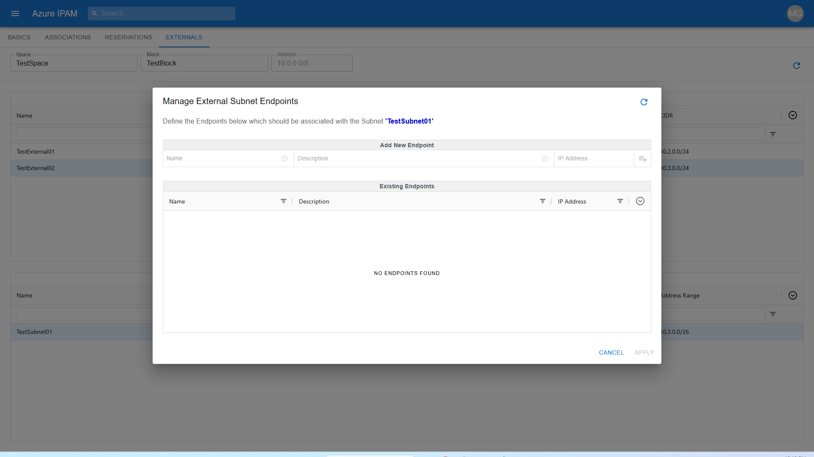

#### Adding an Endpoint

Fill in the endpoint's details in the form at the top of the dialog:

- **Name:** a unique name for the endpoint, up to 64 characters
- **Description:** a description of the endpoint, up to 128 characters
- **IP Address:** an available IP address from the list, or **\<auto\>** for Azure IPAM to assign the next available address in the subnet

Select **Add Endpoint** at the end of the form to stage the endpoint. You can add multiple endpoints before applying your changes.


You can review all staged additions before selecting **Apply** to commit them.


> **TIP:** The **IP Address** list only shows the addresses in the subnet that aren't assigned yet.

#### Editing an Endpoint

Select an endpoint in the table to load it into the form. Change the fields you need, then select **Update Endpoint** to stage the change. A new IP address must be within the subnet and can't be used by another endpoint in it.


You can review all staged endpoint updates before selecting **Apply** to commit them.


#### Deleting Endpoints

To delete an endpoint, select its row in the table, then select **Delete** on that row to stage the deletion.


You can review all staged endpoint deletions before selecting **Apply** to commit them.


#### Saving Endpoint Changes

Endpoint additions, updates and deletions are staged in the dialog until you apply them. This lets you make several changes at once, for example adding some endpoints, updating others and deleting more. When you're done, select **Apply** to save them all. This replaces the subnet's whole list of endpoints in one operation.

### Managing External Networks via the API

External Networks, and their subnets and endpoints, can also be managed through the Azure IPAM REST API. For the endpoints and example calls, see the [External Networks](/api/README.md#external-networks) section of the API documentation.

To keep External Networks up to date automatically, see [Automation](/automation/README.md).

### Tips and Best Practices

- **Use descriptive names:** Name External Networks and subnets so their location is clear, for example `DC1-Floor2-ServerVLAN` or `AWS-US-East-1-VPC`.
- **Keep them current:** External Networks are only useful if they're accurate. Consider synchronizing them automatically with your existing network management tools.
- **Use automatic assignment:** When adding endpoints, use automatic IP assignment (`ip: null` in the API, or `<auto>` in the UI) to let Azure IPAM pick the next available address.
- **Add them before you allocate:** Add External Networks *before* creating Azure virtual networks in the same Block, so Azure IPAM can prevent overlaps with them.
- **Use Force Delete carefully:** **Force Delete** on External Networks and subnets removes everything in them. Take care, especially in production.

## Notifications

Azure IPAM keeps an eye on your deployment and lets you know when something needs attention, such as a newer version being available or a problem with Azure IPAM's own access to Azure. Notifications are under **Notifications**, the bell button in the upper-right corner of every page.


The badge on the button shows how many notifications you haven't read yet, and its color reflects the most severe one: <span style="color: red">**red**</span> for critical, <span style="color: darkorange">**orange**</span> for a warning and <span style="color: dodgerblue">**blue**</span> for information. When something critical needs attention, the bell also pulses briefly.

Select **Notifications** to open the list of notifications, with the most severe at the top.


From the list you can:

- **Open a notification:** Select it to see the full details and anything you can do about it.
- **Dismiss a notification:** Select **Dismiss** next to it to hide it. Some notifications can't be dismissed, because they describe a problem that stops Azure IPAM from working properly.
- **Mark all as read:** Select **Mark all as read** to clear the unread badge without opening each one.
- **Refresh:** Select **Refresh** to have Azure IPAM check everything again right away, rather than wait for its next regular check.

> **NOTE:** Dismissing a notification only hides it in your current browser session. It returns when you select **Refresh** or reload the page, as long as it still applies.

### Acting on a Notification

Opening a notification shows its full message, along with whatever actions it offers. Not every notification offers every kind of action:

- **Links:** Open documentation that explains the notification and what to do about it. These open in a new tab.
- **Fix it for you:** Some notifications can be fixed directly from Azure IPAM, with a button such as **Switch**. Only administrators can use these. For everyone else the button is disabled, so let your administrator know.
- **Take you there:** Some notifications offer a button that opens the relevant page in Azure IPAM.


Some fixes restart Azure IPAM. When they do, a progress screen is shown while it restarts, and the page reloads once Azure IPAM is back. Once a problem is fixed, its notification disappears the next time Azure IPAM checks.

Some notifications are meant only for administrators, and are shown only to them.

### Notifications via the API

Notifications are also available through the Azure IPAM REST API, for automation and monitoring. For details and example calls, see the [Notifications](/api/README.md#notifications) section of the API documentation.
