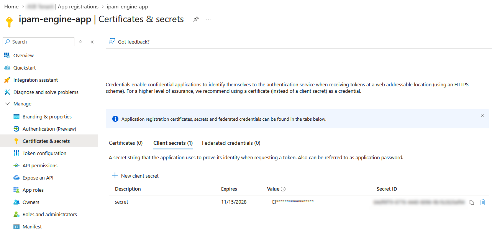
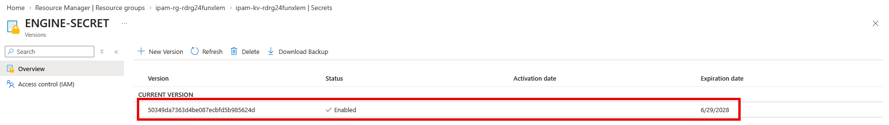
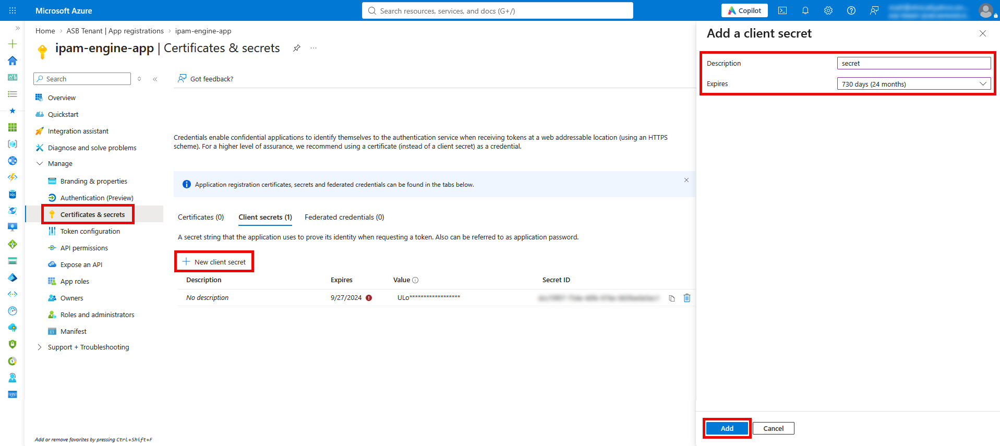
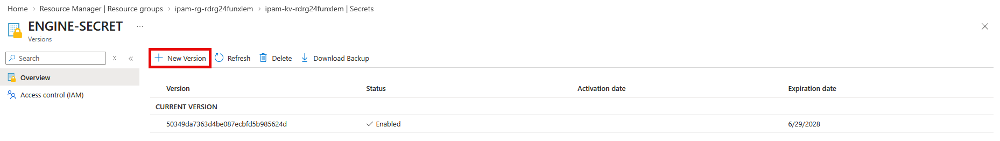
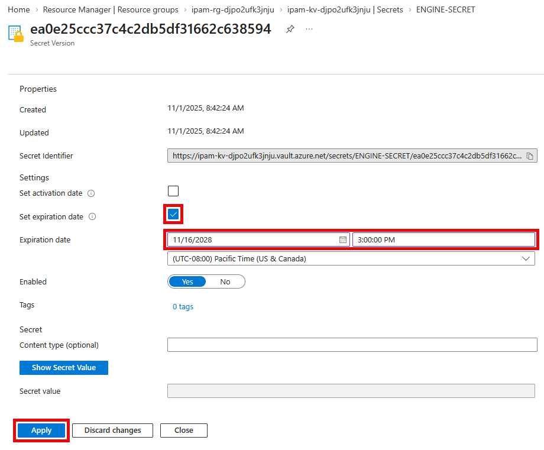
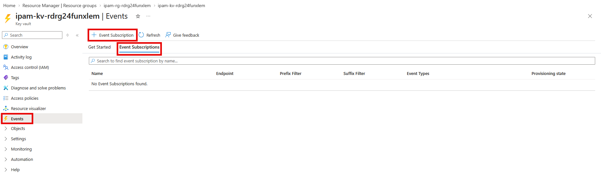
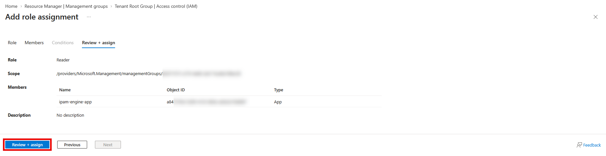

# Maintenance

## Overview

Azure IPAM needs very little ongoing care, but a few tasks keep a deployment healthy over time. This guide covers keeping the Engine app registration's client secret current and making sure the Engine can still read your Azure environment.

Unlike an [update](/update/README.md), none of these tasks change the version of Azure IPAM you are running.

## Engine Client Secret

The *Engine* app registration authenticates to Azure with a client secret. Azure IPAM uses it both to read your Azure environment on its own behalf and to read it on behalf of signed-in users, so every request that touches Azure depends on it.

The deployment script stores the secret in Key Vault as `ENGINE-SECRET`, and the App Service or Function App reads it through a [Key Vault reference](https://learn.microsoft.com/azure/app-service/app-service-key-vault-references) in the `ENGINE_APP_SECRET` app setting.

When the deployment script creates the secret, it is valid for **two years**. If the secret has since been rotated, or the app registration was created some other way, its lifetime may be different, so [check when it expires](#check-when-the-secret-expires) rather than relying on when Azure IPAM was deployed.

Once the secret expires, Azure IPAM can no longer reach Azure (see [AADSTS7000222 (Engine Secret Expired)](/troubleshooting/README.md#aadsts7000222-engine-secret-expired)). Rotate it before that happens.

### Check When the Secret Expires

An app registration can have more than one client secret. Microsoft Entra ID shows the first three characters of each one, which is how you can tell which secret Azure IPAM is using: it is the one whose first three characters match the value of `ENGINE-SECRET` in Key Vault.

Reading a secret value from Key Vault requires a Key Vault data-plane role. Azure IPAM's Key Vault uses Azure RBAC, and by default only the Azure IPAM managed identity has data-plane access, so you may need to assign yourself the [Key Vault Secrets Officer](https://learn.microsoft.com/azure/role-based-access-control/built-in-roles#key-vault-secrets-officer) role first. Remove it again when you are done.

#### Azure Portal

1. Navigate to **Microsoft Entra ID** → **App registrations** → **All applications** → your Azure IPAM **Engine** application (`ipam-engine-app` by default)
2. Select **Certificates & secrets** → **Client secrets**
3. Note the **Expires** date and the first three characters shown under **Value** for each secret

   <!-- SCREENSHOT PLACEHOLDER: Engine app registration, Certificates & secrets, showing client secrets with their Expires dates and masked values -->
   

4. Navigate to your Azure IPAM **Key Vault** → **Objects** → **Secrets** → **ENGINE-SECRET**
5. Select the current version and select **Show Secret Value**, then compare its first three characters against the secrets from step 3

   <!-- SCREENSHOT PLACEHOLDER: ENGINE-SECRET current version in Key Vault with Show Secret Value selected -->
   

#### Azure PowerShell

```powershell
$engineAppId = "<engine-app-id>"
$vaultName = "<your-ipam-kv>"

# The secret Azure IPAM is currently using
$hint = (Get-AzKeyVaultSecret -VaultName $vaultName -Name "ENGINE-SECRET" -AsPlainText).Substring(0, 3)

# All client secrets on the Engine app registration
Get-AzADAppCredential -ApplicationId $engineAppId |
  Select-Object Hint, KeyId, StartDateTime, EndDateTime, @{ Name = "InUse"; Expression = { $_.Hint -eq $hint } }
```

#### Azure CLI

```bash
appId="<engine-app-id>"
vaultName="<your-ipam-kv>"

# The secret Azure IPAM is currently using
hint=$(az keyvault secret show --vault-name "$vaultName" --name "ENGINE-SECRET" --query value --output tsv | cut -c1-3)

# All client secrets on the Engine app registration
az ad app credential list --id "$appId" \
  --query "[].{hint: hint, keyId: keyId, start: startDateTime, end: endDateTime, inUse: hint=='$hint'}" \
  --output table
```

### Rotate the Secret

Rotating the secret means creating a new one alongside the existing one, switching Azure IPAM over to it, confirming it works, and only then removing the old one. Both secrets stay valid during the switch, so Azure IPAM keeps working throughout.

You will need:

- One of the following in Microsoft Entra ID, to manage the Engine app registration's secrets:
  - Owner of the Engine app registration
  - [Application Administrator](https://learn.microsoft.com/entra/identity/role-based-access-control/permissions-reference#application-administrator)
  - [Cloud Application Administrator](https://learn.microsoft.com/entra/identity/role-based-access-control/permissions-reference#cloud-application-administrator)
- [Key Vault Secrets Officer](https://learn.microsoft.com/azure/role-based-access-control/built-in-roles#key-vault-secrets-officer) on the Azure IPAM Key Vault, to store the new secret. Assign it to yourself for the rotation and remove it afterwards
- [Website Contributor](https://learn.microsoft.com/azure/role-based-access-control/built-in-roles#website-contributor) or [Contributor](https://learn.microsoft.com/azure/role-based-access-control/built-in-roles#contributor) on the App Service or Function App, to restart it

The steps are:

1. Create a new client secret on the Engine app registration
2. Store it in Key Vault as a new version of `ENGINE-SECRET`, with its expiration date
3. Restart the App Service or Function App so it loads the new value
4. Confirm that Azure IPAM can reach Azure
5. Remove the old client secret
6. Remove the Key Vault Secrets Officer role assignment you granted yourself

> **IMPORTANT:** A client secret's value is only shown once, when it is created. Copy the **Value**, not the **Secret ID**. Storing the Secret ID is a common mistake, and it causes [AADSTS7000215 (Engine Secret Invalid)](/troubleshooting/README.md#aadsts7000215-engine-secret-invalid).

#### Azure Portal

1. Navigate to **Microsoft Entra ID** → **App registrations** → **All applications** → your Azure IPAM **Engine** application
2. Select **Certificates & secrets** → **Client secrets** → **New client secret**
3. Enter a description, choose an expiration period that your organization's policies allow, then select **Add**
4. Copy the new secret's **Value** and note its **Expires** date

   <!-- SCREENSHOT PLACEHOLDER: Add a client secret panel with a description and expiration period selected -->
   

5. Navigate to your Azure IPAM **Key Vault** → **Objects** → **Secrets** → **ENGINE-SECRET** → **New Version**
6. Paste the value into **Secret value**, select **Set expiration date**, and enter the **Expires** date from step 4
7. Select **Create**

   <!-- SCREENSHOT PLACEHOLDER: Create a new version of ENGINE-SECRET with the secret value and expiration date set -->
   

8. Navigate to your Azure IPAM **App Service** or **Function App** → **Overview** and select **Restart**
9. If the `staging` [deployment slot](/update/README.md#staging-slots) is running, restart it too from **Deployment slots** → **staging** → **Restart**
10. Confirm that Azure IPAM can reach Azure (see [Confirm the Rotation](#confirm-the-rotation))
11. Return to the Engine app registration's **Certificates & secrets** → **Client secrets**, and select the delete icon next to the **old** secret
12. Remove the Key Vault Secrets Officer role assignment you granted yourself

#### Azure PowerShell

```powershell
$engineAppId = "<engine-app-id>"
$vaultName = "<your-ipam-kv>"

# Create a new secret alongside the existing one, with a lifetime your organization's policies allow
$newSecret = New-AzADAppCredential -ApplicationId $engineAppId -EndDate (Get-Date).AddYears(2)

# Store it in Key Vault with the same expiration date
Set-AzKeyVaultSecret `
  -VaultName $vaultName `
  -Name "ENGINE-SECRET" `
  -SecretValue (ConvertTo-SecureString $newSecret.SecretText -AsPlainText -Force) `
  -Expires $newSecret.EndDateTime | Out-Null

# Note the new secret's details, without its value
$newSecret | Select-Object Hint, KeyId, EndDateTime

Remove-Variable newSecret
```

Restart Azure IPAM so it loads the new value:

```powershell
# App Service
Restart-AzWebApp -ResourceGroupName "<your-ipam-rg>" -Name "<your-ipam-app>"

# App Service staging slot (only if it is running)
Restart-AzWebAppSlot -ResourceGroupName "<your-ipam-rg>" -Name "<your-ipam-app>" -Slot "staging"

# Function App
Restart-AzFunctionApp -ResourceGroupName "<your-ipam-rg>" -Name "<your-ipam-function>" -Force
```

Once you have [confirmed the rotation](#confirm-the-rotation), remove the old secret:

```powershell
Get-AzADAppCredential -ApplicationId $engineAppId | Select-Object Hint, KeyId, StartDateTime, EndDateTime

Remove-AzADAppCredential -ApplicationId $engineAppId -KeyId "<old-key-id>"
```

#### Azure CLI

```bash
appId="<engine-app-id>"
vaultName="<your-ipam-kv>"

# Create a new secret alongside the existing one, with a lifetime your organization's policies allow
secret=$(az ad app credential reset --id "$appId" --append --years 2 --query password --output tsv)

# Look up the new secret's expiration date by its first three characters
expires=$(az ad app credential list --id "$appId" --query "[?hint=='${secret:0:3}'].endDateTime | [0]" --output tsv)

# Store it in Key Vault with the same expiration date
az keyvault secret set --vault-name "$vaultName" --name "ENGINE-SECRET" --value "$secret" --expires "$expires" --output none

unset secret
```

> **IMPORTANT:** Always include `--append`. Without it, `az ad app credential reset` **removes every existing secret** on the app registration, and Azure IPAM stops working until the new secret is in place.

Restart Azure IPAM so it loads the new value:

```bash
# App Service
az webapp restart --resource-group "<your-ipam-rg>" --name "<your-ipam-app>"

# App Service staging slot (only if it is running)
az webapp restart --resource-group "<your-ipam-rg>" --name "<your-ipam-app>" --slot staging

# Function App
az functionapp restart --resource-group "<your-ipam-rg>" --name "<your-ipam-function>"
```

Once you have [confirmed the rotation](#confirm-the-rotation), remove the old secret:

```bash
az ad app credential list --id "$appId" --query "[].{hint: hint, keyId: keyId, start: startDateTime, end: endDateTime}" --output table

az ad app credential delete --id "$appId" --key-id "<old-key-id>"
```

#### Confirm the Rotation

The health endpoint signs in to Azure as the Engine, so it confirms the new secret works. Look for `ok` set to `true` on the `arm` check.

```powershell
$accessToken = (Get-AzAccessToken -ResourceUrl api://<engine-app-id>).Token

$health = Invoke-RestMethod `
  -Method Get `
  -Uri "https://<your-ipam-app>.azurewebsites.net/api/health" `
  -Authentication Bearer `
  -Token $accessToken

$health.checks.arm
```

You can also call `GET /api/health` from the interactive API documentation at `https://<your-ipam-app>.azurewebsites.net/api/docs`, as described in the [API](/api/README.md) guide.

> **NOTE:** Key Vault references are refreshed automatically about once a day, which is why the steps above restart Azure IPAM rather than waiting. Don't remove the old secret until the health check passes.

#### Other Hosting Environments

If you run the Azure IPAM container yourself, for example with Docker Compose for development, the secret is supplied through the `CLIENT_SECRET` (or `ENGINE_APP_SECRET`) environment variable rather than Key Vault. Create the new secret as above, update the variable wherever your environment stores it, restart the container, confirm the rotation, and then remove the old secret.

#### Notes

The secret may also be stored in places Azure IPAM doesn't manage. The [Azure Identities (Only) Deployment](/deployment/README.md#azure-identities-only-deployment) writes it to `main.parameters.json`, and your own automation may hold a copy. Update or delete those copies when you rotate, otherwise they will stop working once the old secret is removed.

Your organization may limit how long client secrets can remain valid through an [app management policy](https://learn.microsoft.com/graph/api/resources/applicationauthenticationmethodpolicy). If creating the secret fails, choose a shorter expiration period.

### Get Notified Before the Secret Expires

Key Vault can notify you before a secret expires, but only when the secret has an expiration date. Rotations that follow the steps above set one. For an existing secret, set it yourself first.

#### Set the Expiration Date

Look up the expiration date of the secret Azure IPAM is using (see [Check When the Secret Expires](#check-when-the-secret-expires)), then apply it to `ENGINE-SECRET`. Changing the expiration date doesn't create a new version of the secret, so Azure IPAM doesn't need a restart.

##### Azure Portal

1. Navigate to your Azure IPAM **Key Vault** → **Objects** → **Secrets** → **ENGINE-SECRET** and select the current version
2. Select **Set expiration date** and enter the date
3. Select **Save**

   <!-- SCREENSHOT PLACEHOLDER: ENGINE-SECRET current version with Set expiration date selected -->
   

##### Azure PowerShell

```powershell
$engineAppId = "<engine-app-id>"
$vaultName = "<your-ipam-kv>"

$hint = (Get-AzKeyVaultSecret -VaultName $vaultName -Name "ENGINE-SECRET" -AsPlainText).Substring(0, 3)

$credential = Get-AzADAppCredential -ApplicationId $engineAppId |
  Where-Object Hint -eq $hint |
  Sort-Object EndDateTime |
  Select-Object -First 1

Update-AzKeyVaultSecret -VaultName $vaultName -Name "ENGINE-SECRET" -Expires $credential.EndDateTime | Out-Null
```

##### Azure CLI

```bash
appId="<engine-app-id>"
vaultName="<your-ipam-kv>"

hint=$(az keyvault secret show --vault-name "$vaultName" --name "ENGINE-SECRET" --query value --output tsv | cut -c1-3)

expires=$(az ad app credential list --id "$appId" --query "[?hint=='$hint'].endDateTime | [0]" --output tsv)

az keyvault secret set-attributes --vault-name "$vaultName" --name "ENGINE-SECRET" --expires "$expires" --output none
```

#### Subscribe to Expiration Events

Key Vault publishes the following events through [Azure Event Grid](https://learn.microsoft.com/azure/key-vault/general/event-grid-overview):

| Event                                  | Raised                                       |
| :------------------------------------- | :------------------------------------------- |
| `Microsoft.KeyVault.SecretNearExpiry`  | 30 days before the current version expires   |
| `Microsoft.KeyVault.SecretExpired`     | When the current version expires             |

Send them wherever your team will see them, such as an email from a Logic App, a Teams message, or an Azure Function:

1. Navigate to your Azure IPAM **Key Vault** → **Events** → **Event Subscription**
2. Under **Event Types**, select only **Secret Near Expiry** and **Secret Expired**
3. Choose an **Endpoint Type** and endpoint, then select **Create**

   <!-- SCREENSHOT PLACEHOLDER: Key Vault Create Event Subscription with Secret Near Expiry and Secret Expired selected -->
   

Microsoft's [Key Vault and Event Grid tutorial](https://learn.microsoft.com/azure/key-vault/general/event-grid-logicapps) walks through sending these events as email with a Logic App.

> **NOTE:** With an expiration date set, `ENGINE-SECRET` satisfies the built-in Azure Policy *Key Vault secrets should have an expiration date*. The other secrets in the vault (`IDENTITY-ID`, `UI-ID`, `ENGINE-ID` and `TENANT-ID`) hold identifiers rather than credentials, don't expire, and are still reported by that policy.

## Engine Azure Access

The Engine app registration is assigned the [Reader](https://learn.microsoft.com/azure/role-based-access-control/built-in-roles#reader) role at the [Tenant Root Management Group](https://learn.microsoft.com/azure/governance/management-groups/overview#root-management-group-for-each-directory), or at the Management Group specified with `-MgmtGroupId` during deployment. Azure IPAM uses this access to show administrators your Azure resources, to calculate utilization, to check new address space against existing virtual networks, and to fulfil Reservations.

If the assignment is removed, Azure IPAM keeps running but can no longer read your Azure environment on its own behalf (see [Access Denied (Engine Reader Role)](/troubleshooting/README.md#access-denied-engine-reader-role)).

### Restore Reader Access

Assigning a role at the Management Group scope requires [Owner](https://learn.microsoft.com/azure/role-based-access-control/built-in-roles#owner), [User Access Administrator](https://learn.microsoft.com/azure/role-based-access-control/built-in-roles#user-access-administrator), or another role with `Microsoft.Authorization/roleAssignments/write` at that scope.

#### Azure Portal

1. Navigate to **Management groups** and select the **Tenant Root Group**, or the Management Group specified during deployment
2. Select **Access control (IAM)** → **Role assignments**, and search for your Azure IPAM **Engine** application
3. If no **Reader** assignment is listed, select **Add** → **Add role assignment**
4. Select **Reader**, then **Next**
5. Select **User, group, or service principal** → **Select members**, search for the Engine application, and select it
6. Select **Review + assign**

   <!-- SCREENSHOT PLACEHOLDER: Tenant Root Group Access control (IAM) showing the Engine application with the Reader role -->
   

#### Azure PowerShell

```powershell
$engineAppId = "<engine-app-id>"

# The Tenant Root Management Group shares its ID with the tenant
$scope = "/providers/Microsoft.Management/managementGroups/$((Get-AzContext).Tenant.Id)"

# Check for an existing assignment
Get-AzRoleAssignment -ServicePrincipalName $engineAppId -Scope $scope

# Restore it if it is missing
New-AzRoleAssignment -ApplicationId $engineAppId -RoleDefinitionName "Reader" -Scope $scope
```

#### Azure CLI

```bash
appId="<engine-app-id>"

# The Tenant Root Management Group shares its ID with the tenant
scope="/providers/Microsoft.Management/managementGroups/$(az account show --query tenantId --output tsv)"

# Check for an existing assignment
az role assignment list --assignee "$appId" --scope "$scope" --output table

# Restore it if it is missing
az role assignment create --assignee "$appId" --role "Reader" --scope "$scope"
```

If you deployed with `-MgmtGroupId`, replace the tenant ID in the scope with that Management Group's ID.

> **NOTE:** New role assignments can take several minutes to take effect.
