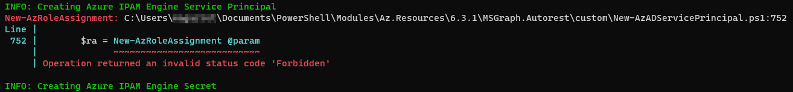
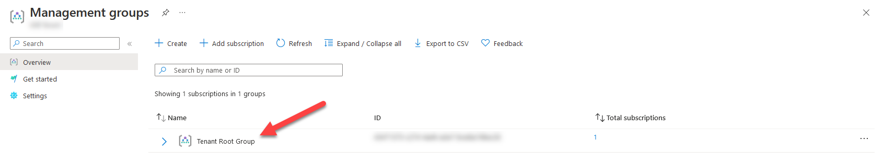
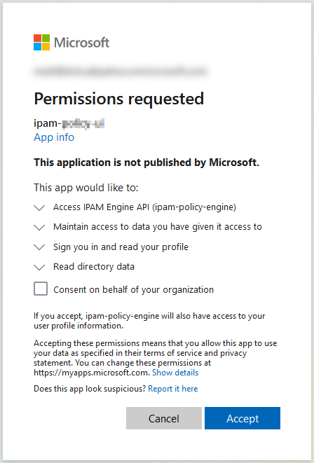
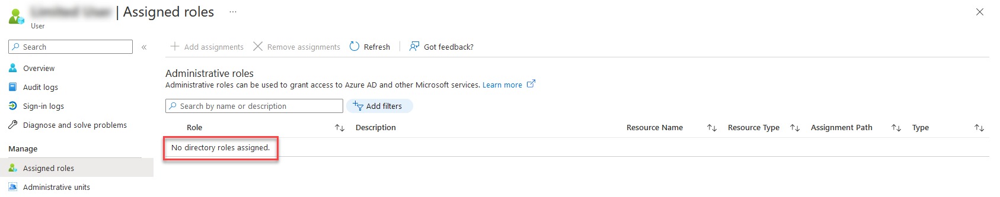
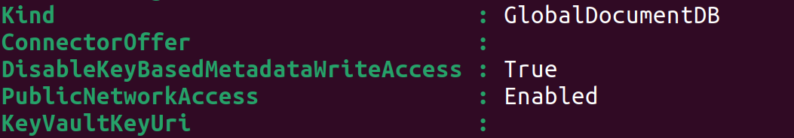
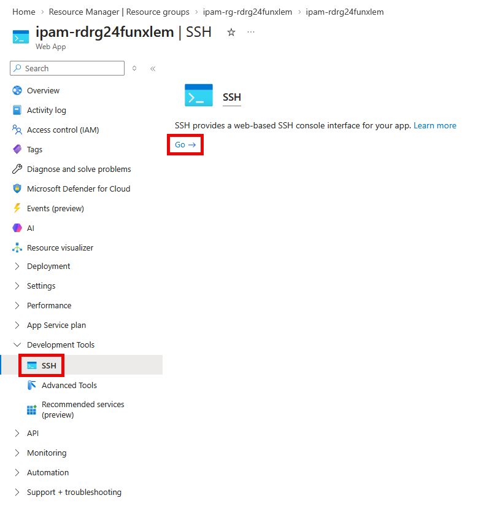
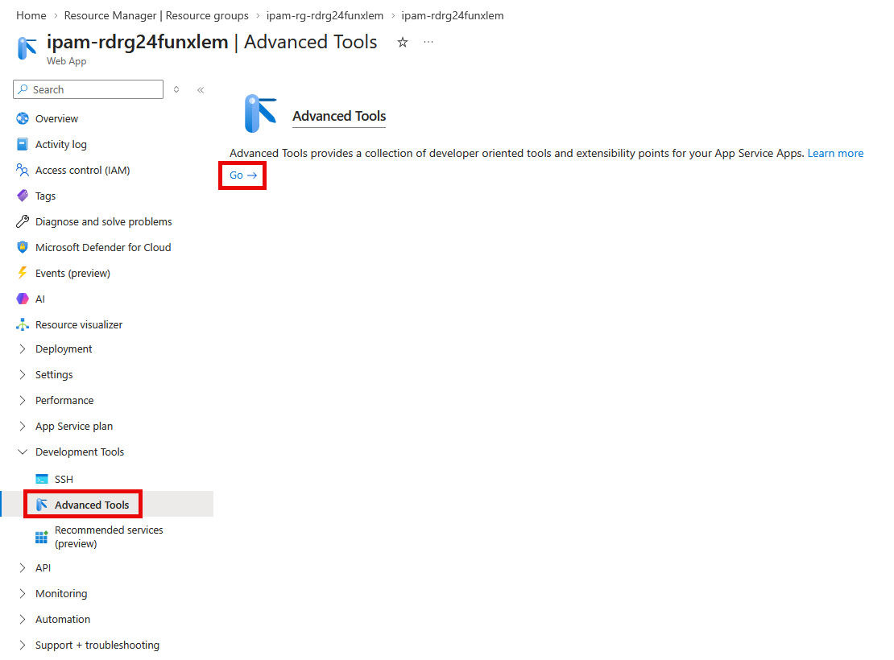
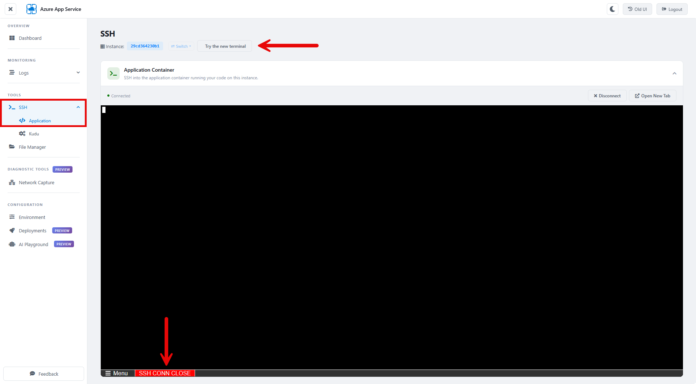
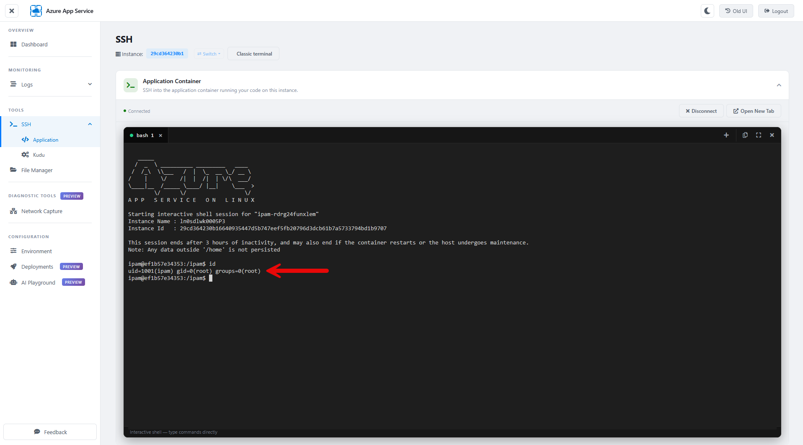
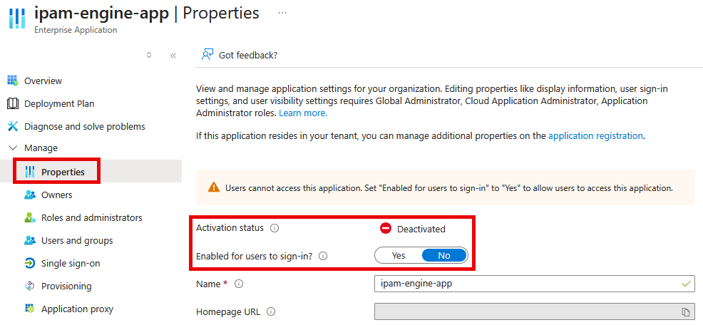

# Troubleshooting

## New-AzRoleAssignment (Failed)

### <u>Symptoms</u>

During the deployment of Azure IPAM, you see an error similar to the following:



If the deployment finished without the Engine's **Reader** role assignment, Azure IPAM then shows the symptoms described in [Access Denied (Engine Reader Role)](#access-denied-engine-reader-role).

### <u>Verify</u>

You can check to see if you have the necessary permissions on the Tenant Root Group in the Azure Portal by navigating to [Management Groups](https://learn.microsoft.com/azure/governance/management-groups/overview)

If you cannot click on the *Tenant Root Group*, then you likely don't have access to the *Tenant Root Group* at all.



Once you select the Tenant Root Group, under *Access Control (IAM)* you can click on *View my access* to see what RBAC permissions your currently logged in user has.


You can see from the above image, this user only has the `Reader` role, which isn't sufficient to deploy the Azure IPAM solution.

### <u>Resolve</u>

Contact your Azure Administrator (or equivalent) to request a role which has `Microsoft.Authorization/roleAssignments/write` at the *Tenant Root Group* level.

This role could be one of the following:

- [Owner](https://learn.microsoft.com/azure/role-based-access-control/built-in-roles/privileged#owner)
- [User Access Administrator](https://learn.microsoft.com/azure/role-based-access-control/built-in-roles/privileged#user-access-administrator)
- [Role Based Access Control Administrator](https://learn.microsoft.com/azure/role-based-access-control/built-in-roles/privileged#role-based-access-control-administrator)
- [Custom Role](https://learn.microsoft.com/azure/role-based-access-control/custom-roles) with *allow* permissions of `Microsoft.Authorization/roleAssignments/write`

### <u>Notes</u>

You can read more about the requirements for deploying Azure IPAM in the [Prerequisites](/deployment/README.md#prerequisites) section of the deployment guide.

## New-MgOauth2PermissionGrant (Failed)

### <u>Symptoms</u>

During the deployment of Azure IPAM, you see an error similar to the following:


When authenticating to Azure IPAM for the first time, you are presented with a *Permissions Requested* screen.



### <u>Verify</u>

The role of [Global Administrator](https://learn.microsoft.com/entra/identity/role-based-access-control/permissions-reference#global-administrator) is required to deploy the Azure IPAM solution. This role is needed to [grant admin consent](https://learn.microsoft.com/entra/identity/enterprise-apps/grant-admin-consent?pivots=portal) for the API permissions used by the Azure IPAM [App Registrations](https://learn.microsoft.com/entra/identity-platform/app-objects-and-service-principals#application-registration).

Navigate to your user in Microsoft Entra ID and check your current [Role Assignments](https://learn.microsoft.com/entra/identity/role-based-access-control/manage-roles-portal).



You can see from the image above that the [Global Administrator](https://learn.microsoft.com/entra/identity/role-based-access-control/permissions-reference#global-administrator) role is not present.

### <u>Resolve</u>

Contact your Microsoft Entra ID Administrator (or equivalent) to request the [Global Administrator](https://learn.microsoft.com/entra/identity/role-based-access-control/permissions-reference#global-administrator) role.

Alternatively, if your organization (like many) has separate groups who manage Microsoft Entra ID permissions and Azure infrastructure, you can leverage the two-step deployment method for Azure IPAM where a member of the [Global Administrators](https://learn.microsoft.com/entra/identity/role-based-access-control/permissions-reference#global-administrator) can deploy the required [App Registrations](https://learn.microsoft.com/entra/identity-platform/app-objects-and-service-principals#application-registration), then pass the generated [Parameters](https://learn.microsoft.com/azure/azure-resource-manager/templates/parameter-files) file to the Azure Infrastructure team to complete the deployment.

Here are the steps from the [Deployment](/deployment/README.md) section:

1. [Azure Identities (Only) Deployment](/deployment/README.md#azure-identities-only-deployment)
2. [Infrastructure Stack (Only) Deployment](/deployment/README.md#infrastructure-stack-only-deployment)

### <u>Notes</u>

You can read more about the requirements for deploying Azure IPAM in the [Prerequisites](/deployment/README.md#prerequisites) section of the deployment guide.

## DisableKeyBasedMetadataWriteAccess (Cosmos DB)

### <u>Symptoms</u>

- Spaces, Blocks, Virtual Networks, Subnets, and Endpoints fail to load
- HTTP 502 responses are visible for the "me" call in the Developer Tools networking view


- An error in the Application Log for the App Service stating that the *Operation...is not allow through the Azure Cosmos DB endpoint*.


### <u>Verify</u>

You can check to see if the flag `DisableKeyBasedMetadataWriteAccess` is set on your Cosmos DB resource by running one of the following commands:

#### Azure PowerShell

```powershell
Get-AzCosmosDBAccount -ResourceGroupName <ResourceGroupName> -Name <CosmosDBAccountName>
```



#### Azure CLI

```bash
az cosmosdb show --resource-group <ResourceGroupName> --name <CosmosDBAccountName>
```


### <u>Resolve</u>

Set the `DisableKeyBasedMetadataWriteAccess` flag to `false` using one of the following commands:

#### Azure PowerShell

```powershell
Update-AzCosmosDBAccount -ResourceGroupName <ResourceGroupName> -Name <CosmosDBAccountName> -DisableKeyBasedMetadataWriteAccess $false
```

#### Azure CLI

```bash
az cosmosdb update --resource-group <ResourceGroupName> --name <CosmosDBAccountName> --disable-key-based-metadata-write-access false
```

### <u>Notes</u>

This flag may have been set by [Azure Policy](https://learn.microsoft.com/azure/governance/policy/overview). You can find more details about this policy in the [Azure Policy Built-Ins](https://learn.microsoft.com/azure/cosmos-db/policy-reference#azure-cosmos-db) documentation under *Azure Cosmos DB key based metadata write access should be disabled*. You may need to contact your policy administrator to request an exception for Azure IPAM.

Additionally this issue only applies to legacy deployments of Azure IPAM (prior to v3.0.0) as the latest versions use SQL [role-based access control](https://learn.microsoft.com/azure/cosmos-db/how-to-setup-rbac) to read/write data from Cosmos DB.

## Update Not Applied (ZIP Deploy)

### <u>Symptoms</u>

- An update completes successfully and the App Service restarts, but the application continues to run the previous version
- Fixes known to be present in the ZIP Deploy archive are missing from the running application
- Errors reported before the update continue to appear in the Application Log afterwards, unchanged
- Repeating the update produces the same result

<!-- SCREENSHOT PLACEHOLDER: Application Log showing an identical error before and after an update -->


### <u>Verify</u>

This applies to internet-restricted cloud deployments, which run the application directly from a ZIP package instead of building it on the server. The `WEBSITE_RUN_FROM_PACKAGE` app setting is set to `1`, uploaded packages are stored in `/home/data/SitePackages`, and a file named `packagename.txt` records which one is mounted as `/home/site/wwwroot`.

If `packagename.txt` is not updated during a deployment, the App Service continues to mount the package it names, no matter how many times you redeploy.

Connect to the App Service over SSH and inspect the package directory:

#### SSH

```bash
cat /home/data/SitePackages/packagename.txt
ls -la /home/data/SitePackages/
```

<!-- SCREENSHOT PLACEHOLDER: SSH session showing packagename.txt alongside the SitePackages listing -->


Packages are named for the time they were uploaded, in the form `yyyyMMddHHmmss.zip`. If the name recorded in `packagename.txt` predates your most recent deployment, that deployment did not take effect.

Archives produced by Azure IPAM v4.0.0 and later carry a manifest at their root. Where one is present, it identifies the running build directly:

```bash
cat /home/site/wwwroot/build.json
```

The `built` timestamp names the archive, which is useful in environments where deployment logs cannot be copied off the system. Archives produced before v4.0.0 do not contain this file &mdash; for those, compare the name recorded in `packagename.txt` against the time you uploaded the archive instead.

### <u>Resolve</u>

Redeploy with the Azure IPAM update script, supplying the archive explicitly:

```powershell
# Deploy a specific archive to an existing deployment
.\update.ps1 -AppName "your-ipam-app" -ResourceGroupName "your-ipam-rg" -ZipFilePath ".\ipam.zip"
```

The update script uploads through the ZIP Deploy APIs, which place the package in `/home/data/SitePackages` and update `packagename.txt`. Deployment methods that perform a server-side build write to `/home/site/wwwroot` instead, and that content is hidden beneath the read-only package mount.

Confirm that the active package advanced:

```bash
cat /home/data/SitePackages/packagename.txt
```

To return to an earlier build, redeploy that archive the same way.

### <u>Notes</u>

The five most recently deployed packages are retained as a cache. You can change this with the `SCM_MAX_ZIP_PACKAGE_COUNT` app setting. See the [Environment variables and app settings reference](https://learn.microsoft.com/azure/app-service/reference-app-settings#deployment) for details.

Running directly from a package is only used for internet-restricted clouds, where the App Service cannot reach a package index to install the Python dependencies. Deployments in all other clouds build the application on the server and are unaffected by this issue.

Microsoft does not support running from a package for Python apps on App Service, because the platform expects its build automation to create the virtual environment. Azure IPAM ships its dependencies inside the archive and adds them to `PYTHONPATH` at startup instead. As a result, `Could not find virtual environment directory /home/site/wwwroot/antenv` appears in the Application Log on every start. This is expected and is not an error.

## SSH Connection Fails (Container Deployments)

### <u>Symptoms</u>

Azure IPAM is deployed as a container, and opening an SSH session to it fails. For example, selecting **SSH** under **Development Tools** for the App Service in the Azure Portal reports that the connection was closed, or `az webapp ssh` cannot connect.




### <u>Verify</u>

The Azure IPAM container images run as a non-root user (UID `1001`, GID `0`), and an SSH server cannot run under a non-root user. Tools that depend on an SSH server inside the container cannot connect:

- **Debian** images (the default) run as a non-root user and no longer include an SSH server starting with v4.0.0
- **RHEL** images have always run as a non-root user, so SSH has never been available in any version, even though earlier versions included an SSH server

Confirm that the App Service is running a container:

#### Azure PowerShell

```powershell
(Get-AzWebApp -ResourceGroupName "<resource-group>" -Name "<app-name>").SiteConfig.LinuxFxVersion
```

#### Azure CLI

```bash
az webapp config show --resource-group <resource-group> --name <app-name> --query linuxFxVersion --output tsv
```

A value beginning with `DOCKER|` indicates a container deployment. Function App container deployments also report `DOCKER|` but are not affected (see the notes below).

### <u>Resolve</u>

Use the shell access provided by your hosting platform. These tools connect through the platform instead of an SSH server inside the container:

| Platform           | Command                                                               | Reference                                                                                                                    |
| ------------------ | --------------------------------------------------------------------- | ---------------------------------------------------------------------------------------------------------------------------- |
| App Service        | `az webapp exec --resource-group <resource-group> --name <app-name>`  | [Open a container shell](https://learn.microsoft.com/azure/app-service/configure-linux-open-ssh-session?pivots=container-linux) |
| Container Apps     | `az containerapp exec --resource-group <resource-group> --name <app-name>` | [Connect to a container console](https://learn.microsoft.com/azure/container-apps/container-console)                      |
| Kubernetes (AKS)   | `kubectl exec -it <pod-name> -- /bin/bash`                            | [Get a shell to a running container](https://kubernetes.io/docs/tasks/debug/debug-application/get-shell-running-container/)  |
| Docker             | `docker exec -it <container-name> /bin/bash`                          | [docker container exec](https://docs.docker.com/reference/cli/docker/container/exec/)                                        |

`az webapp exec` is currently in preview and requires Azure CLI 2.90.0 or later.

For App Service, the newer terminal is also available in the browser. The **SSH** option under **Development Tools** may still use the legacy connection and fail. At the time of writing, open **Development Tools** > **Advanced Tools** > **Go**, select **SSH** > **Application**, and then select **Try the new terminal** at the top of the page. The Azure Portal layout may change, so refer to the linked App Service documentation for current steps.







The shell runs as the same non-root user as Azure IPAM. Where root access is required, Docker accepts `--user 0` on `docker exec`, and Kubernetes can attach an [ephemeral debug container](https://kubernetes.io/docs/tasks/debug/debug-application/debug-running-pod/#ephemeral-container) with `kubectl debug`.

Useful locations inside the container:

| Path                 | Contents                                                                                           |
| -------------------- | -------------------------------------------------------------------------------------------------- |
| `/ipam/app`          | Engine application code                                                                            |
| `/ipam/dist/env.js`  | UI configuration written at startup (`/tmp/dist/env.js` when `/ipam/dist` is not writable)          |
| `/tmp/logs/ipam.log` | Engine log file, unless overridden with the `IPAM_LOGFILE_LOCATION` environment variable           |

### <u>Notes</u>

Running without root privileges or an SSH server limits what can be reached if the application is ever compromised, and allows the images to run on platforms that require non-root containers.

This only applies to App Service (web app) container deployments. Code deployments (a `linuxFxVersion` beginning with `PYTHON|`) run on the App Service built-in Python image, which provides its own SSH server, so SSH continues to work as before.

Function App container deployments use Microsoft's Azure Functions base image, which runs as root and includes its own SSH server, so SSH continues to work as before. `az webapp exec` does not support Function Apps.

The commands above are maintained by each platform. Refer to the linked documentation for current options and requirements.

## Key Vault Reference Not Resolved (App Service)

### <u>Symptoms</u>

One or more of the following, depending on which app setting can't be resolved:

- **`ENGINE_APP_SECRET`:** a notification titled *Azure IPAM's client secret isn't configured* appears in the notification center, and actions that read from Azure fail with an error stating *Azure IPAM's client secret isn't configured. Its Key Vault reference couldn't be resolved.*
- **`ENGINE_APP_ID` or `TENANT_ID`:** signing in to Azure IPAM fails, or every request is rejected as unauthorized
- **`UI_APP_ID`:** the Azure IPAM interface doesn't load, and its address returns `404 Not Found`, while the API at `/api/docs` still responds
- **`MANAGED_IDENTITY_ID`:** Azure IPAM fails to start, because it can't authenticate to Cosmos DB, and errors appear in the Application Log during startup

On the App Service or Function App's **Environment variables** page, an app setting whose **Source** is **Key vault** shows an error.

<!-- SCREENSHOT PLACEHOLDER: App Service Environment variables showing a Key vault Reference app setting with an error -->


### <u>Verify</u>

Azure IPAM reads its identifiers and secret from Key Vault through [Key Vault references](https://learn.microsoft.com/azure/app-service/app-service-key-vault-references) (`ENGINE_APP_SECRET`, `ENGINE_APP_ID`, `UI_APP_ID`, `TENANT_ID` and `MANAGED_IDENTITY_ID`). When a reference can't be resolved, App Service passes the reference text itself to Azure IPAM in place of the value.

#### Azure Portal

Navigate to your Azure IPAM **App Service** or **Function App** → **Settings** → **Environment variables** → **App settings**, and select any setting with an error to see its details.

#### Azure PowerShell

```powershell
$path = "/subscriptions/<subscription-id>/resourceGroups/<your-ipam-rg>/providers/Microsoft.Web/sites/<your-ipam-app>/config/configreferences/appsettings?api-version=2022-03-01"

((Invoke-AzRestMethod -Method GET -Path $path).Content | ConvertFrom-Json).value |
  Select-Object name, @{ Name = "status"; Expression = { $_.properties.status } }, @{ Name = "details"; Expression = { $_.properties.details } }
```

#### Azure CLI

```bash
az rest --method get \
  --url "/subscriptions/<subscription-id>/resourceGroups/<your-ipam-rg>/providers/Microsoft.Web/sites/<your-ipam-app>/config/configreferences/appsettings?api-version=2022-03-01" \
  --query "value[].{setting: name, status: properties.status, details: properties.details}" \
  --output table
```

Every reference should report a status of `Resolved`.

### <u>Resolve</u>

| Status                   | Likely Cause                                                                                    | Resolution                                                                                                                                                      |
| ------------------------ | ----------------------------------------------------------------------------------------------- | --------------------------------------------------------------------------------------------------------------------------------------------------------------- |
| `AccessToKeyVaultDenied` | The managed identity has lost access, or the Key Vault firewall is blocking App Service          | Assign the Azure IPAM managed identity the **Key Vault Secrets User** role on the Key Vault, and review the Key Vault's **Networking** settings                 |
| `SecretNotFound`         | The secret has been deleted or disabled                                                         | Recover the secret (soft delete keeps it for 90 days) or re-enable it. For `ENGINE-SECRET`, you can also [rotate the secret](/maintenance/README.md#rotate-the-secret) |
| `VaultNotFound`          | The Key Vault has been deleted or renamed                                                       | Recover the Key Vault (soft delete keeps it for 90 days). If it was recreated under a different name, the app settings' Key Vault references need to point to it |

After fixing the cause, select **Pull reference values** on the **Environment variables** page so the references are resolved again, then restart the App Service or Function App so Azure IPAM loads the values.

### <u>Notes</u>

The deployment configures the App Service or Function App to use the Azure IPAM managed identity, rather than a system-assigned identity, to read from Key Vault (the `keyVaultReferenceIdentity` site property). If that property has been changed, the references are resolved with the wrong identity.

## Access Denied (Engine Reader Role)

### <u>Symptoms</u>

- A notification titled *Azure IPAM doesn't have access to Azure* appears in the notification center
- When Azure IPAM is opened, Spaces and Blocks appear empty for every user, with an error stating *Azure IPAM doesn't have permission to read Azure resources. An administrator needs to restore its Reader role.* Administrators' views of subscriptions, virtual networks, subnets and endpoints are empty too, while other users still see the Azure resources they have access to
- Actions that check address space against Azure, such as creating a Reservation or associating virtual networks with a Block, fail with the same error
- Reservations stay waiting even after a matching virtual network has been created and tagged
- Errors in the Application Log for the App Service stating *Azure IPAM can't reach Azure as itself*, and *Azure Resource Graph query failed*, followed by *Access is denied to the requested resource. The user might not have enough permission*
- The `arm` check returned by `/api/health` is not `ok`, reporting the same error

### <u>Verify</u>

Azure IPAM reads your Azure environment through the Engine's own **Reader** role assignment for administrators, and for its own work such as calculating utilization and checking for overlapping address space. Other users see Azure resources through their own permissions, which is why their views keep working. Check the Engine's role assignment by following [Restore Reader Access](/maintenance/README.md#restore-reader-access).

### <u>Resolve</u>

Restore the Engine's **Reader** role assignment by following [Restore Reader Access](/maintenance/README.md#restore-reader-access).

### <u>Notes</u>

A deployment where the role assignment was never created shows the same symptoms. See [New-AzRoleAssignment (Failed)](#new-azroleassignment-failed).

If the Engine was given **Reader** at a Management Group other than the Tenant Root Group (using `-MgmtGroupId`), resources outside that Management Group are never visible to Azure IPAM. This is expected.

## Timeouts Reaching Azure (Network)

### <u>Symptoms</u>

- Azure IPAM is slow to load, and Spaces, Blocks, virtual networks, subnets and endpoints then appear empty for every user, with an error stating *Azure IPAM couldn't reach Azure Resource Manager.* or *Azure IPAM couldn't reach Microsoft Entra ID.*
- Actions that read from Azure, such as creating a Reservation or associating virtual networks with a Block, fail with the same error
- If the problem lasts for more than a few minutes, a notification titled *Azure IPAM can't reach Azure* appears in the notification center
- Errors in the Application Log for the App Service stating *Error communicating with Azure*, followed by details of the failed connection to Microsoft Entra ID or Azure Resource Manager
- The `arm` check returned by `/api/health` is not `ok`, reporting that it timed out or the same error

### <u>Verify</u>

Azure IPAM needs outbound HTTPS (TCP 443) access to Microsoft Entra ID and Azure Resource Manager:

| Azure Cloud          | Microsoft Entra ID                          | Azure Resource Manager                 |
| -------------------- | ------------------------------------------- | -------------------------------------- |
| Azure Public         | `login.microsoftonline.com`                 | `management.azure.com`                 |
| Azure US Government  | `login.microsoftonline.us`                  | `management.usgovcloudapi.net`         |
| Azure China          | `login.chinacloudapi.cn`                    | `management.chinacloudapi.cn`          |
| Azure US Gov Secret  | `login.microsoftonline.microsoft.scloud`    | `management.azure.microsoft.scloud`    |

Open a shell inside Azure IPAM (see [SSH Connection Fails (Container Deployments)](#ssh-connection-fails-container-deployments) for how), and test each endpoint for your cloud:

```bash
python -c "import socket; socket.create_connection(('login.microsoftonline.com', 443), timeout=10); print('OK')"
python -c "import socket; socket.create_connection(('management.azure.com', 443), timeout=10); print('OK')"
```

A `timed out` or `Name or service not known` error points to a firewall or DNS problem respectively.

### <u>Resolve</u>

Allow outbound HTTPS to the endpoints above through any firewall, network virtual appliance or proxy in the path. With Azure Firewall, the `AzureActiveDirectory` and `AzureResourceManager` [service tags](https://learn.microsoft.com/azure/virtual-network/service-tags-overview) cover them.

If the App Service or Function App uses vNet integration with custom DNS, make sure those DNS servers can resolve public Azure endpoints.

### <u>Notes</u>

This applies most often to deployments that route all outbound traffic through a vNet (see the vNet integration notes in the [Update](/update/README.md#vnet-integration-on-the-staging-slot) guide).

## AADSTS53003 (Engine Blocked by Conditional Access)

### <u>Symptoms</u>

- A notification titled *Conditional Access is blocking Azure IPAM* appears in the notification center
- When Azure IPAM is opened, Spaces and Blocks appear empty for every user, with an error stating *Conditional Access blocked Azure IPAM from signing in to Azure (AADSTS53003).* Administrators' views of virtual networks, subnets and endpoints are empty too. Depending on how the policy is configured, other users' views of Azure resources may also be affected
- Actions that read from Azure, such as creating a Reservation or associating virtual networks with a Block, fail with the same error
- Errors in the Application Log for the App Service stating *Azure IPAM can't reach Azure as itself*, and *Azure authentication failed*, followed by `AADSTS53003` and *Access has been blocked by Conditional Access policies. The access policy does not allow token issuance*
- The `arm` check returned by `/api/health` is not `ok`, reporting the same error

### <u>Verify</u>

A [Conditional Access policy for workload identities](https://learn.microsoft.com/entra/identity/conditional-access/workload-identity) is blocking the Engine's sign-in.

Navigate to **Microsoft Entra ID** → **Monitoring** → **Sign-in logs** → **Service principal sign-ins**, and filter to the Engine application. Sign-ins are grouped by application, so expand a row with a failed sign-in, select one of the sign-ins listed under it, then select **Conditional Access** to see which policy blocked it.

<!-- SCREENSHOT PLACEHOLDER: Service principal sign-in details showing the Conditional Access policy that blocked the Engine -->


### <u>Resolve</u>

Ask whoever manages Conditional Access in your organization to do one of the following:

- Exclude the Engine's service principal from the policy, under **Assignments** → **Users or workload identities** → **Exclude**
- If the policy only allows sign-ins from certain locations, add the App Service or Function App's outbound IP addresses (shown under **Networking** → **Outbound addresses**) to a trusted [named location](https://learn.microsoft.com/entra/identity/conditional-access/concept-assignment-network)

### <u>Notes</u>

Changing Conditional Access policies requires the [Conditional Access Administrator](https://learn.microsoft.com/entra/identity/role-based-access-control/permissions-reference#conditional-access-administrator) or [Security Administrator](https://learn.microsoft.com/entra/identity/role-based-access-control/permissions-reference#security-administrator) role.

## AADSTS700016 (Engine Application Not Found)

### <u>Symptoms</u>

- Signing in to Azure IPAM fails for every user, with an error on the Microsoft sign-in page stating that the application or resource could not be found
- An error in the Application Log for the App Service containing `AADSTS700016`, stating that *the application wasn't found in the directory*
- API calls to Azure IPAM fail, because access tokens can no longer be issued for it

### <u>Verify</u>

Either the Engine app registration or its service principal has been deleted, or Azure IPAM is using the wrong application ID.

First, confirm the Key Vault references resolve, since an unresolved `ENGINE-ID` reference produces this error too. See [Key Vault Reference Not Resolved (App Service)](#key-vault-reference-not-resolved-app-service).

Then check that the app registration and its service principal (enterprise application) both exist:

#### Azure PowerShell

```powershell
Get-AzADApplication -ApplicationId "<engine-app-id>"
Get-AzADServicePrincipal -ApplicationId "<engine-app-id>"
```

#### Azure CLI

```bash
az ad app show --id "<engine-app-id>"
az ad sp show --id "<engine-app-id>"
```

If either is missing, look for it under **Microsoft Entra ID** → **App registrations** → **Deleted applications**, or **Microsoft Entra ID** → **Enterprise applications** → **Deleted applications**.

<!-- SCREENSHOT PLACEHOLDER: App registrations Deleted applications tab listing the Engine application -->


### <u>Resolve</u>

Deleted applications can be restored for 30 days. Select the Engine application under **Deleted applications** and select **Restore app registration**. Restoring the app registration from the Microsoft Entra admin center also restores its service principal. If only the enterprise application was deleted, restore it from **Enterprise applications** → **Deleted applications** instead.

After restoring, confirm the Engine still has its Azure access by following [Restore Reader Access](/maintenance/README.md#restore-reader-access).

If the application no longer appears under **Deleted applications**, it has been permanently deleted and the app registrations must be recreated with the [Azure Identities (Only) Deployment](/deployment/README.md#azure-identities-only-deployment). The new registrations have different IDs, so the `ENGINE-ID`, `UI-ID` and `ENGINE-SECRET` secrets in Key Vault, and the UI app registration's redirect URI, must then be updated to match. [Open an issue](https://github.com/Azure/ipam/issues/new?template=bug_report.yml) if you need help.

### <u>Notes</u>

Restoring an application requires [Application Administrator](https://learn.microsoft.com/entra/identity/role-based-access-control/permissions-reference#application-administrator), [Cloud Application Administrator](https://learn.microsoft.com/entra/identity/role-based-access-control/permissions-reference#cloud-application-administrator), or ownership of the application. See [Restore a recently deleted application](https://learn.microsoft.com/entra/identity-platform/howto-restore-app) for details.

## AADSTS7000112 (Engine Application Disabled)

### <u>Symptoms</u>

- Signing in to Azure IPAM fails for every user, with an error on the Microsoft sign-in page containing `AADSTS7000112`, stating that *the application is disabled*
- The same error in the Application Log for the App Service
- API calls to Azure IPAM fail, because access tokens can no longer be issued for it

### <u>Verify</u>

The Engine's service principal has been disabled, which stops it from signing in.

#### Azure Portal

Navigate to **Microsoft Entra ID** → **Enterprise applications** → your Azure IPAM **Engine** application → **Properties**, and check **Enabled for users to sign-in?**

<!-- SCREENSHOT PLACEHOLDER: Engine enterprise application Properties with Enabled for users to sign-in set to No -->


#### Azure PowerShell

```powershell
(Get-AzADServicePrincipal -ApplicationId "<engine-app-id>").AccountEnabled
```

#### Azure CLI

```bash
az ad sp show --id "<engine-app-id>" --query accountEnabled
```

### <u>Resolve</u>

Re-enable the service principal.

#### Azure Portal

Set **Enabled for users to sign-in?** to **Yes**, then select **Save**.

#### Azure PowerShell

```powershell
Update-AzADServicePrincipal -ApplicationId "<engine-app-id>" -AccountEnabled
```

#### Azure CLI

```bash
az ad sp update --id "<engine-app-id>" --set accountEnabled=true
```

### <u>Notes</u>

Service principals are sometimes disabled deliberately, for example by a security team responding to an alert. Check with whoever manages Microsoft Entra ID in your organization before re-enabling it.

## AADSTS7000215 (Engine Secret Invalid)

### <u>Symptoms</u>

- A notification titled *Azure IPAM's client secret isn't valid* appears in the notification center
- When Azure IPAM is opened, Spaces, Blocks, virtual networks, subnets and endpoints all appear empty for every user, with an error stating *Azure IPAM's client secret isn't valid (AADSTS7000215). An administrator needs to check the secret it's using.* Pages that were already open keep showing the data loaded before the problem started
- Actions that read from Azure, such as creating a Reservation or associating virtual networks with a Block, fail with the same error
- Errors in the Application Log for the App Service stating *Azure IPAM can't reach Azure as itself*, and *Azure authentication failed*, followed by `AADSTS7000215` and *Invalid client secret provided. Ensure the secret being sent in the request is the client secret value, not the client secret ID*
- The `arm` check returned by `/api/health` is not `ok`, reporting the same error

### <u>Verify</u>

Microsoft Entra ID doesn't recognize the secret Azure IPAM is using. Check the following, in order:

1. **The Key Vault reference resolves.** If App Service can't read `ENGINE-SECRET` from Key Vault, it passes the reference text to Azure IPAM in place of the secret. See [Key Vault Reference Not Resolved (App Service)](#key-vault-reference-not-resolved-app-service).
2. **The secret matches one on the Engine app registration.** Follow [Check When the Secret Expires](/maintenance/README.md#check-when-the-secret-expires). If no client secret on the app registration shares its first three characters with `ENGINE-SECRET`, the stored value is wrong. A common cause is storing the **Secret ID** instead of the **Value**.

### <u>Resolve</u>

If a matching secret exists on the app registration, Azure IPAM hasn't loaded it yet. This happens when the old secret is removed during a rotation before Azure IPAM loads the new one. Refresh Azure IPAM's Key Vault references, then restart the App Service or Function App, as described in [Rotate the Secret](/maintenance/README.md#rotate-the-secret). Restarting on its own isn't enough, because App Service caches Key Vault reference values for up to a day.

Otherwise, create a new client secret and store it in Key Vault by following [Rotate the Secret](/maintenance/README.md#rotate-the-secret).

### <u>Notes</u>

Removing the old secret is the last step of a rotation for this reason. Wait until [the rotation is confirmed](/maintenance/README.md#confirm-the-rotation) before removing it.

## AADSTS7000222 (Engine Secret Expired)

### <u>Symptoms</u>

- A notification titled *Azure IPAM's client secret has expired* appears in the notification center
- When Azure IPAM is opened, Spaces, Blocks, virtual networks, subnets and endpoints all appear empty for every user, with an error stating *Azure IPAM's client secret has expired (AADSTS7000222). An administrator needs to rotate it.* Pages that were already open keep showing the data loaded before the problem started
- Actions that read from Azure, such as creating a Reservation or associating virtual networks with a Block, fail with the same error
- Errors in the Application Log for the App Service stating *Azure IPAM can't reach Azure as itself*, and *Azure authentication failed*, followed by `AADSTS7000222` and *The provided client secret keys for app '...' are expired*
- The `arm` check returned by `/api/health` is not `ok`, reporting the same error

<!-- SCREENSHOT PLACEHOLDER: Application Log showing an AADSTS7000222 error -->


### <u>Verify</u>

The Engine app registration's client secret has passed its expiration date. Follow [Check When the Secret Expires](/maintenance/README.md#check-when-the-secret-expires) and confirm that the secret Azure IPAM is using has an **Expires** date in the past.

### <u>Resolve</u>

Create a new client secret and switch Azure IPAM over to it by following [Rotate the Secret](/maintenance/README.md#rotate-the-secret). Because the old secret has already expired, Azure IPAM is unavailable until the new one is in place.

### <u>Notes</u>

To be warned ahead of time in the future, see [Get Notified Before the Secret Expires](/maintenance/README.md#get-notified-before-the-secret-expires).
