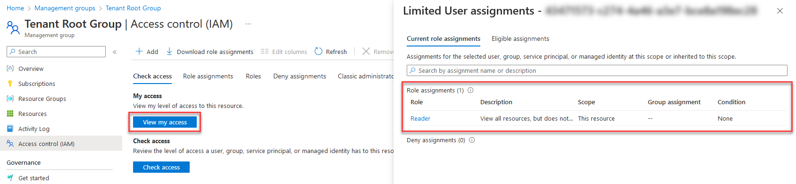
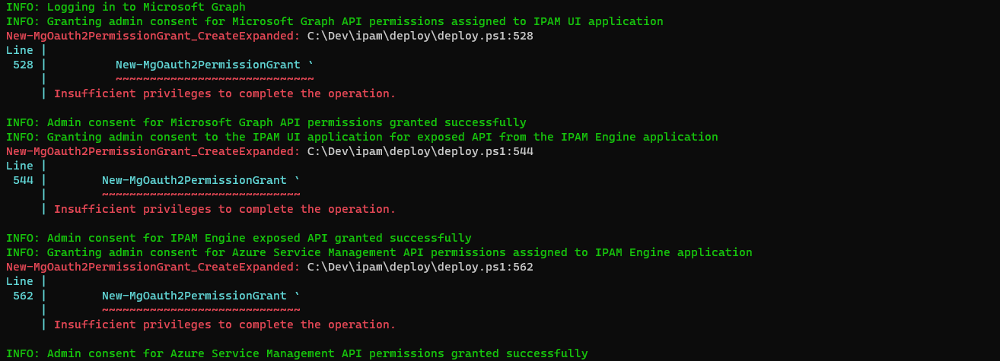
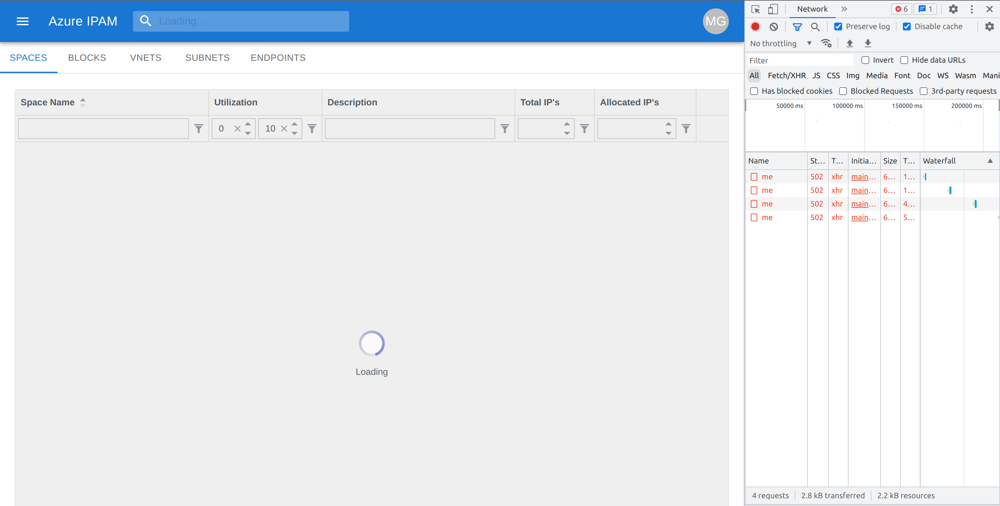
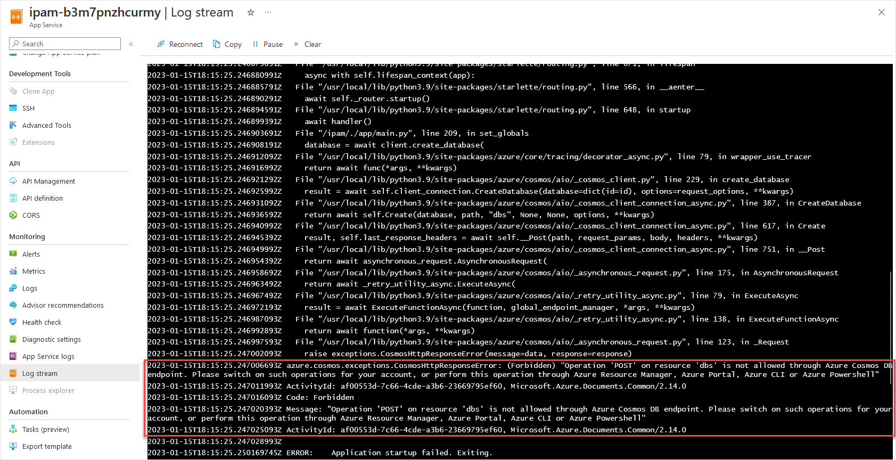
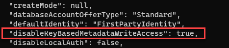
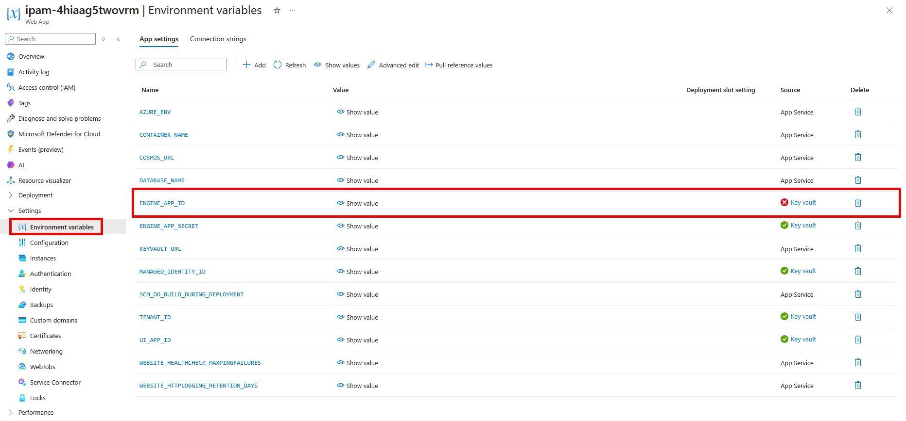
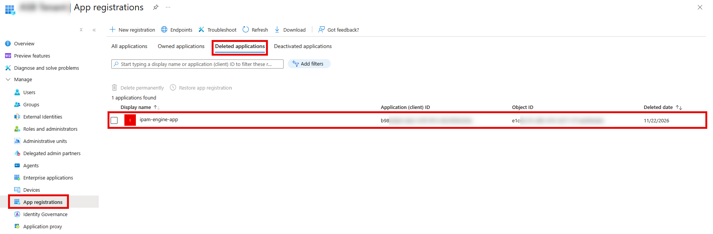
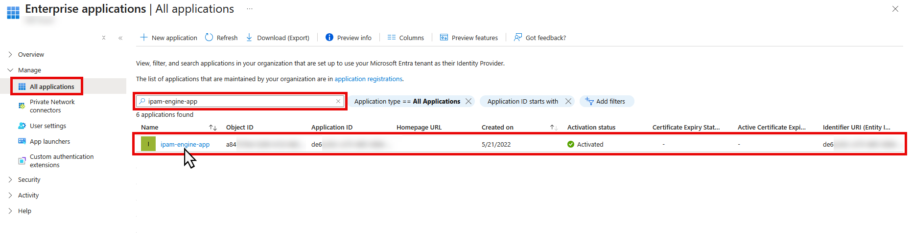

# Troubleshooting

This page covers common problems with deploying and running Azure IPAM. Each entry describes the symptoms, how to confirm the cause and how to fix it. If your problem isn't listed, [report an issue](https://github.com/Azure/ipam/issues/new?template=bug_report.yml).

The Azure PowerShell and Azure CLI commands on this page assume you're signed in to the cloud and subscription where Azure IPAM is deployed. See [Authenticate to Azure PowerShell](/deployment/README.md#authenticate-to-azure-powershell) and [Authenticate to Azure CLI](/deployment/README.md#authenticate-to-azure-cli).

## New-AzRoleAssignment (Failed)

### Symptoms

Deploying Azure IPAM fails with an error similar to the following:


If the deployment finished without the Engine's **Reader** role assignment, Azure IPAM then shows the symptoms described in [Access Denied (Engine Reader Role)](#access-denied-engine-reader-role).

### Verify

The deployment assigns the Engine's service principal the **Reader** role on the [Root Management Group](https://learn.microsoft.com/azure/governance/management-groups/overview#root-management-group-for-each-directory), which needs permission to create role assignments there. To check your access, open **Management groups** in the Azure portal.

If you can't select **Tenant Root Group**, you don't have access to it at all.


Otherwise, select **Tenant Root Group** → **Access control (IAM)** → **View my access** to see the roles assigned to you.



In this example, the user only has the **Reader** role, which can't create role assignments.

### Resolve

Ask your Azure administrator for one of the following roles on the Root Management Group:

- [Owner](https://learn.microsoft.com/azure/role-based-access-control/built-in-roles/privileged#owner)
- [User Access Administrator](https://learn.microsoft.com/azure/role-based-access-control/built-in-roles/privileged#user-access-administrator)
- [Role Based Access Control Administrator](https://learn.microsoft.com/azure/role-based-access-control/built-in-roles/privileged#role-based-access-control-administrator)
- A [custom role](https://learn.microsoft.com/azure/role-based-access-control/custom-roles) that allows `Microsoft.Authorization/roleAssignments/write`

### Notes

For everything a deployment needs, see [Prerequisites](/deployment/README.md#prerequisites) in the deployment guide.

## New-MgOauth2PermissionGrant (Failed)

### Symptoms

Deploying Azure IPAM fails with an error similar to the following:



When you first sign in to Azure IPAM, you're asked to consent to the permissions it requests.


### Verify

Creating the Azure IPAM [app registrations](https://learn.microsoft.com/entra/identity-platform/app-objects-and-service-principals#application-registration) and [granting admin consent](https://learn.microsoft.com/entra/identity/enterprise-apps/grant-admin-consent?pivots=portal) for their API permissions needs one of the Microsoft Entra roles listed in the deployment [Prerequisites](/deployment/README.md#prerequisites): Cloud Application Administrator, Application Administrator or Global Administrator.

In Microsoft Entra ID, open your user and check its [assigned roles](https://learn.microsoft.com/entra/identity/role-based-access-control/manage-roles-portal).


In this example, the user has none of those roles.

### Resolve

Ask your Microsoft Entra administrator for one of those roles.

If different teams in your organization manage Microsoft Entra ID and Azure infrastructure, use the two-part deployment instead. Someone with one of those roles creates the app registrations, then gives the generated `main.parameters.json` file to the team deploying the infrastructure:

1. [Azure Identities (Only) Deployment](/deployment/README.md#azure-identities-only-deployment)
2. [Infrastructure Stack (Only) Deployment](/deployment/README.md#infrastructure-stack-only-deployment)

### Notes

For everything a deployment needs, see [Prerequisites](/deployment/README.md#prerequisites) in the deployment guide.

## DisableKeyBasedMetadataWriteAccess (Cosmos DB)

### Symptoms

This only affects Azure IPAM versions earlier than v3.0.0. You see one or more of the following:

- Spaces, Blocks, virtual networks, subnets and endpoints fail to load
- In the browser's developer tools, requests to `me` return HTTP 502



- An error in the Application Log for the App Service stating *Operation '...' on resource '...' is not allowed through Azure Cosmos DB endpoint*



### Verify

Check whether `DisableKeyBasedMetadataWriteAccess` is set on the Cosmos DB account.

#### Azure PowerShell

```powershell
Get-AzCosmosDBAccount -ResourceGroupName "<your-ipam-rg>" -Name "<your-ipam-cosmos>"
```


#### Azure CLI

```bash
az cosmosdb show --resource-group "<your-ipam-rg>" --name "<your-ipam-cosmos>"
```



### Resolve

Set `DisableKeyBasedMetadataWriteAccess` to `false`.

#### Azure PowerShell

```powershell
Update-AzCosmosDBAccount -ResourceGroupName "<your-ipam-rg>" -Name "<your-ipam-cosmos>" -DisableKeyBasedMetadataWriteAccess $false
```

#### Azure CLI

```bash
az cosmosdb update --resource-group "<your-ipam-rg>" --name "<your-ipam-cosmos>" --disable-key-based-metadata-write-access false
```

### Notes

An [Azure Policy](https://learn.microsoft.com/azure/governance/policy/overview) may have set it. See *Azure Cosmos DB key based metadata write access should be disabled* in the [Azure Policy built-in definitions for Azure Cosmos DB](https://learn.microsoft.com/azure/cosmos-db/policy-reference#azure-cosmos-db). You may need to ask your policy administrator for an exemption for Azure IPAM.

Azure IPAM v3.0.0 and later use Cosmos DB [role-based access control](https://learn.microsoft.com/azure/cosmos-db/how-to-setup-rbac) instead of account keys, so this setting doesn't affect them.

## Update Not Applied (ZIP Deploy)

### Symptoms

- An update completes successfully and the App Service restarts, but the application continues to run the previous version
- Fixes known to be present in the ZIP Deploy archive are missing from the running application
- Errors reported before the update continue to appear in the Application Log afterwards, unchanged
- Repeating the update produces the same result

### Verify

This applies to internet-restricted cloud deployments, which run the application directly from a ZIP package instead of building it on the server. The `WEBSITE_RUN_FROM_PACKAGE` app setting is set to `1`, uploaded packages are stored in `/home/data/SitePackages`, and a file named `packagename.txt` records which one is mounted as `/home/site/wwwroot`.

If `packagename.txt` is not updated during a deployment, the App Service continues to mount the package it names, no matter how many times you redeploy.

Connect to the App Service over SSH and inspect the package directory:

#### SSH

```bash
cat /home/data/SitePackages/packagename.txt; echo
ls -la /home/data/SitePackages/
```

The output looks similar to this:

```text
$ cat /home/data/SitePackages/packagename.txt
20260918213614.zip
$ ls -la /home/data/SitePackages/
total 241149
drwxrwxrwx 2 nobody nogroup     4096 Sep 18 21:36 .
drwxrwxrwx 2 nobody nogroup        0 Aug  4 18:25 ..
-rwxrwxrwx 1 nobody nogroup 52081184 Sep  7 20:33 20260907203226.zip
-rwxrwxrwx 1 nobody nogroup 38584320 Sep  9 22:58 20260909225755.zip
-rwxrwxrwx 1 nobody nogroup 52081184 Sep  9 23:08 20260909230755.zip
-rwxrwxrwx 1 nobody nogroup 52081627 Sep 10 16:39 20260910163920.zip
-rwxrwxrwx 1 nobody nogroup 52091397 Sep 18 21:36 20260918213614.zip
-rwxrwxrwx 1 nobody nogroup       18 Sep 18 21:36 packagename.txt
```

Packages are named for the time they were uploaded, in the form `yyyyMMddHHmmss.zip`. If the name recorded in `packagename.txt` predates your most recent deployment, that deployment did not take effect. In the example above, `packagename.txt` names the most recent upload, so the latest deployment is the one running.

If `/home/data/SitePackages` doesn't exist, the App Service doesn't run from a package and this issue doesn't apply. When it does, the SSH welcome banner shows `WEBSITE_RUN_FROM_PACKAGE : set`.

Archives produced by Azure IPAM v4.0.0 and later carry a manifest at their root. Where one is present, it identifies the running build directly:

```bash
cat /home/site/wwwroot/build.json
```

For example (the `packages` list is shortened here):

```text
{
  "built": "2026-09-18T21:31:19.4880092Z",
  "app": "4.0.0",
  "python": "3.12",
  "pipPlatform": "manylinux2014_x86_64",
  "glibcCeiling": "2.17",
  "glibcObserved": "2.17",
  "nativeModules": 24,
  "manifestOnly": false,
  "packages": {
    "fastapi-0.141.1": "py3-none-any",
    "azure_identity-1.25.3": "py3-none-any",
    ...
  }
}
```

The `built` timestamp records when the archive was built, so it identifies the archive that's running. This is useful in environments where you can't copy deployment logs off the system. Because the archive is uploaded after it's built, `built` is earlier than the package name in `packagename.txt`. Archives produced before v4.0.0 don't contain this file. For those, compare the name in `packagename.txt` with the time you uploaded the archive.

### Resolve

Redeploy with the Azure IPAM update script, supplying the archive explicitly. Run the following from the `update` folder:

```powershell
# Deploy a Specific Archive to an Existing Deployment
./update.ps1 -AppName "<your-ipam-app>" -ResourceGroupName "<your-ipam-rg>" -ZipFilePath "./ipam.zip"
```

The update script uploads through the ZIP Deploy APIs, which place the package in `/home/data/SitePackages` and update `packagename.txt`. Deployment methods that perform a server-side build write to `/home/site/wwwroot` instead, and that content is hidden beneath the read-only package mount.

Confirm that the active package advanced:

```bash
cat /home/data/SitePackages/packagename.txt
```

To return to an earlier build, redeploy that archive the same way.

### Notes

The five most recently deployed packages are retained as a cache. You can change this with the `SCM_MAX_ZIP_PACKAGE_COUNT` app setting. See the [Environment variables and app settings reference](https://learn.microsoft.com/azure/app-service/reference-app-settings#deployment) for details.

Running directly from a package is only used for internet-restricted clouds, where the App Service cannot reach a package index to install the Python dependencies. Deployments in all other clouds build the application on the server and are unaffected by this issue.

Microsoft does not support running from a package for Python apps on App Service, because the platform expects its build automation to create the virtual environment. Azure IPAM ships its dependencies inside the archive and adds them to `PYTHONPATH` at startup instead. As a result, `Could not find virtual environment directory /home/site/wwwroot/antenv` appears in the Application Log on every start. This is expected and is not an error.

## SSH Connection Fails (Container Deployments)

### Symptoms

Azure IPAM is deployed as a container, and opening an SSH session to it fails. For example, selecting **SSH** under **Development Tools** for the App Service in the Azure portal reports that the connection was closed, or `az webapp ssh` cannot connect.


### Verify

The Azure IPAM container images run as a non-root user (UID `1001`, GID `0`), and an SSH server cannot run under a non-root user. Tools that depend on an SSH server inside the container cannot connect:

- **Debian** images (the default) run as a non-root user and no longer include an SSH server starting with v4.0.0
- **RHEL** images have always run as a non-root user, so SSH has never been available in any version, even though earlier versions included an SSH server

Confirm that the App Service is running a container:

#### Azure PowerShell

```powershell
(Get-AzWebApp -ResourceGroupName "<your-ipam-rg>" -Name "<your-ipam-app>").SiteConfig.LinuxFxVersion
```

#### Azure CLI

```bash
az webapp config show --resource-group "<your-ipam-rg>" --name "<your-ipam-app>" --query linuxFxVersion --output tsv
```

A value beginning with `DOCKER|` indicates a container deployment. Function App container deployments also report `DOCKER|` but are not affected (see the notes below).

### Resolve

Use the shell access provided by your hosting platform. These tools connect through the platform instead of an SSH server inside the container:

| Platform | Command | Reference |
| -------- | ------- | --------- |
| App Service | `az webapp exec --resource-group "<your-ipam-rg>" --name "<your-ipam-app>"` | [Open a container shell](https://learn.microsoft.com/azure/app-service/configure-linux-open-ssh-session?pivots=container-linux) |
| Container Apps | `az containerapp exec --resource-group "<your-ipam-rg>" --name "<your-ipam-container-app>"` | [Connect to a container console](https://learn.microsoft.com/azure/container-apps/container-console) |
| Kubernetes (AKS) | `kubectl exec -it "<pod-name>" -- /bin/bash` | [Get a shell to a running container](https://kubernetes.io/docs/tasks/debug/debug-application/get-shell-running-container/) |
| Docker | `docker exec -it "<container-name>" /bin/bash` | [docker container exec](https://docs.docker.com/reference/cli/docker/container/exec/) |

`az webapp exec` is in preview and needs Azure CLI 2.90.0 or later.

For App Service, you can also open the new terminal in the browser. The **SSH** option under **Development Tools** may still use the legacy connection and fail. Instead, select **Development Tools** → **Advanced Tools** → **Go**, then **SSH** → **Application**, and then **Try the new terminal** at the top of the page. If these steps have changed, see the linked App Service documentation.


The shell runs as the same non-root user as Azure IPAM. Where root access is required, Docker accepts `--user 0` on `docker exec`, and Kubernetes can attach an [ephemeral debug container](https://kubernetes.io/docs/tasks/debug/debug-application/debug-running-pod/#ephemeral-container) with `kubectl debug`.

Useful locations inside the container:

| Path                 | Contents                                                                                           |
| -------------------- | -------------------------------------------------------------------------------------------------- |
| `/ipam/app`          | Engine application code                                                                            |
| `/ipam/dist/env.js`  | UI configuration written at startup (`/tmp/dist/env.js` when `/ipam/dist` is not writable)          |
| `/tmp/logs/ipam.log` | Engine log file, unless overridden with the `IPAM_LOGFILE_LOCATION` environment variable           |

### Notes

Running without root privileges or an SSH server limits what can be reached if the application is ever compromised, and allows the images to run on platforms that require non-root containers.

This only applies to App Service (web app) container deployments. Code deployments (a `linuxFxVersion` beginning with `PYTHON|`) run on the App Service built-in Python image, which provides its own SSH server, so SSH continues to work as before.

Function App container deployments use Microsoft's Azure Functions base image, which runs as root and includes its own SSH server, so SSH continues to work as before. `az webapp exec` does not support Function Apps.

The commands above are maintained by each platform. Refer to the linked documentation for current options and requirements.

## Key Vault Reference Not Resolved (App Service)

### Symptoms

One or more of the following, depending on which app setting can't be resolved:

- **`ENGINE_APP_SECRET`:** a notification titled *Azure IPAM's client secret isn't configured* appears in the notification center, and actions that read from Azure fail with an error stating *Azure IPAM's client secret isn't configured. Its Key Vault reference couldn't be resolved.*
- **`ENGINE_APP_ID` or `TENANT_ID`:** signing in to Azure IPAM fails, or every request is rejected as unauthorized
- **`UI_APP_ID`:** the Azure IPAM interface doesn't load, and its address returns `404 Not Found`, while the API at `/api/docs` still responds
- **`MANAGED_IDENTITY_ID`:** Azure IPAM fails to start, because it can't authenticate to Cosmos DB, and errors appear in the Application Log during startup

On the App Service or Function App's **Environment variables** page, an app setting whose **Source** is **Key vault** shows an error.



### Verify

Azure IPAM reads its identifiers and secret from Key Vault through [Key Vault references](https://learn.microsoft.com/azure/app-service/app-service-key-vault-references) (`ENGINE_APP_SECRET`, `ENGINE_APP_ID`, `UI_APP_ID`, `TENANT_ID` and `MANAGED_IDENTITY_ID`). When a reference can't be resolved, App Service passes the reference text itself to Azure IPAM in place of the value.

#### Azure Portal

Navigate to your Azure IPAM **App Service** or **Function App** → **Settings** → **Environment variables** → **App settings**, and select any setting with an error to see its details.

#### Azure PowerShell

```powershell
$path = "/subscriptions/<subscription-id>/resourceGroups/<your-ipam-rg>/providers/Microsoft.Web/sites/<your-ipam-app>/config/configreferences/appsettings?api-version=2022-03-01"

((Invoke-AzRestMethod -Method GET -Path $path).Content | ConvertFrom-Json).value |
  Select-Object name, @{ Name = "status"; Expression = { $_.properties.status } }, @{ Name = "details"; Expression = { $_.properties.details } }
```

#### Azure CLI

```bash
az rest --method get \
  --url "/subscriptions/<subscription-id>/resourceGroups/<your-ipam-rg>/providers/Microsoft.Web/sites/<your-ipam-app>/config/configreferences/appsettings?api-version=2022-03-01" \
  --query "value[].{setting: name, status: properties.status, details: properties.details}" \
  --output table
```

Every reference should report a status of `Resolved`.

### Resolve

| Status                   | Likely Cause                                                                                    | Resolution                                                                                                                                                      |
| ------------------------ | ----------------------------------------------------------------------------------------------- | --------------------------------------------------------------------------------------------------------------------------------------------------------------- |
| `AccessToKeyVaultDenied` | The managed identity has lost access, or the Key Vault firewall is blocking App Service          | Assign the Azure IPAM managed identity the **Key Vault Secrets User** role on the Key Vault, and review the Key Vault's **Networking** settings                 |
| `SecretNotFound`         | The secret has been deleted or disabled                                                         | Recover the secret (soft delete keeps it for 90 days) or re-enable it. For `ENGINE-SECRET`, you can also [rotate the secret](/maintenance/README.md#rotate-the-secret) |
| `VaultNotFound`          | The Key Vault has been deleted or renamed                                                       | Recover the Key Vault (soft delete keeps it for 90 days). If it was recreated under a different name, the app settings' Key Vault references need to point to it |

After fixing the cause, select **Pull reference values** on the **Environment variables** page so the references are resolved again, then restart the App Service or Function App so Azure IPAM loads the values.

### Notes

The deployment configures the App Service or Function App to use the Azure IPAM managed identity, rather than a system-assigned identity, to read from Key Vault (the `keyVaultReferenceIdentity` site property). If that property has been changed, the references are resolved with the wrong identity.

## Access Denied (Engine Reader Role)

### Symptoms

- A notification titled *Azure IPAM doesn't have access to Azure* appears in the notification center
- When Azure IPAM is opened, Spaces and Blocks appear empty for every user, with an error stating *Azure IPAM doesn't have permission to read Azure resources. An administrator needs to restore its Reader role.* Administrators' views of subscriptions, virtual networks, subnets and endpoints are empty too, while other users still see the Azure resources they have access to
- Actions that check address space against Azure, such as creating a Reservation or associating virtual networks with a Block, fail with the same error
- Reservations stay waiting even after a matching virtual network has been created and tagged
- Errors in the Application Log for the App Service stating *Azure IPAM can't reach Azure as itself*, and *Azure Resource Graph query failed*, followed by *Access is denied to the requested resource. The user might not have enough permission*
- The `arm` check returned by `/api/health` is not `ok`, reporting the same error

### Verify

Azure IPAM reads your Azure environment through the Engine's own **Reader** role assignment for administrators, and for its own work such as calculating utilization and checking for overlapping address space. Other users see Azure resources through their own permissions, which is why their views keep working. Check the Engine's role assignment by following [Check Reader Access](/maintenance/README.md#check-reader-access).

### Resolve

Restore the Engine's **Reader** role assignment by following [Restore Reader Access](/maintenance/README.md#restore-reader-access).

### Notes

A deployment where the role assignment was never created shows the same symptoms. See [New-AzRoleAssignment (Failed)](#new-azroleassignment-failed).

If the Engine was given **Reader** on a Management Group other than the Root Management Group (using `-MgmtGroupId`), Azure IPAM never sees resources outside that Management Group. This is expected.

## Timeouts Reaching Azure (Network)

### Symptoms

- Azure IPAM is slow to load, and Spaces, Blocks, virtual networks, subnets and endpoints then appear empty for every user, with an error stating *Azure IPAM couldn't reach Azure Resource Manager.* or *Azure IPAM couldn't reach Microsoft Entra ID.*
- Actions that read from Azure, such as creating a Reservation or associating virtual networks with a Block, fail with the same error
- If the problem lasts for more than a few minutes, a notification titled *Azure IPAM can't reach Azure* appears in the notification center
- Errors in the Application Log for the App Service stating *Error communicating with Azure*, followed by details of the failed connection to Microsoft Entra ID or Azure Resource Manager
- The `arm` check returned by `/api/health` is not `ok`, reporting that it timed out or the same error

### Verify

Azure IPAM needs outbound HTTPS (TCP 443) access to Microsoft Entra ID and Azure Resource Manager:

| Azure Cloud          | Microsoft Entra ID                          | Azure Resource Manager                 |
| -------------------- | ------------------------------------------- | -------------------------------------- |
| Azure Public         | `login.microsoftonline.com`                 | `management.azure.com`                 |
| Azure US Government  | `login.microsoftonline.us`                  | `management.usgovcloudapi.net`         |
| Azure China          | `login.chinacloudapi.cn`                    | `management.chinacloudapi.cn`          |
| Azure US Gov Secret  | `login.microsoftonline.microsoft.scloud`    | `management.azure.microsoft.scloud`    |

Open a shell inside Azure IPAM (see [SSH Connection Fails (Container Deployments)](#ssh-connection-fails-container-deployments) for how), and test each endpoint for your cloud:

```bash
python -c "import socket; socket.create_connection(('login.microsoftonline.com', 443), timeout=10); print('OK')"
python -c "import socket; socket.create_connection(('management.azure.com', 443), timeout=10); print('OK')"
```

A `timed out` error points to a firewall problem, and `Name or service not known` to a DNS problem.

### Resolve

Allow outbound HTTPS to the endpoints above through any firewall, network virtual appliance or proxy in the path. With Azure Firewall, the `AzureActiveDirectory` and `AzureResourceManager` [service tags](https://learn.microsoft.com/azure/virtual-network/service-tags-overview) cover them.

If the App Service or Function App uses virtual network integration with custom DNS, make sure those DNS servers can resolve public Azure endpoints.

### Notes

This happens most often in deployments that route all outbound traffic through a virtual network. See [vNet Integration on the Staging Slot](/update/README.md#vnet-integration-on-the-staging-slot) in the update guide.

## AADSTS53003 (Engine Blocked by Conditional Access)

### Symptoms

- A notification titled *Conditional Access is blocking Azure IPAM* appears in the notification center
- When Azure IPAM is opened, Spaces and Blocks appear empty for every user, with an error stating *Conditional Access blocked Azure IPAM from signing in to Azure (AADSTS53003).* Administrators' views of virtual networks, subnets and endpoints are empty too. Depending on how the policy is configured, other users' views of Azure resources may also be affected
- Actions that read from Azure, such as creating a Reservation or associating virtual networks with a Block, fail with the same error
- Errors in the Application Log for the App Service stating *Azure IPAM can't reach Azure as itself*, and *Azure authentication failed*, followed by `AADSTS53003` and *Access has been blocked by Conditional Access policies. The access policy does not allow token issuance*
- The `arm` check returned by `/api/health` is not `ok`, reporting the same error

### Verify

A [Conditional Access policy for workload identities](https://learn.microsoft.com/entra/identity/conditional-access/workload-identity) is blocking the Engine's sign-in.

Navigate to **Microsoft Entra ID** → **Monitoring** → **Sign-in logs** → **Service principal sign-ins**, and filter to the Engine application. Sign-ins are grouped by application, so expand a row with a failed sign-in, select one of the sign-ins listed under it, then select **Conditional Access** to see which policy blocked it.

### Resolve

Ask whoever manages Conditional Access in your organization to do one of the following:

- Exclude the Engine's service principal from the policy, under **Assignments** → **Users or workload identities** → **Exclude**
- If the policy only allows sign-ins from certain locations, add the App Service or Function App's outbound IP addresses (shown under **Networking** → **Outbound addresses**) to a trusted [named location](https://learn.microsoft.com/entra/identity/conditional-access/concept-assignment-network)

### Notes

Changing Conditional Access policies requires the [Conditional Access Administrator](https://learn.microsoft.com/entra/identity/role-based-access-control/permissions-reference#conditional-access-administrator) or [Security Administrator](https://learn.microsoft.com/entra/identity/role-based-access-control/permissions-reference#security-administrator) role.

## AADSTS700016 (Engine Application Not Found)

### Symptoms

- Signing in to Azure IPAM fails for every user, with an error on the Microsoft sign-in page stating that the application or resource could not be found
- An error in the Application Log for the App Service containing `AADSTS700016` and *Application with identifier '...' was not found in the directory '...'*
- API calls to Azure IPAM fail, because access tokens can no longer be issued for it

### Verify

Either the Engine app registration or its service principal has been deleted, or Azure IPAM is using the wrong application ID.

First, confirm the Key Vault references resolve, since an unresolved `ENGINE_APP_ID` reference produces this error too. See [Key Vault Reference Not Resolved (App Service)](#key-vault-reference-not-resolved-app-service).

Then check that the app registration and its service principal (enterprise application) both exist:

#### Azure PowerShell

```powershell
Get-AzADApplication -ApplicationId "<engine-app-id>"
Get-AzADServicePrincipal -ApplicationId "<engine-app-id>"
```

#### Azure CLI

```bash
az ad app show --id "<engine-app-id>"
az ad sp show --id "<engine-app-id>"
```

If the app registration is missing, look for it under **Microsoft Entra ID** → **App registrations** → **Deleted applications**. Deleting an app registration also deletes its service principal.



If the app registration exists but its service principal doesn't, only the service principal was deleted. The Microsoft Entra admin center doesn't list deleted service principals, so find and restore it with the commands under **Resolve** below.

### Resolve

Deleted applications can be restored for 30 days.

If the app registration was deleted, select the Engine application under **Deleted applications**, then select **Restore app registration**. Restoring the app registration also restores its service principal.

If only the service principal was deleted, restore it with Azure PowerShell or Azure CLI.

#### Azure PowerShell

The restore should return `200`:

```powershell
$engineAppId = "<engine-app-id>"

# Microsoft Graph's address depends on the cloud you're signed in to
$graphUrl = (Get-AzContext).Environment.ExtendedProperties.MicrosoftGraphUrl

# Find the Deleted Service Principal
$deleted = Invoke-AzRestMethod -Method GET -Uri "$graphUrl/v1.0/directory/deletedItems/microsoft.graph.servicePrincipal?`$filter=appId eq '$engineAppId'"
$servicePrincipal = ($deleted.Content | ConvertFrom-Json).value | Select-Object -First 1

# Restore It
(Invoke-AzRestMethod -Method POST -Uri "$graphUrl/v1.0/directory/deletedItems/$($servicePrincipal.id)/restore").StatusCode
```

#### Azure CLI

```bash
appId="<engine-app-id>"

# Microsoft Graph's address depends on the cloud you're signed in to
graphUrl=$(az cloud show --query endpoints.microsoftGraphResourceId --output tsv)
graphUrl=${graphUrl%/}

# Find the Deleted Service Principal
spId=$(az rest --method get --url "$graphUrl/v1.0/directory/deletedItems/microsoft.graph.servicePrincipal?\$filter=appId eq '$appId'" --query "value[0].id" --output tsv)

# Restore It
az rest --method post --url "$graphUrl/v1.0/directory/deletedItems/$spId/restore"
```

After restoring, confirm the Engine still has its Azure access by following [Check Reader Access](/maintenance/README.md#check-reader-access).

If the application no longer appears under **Deleted applications**, or the commands above don't find its service principal, it has been permanently deleted. The app registrations must be recreated with the [Azure Identities (Only) Deployment](/deployment/README.md#azure-identities-only-deployment). The new registrations have different IDs, so the `ENGINE-ID`, `UI-ID` and `ENGINE-SECRET` secrets in Key Vault, and the UI app registration's redirect URI, must then be updated to match. [Open an issue](https://github.com/Azure/ipam/issues/new?template=bug_report.yml) if you need help.

### Notes

Restoring an application requires [Application Administrator](https://learn.microsoft.com/entra/identity/role-based-access-control/permissions-reference#application-administrator), [Cloud Application Administrator](https://learn.microsoft.com/entra/identity/role-based-access-control/permissions-reference#cloud-application-administrator), or ownership of the application. See [Restore a recently deleted application](https://learn.microsoft.com/entra/identity-platform/howto-restore-app) and [Restore a soft deleted enterprise application](https://learn.microsoft.com/entra/identity/enterprise-apps/restore-application) for details.

## AADSTS7000112 (Engine Application Disabled)

### Symptoms

- Signing in to Azure IPAM fails for every user, with an error on the Microsoft sign-in page containing `AADSTS7000112` and *Application '...' is disabled*
- The same error in the Application Log for the App Service
- API calls to Azure IPAM fail, because access tokens can no longer be issued for it

### Verify

The Engine's service principal has been disabled, which stops it from signing in.

#### Azure Portal

Navigate to **Microsoft Entra ID** → **Enterprise applications** → your Azure IPAM **Engine** application → **Properties**, and check **Enabled for users to sign-in?**




#### Azure PowerShell

```powershell
(Get-AzADServicePrincipal -ApplicationId "<engine-app-id>").AccountEnabled
```

#### Azure CLI

```bash
az ad sp show --id "<engine-app-id>" --query accountEnabled
```

### Resolve

Re-enable the service principal.

#### Azure Portal

Set **Enabled for users to sign-in?** to **Yes**, then select **Save**.

#### Azure PowerShell

```powershell
Update-AzADServicePrincipal -ApplicationId "<engine-app-id>" -AccountEnabled
```

#### Azure CLI

```bash
az ad sp update --id "<engine-app-id>" --set accountEnabled=true
```

### Notes

Service principals are sometimes disabled deliberately, for example by a security team responding to an alert. Check with whoever manages Microsoft Entra ID in your organization before re-enabling it.

## AADSTS7000215 (Engine Secret Invalid)

### Symptoms

- A notification titled *Azure IPAM's client secret isn't valid* appears in the notification center
- When Azure IPAM is opened, Spaces, Blocks, virtual networks, subnets and endpoints all appear empty for every user, with an error stating *Azure IPAM's client secret isn't valid (AADSTS7000215). An administrator needs to check the secret it's using.* Pages that were already open keep showing the data loaded before the problem started
- Actions that read from Azure, such as creating a Reservation or associating virtual networks with a Block, fail with the same error
- Errors in the Application Log for the App Service stating *Azure IPAM can't reach Azure as itself*, and *Azure authentication failed*, followed by `AADSTS7000215` and *Invalid client secret provided. Ensure the secret being sent in the request is the client secret value, not the client secret ID*
- The `arm` check returned by `/api/health` is not `ok`, reporting the same error

### Verify

Microsoft Entra ID doesn't recognize the secret Azure IPAM is using. Check the following, in order:

1. **The Key Vault reference resolves.** If App Service can't read `ENGINE-SECRET` from Key Vault, it passes the reference text to Azure IPAM in place of the secret. See [Key Vault Reference Not Resolved (App Service)](#key-vault-reference-not-resolved-app-service).
2. **The secret matches one on the Engine app registration.** Follow [Check When the Secret Expires](/maintenance/README.md#check-when-the-secret-expires). If no client secret on the app registration shares its first three characters with `ENGINE-SECRET`, the stored value is wrong. A common cause is storing the **Secret ID** instead of the **Value**.

### Resolve

If a matching secret exists on the app registration, Azure IPAM hasn't loaded it yet. This happens when the old secret is removed during a rotation before Azure IPAM loads the new one. Refresh Azure IPAM's Key Vault references, then restart the App Service or Function App, as described in [Rotate the Secret](/maintenance/README.md#rotate-the-secret). Restarting on its own isn't enough, because App Service caches Key Vault reference values for up to a day.

Otherwise, create a new client secret and store it in Key Vault by following [Rotate the Secret](/maintenance/README.md#rotate-the-secret).

### Notes

Removing the old secret is the last step of a rotation for this reason. Wait until [the rotation is confirmed](/maintenance/README.md#confirm-the-rotation) before removing it.

## AADSTS7000222 (Engine Secret Expired)

### Symptoms

- A notification titled *Azure IPAM's client secret has expired* appears in the notification center
- When Azure IPAM is opened, Spaces, Blocks, virtual networks, subnets and endpoints all appear empty for every user, with an error stating *Azure IPAM's client secret has expired (AADSTS7000222). An administrator needs to rotate it.* Pages that were already open keep showing the data loaded before the problem started
- Actions that read from Azure, such as creating a Reservation or associating virtual networks with a Block, fail with the same error
- Errors in the Application Log for the App Service stating *Azure IPAM can't reach Azure as itself*, and *Azure authentication failed*, followed by `AADSTS7000222` and *The provided client secret keys for app '...' are expired*
- The `arm` check returned by `/api/health` is not `ok`, reporting the same error

In the Application Log, the first line below is written once when the problem starts, and the second each time a request to Azure fails:

```text
2026-11-16 18:12:04.512 | ERROR    | app.engine_access:_report_change:218 - Azure IPAM can't reach Azure as itself: Azure IPAM's client secret has expired (AADSTS7000222). An administrator needs to rotate it.
2026-11-16 18:12:04.519 | ERROR    | app.routers.common.helper:arg_query_helper:558 - Azure authentication failed (app_only=True): Microsoft Entra ID error '(invalid_client) AADSTS7000222: The provided client secret keys for app '<engine-app-id>' are expired. Visit the Azure portal to create new keys for your app: https://aka.ms/NewClientSecret, or consider using certificate credentials for added security: https://aka.ms/certCreds. Trace ID: <trace-id> Correlation ID: <correlation-id> Timestamp: 2026-11-17 02:12:04Z'
```

### Verify

The Engine app registration's client secret has passed its expiration date. Follow [Check When the Secret Expires](/maintenance/README.md#check-when-the-secret-expires) and confirm that the secret Azure IPAM is using has an **Expires** date in the past.

### Resolve

Create a new client secret and switch Azure IPAM over to it by following [Rotate the Secret](/maintenance/README.md#rotate-the-secret). Because the old secret has already expired, Azure IPAM is unavailable until the new one is in place.

### Notes

To be warned ahead of time in the future, see [Get Notified Before the Secret Expires](/maintenance/README.md#get-notified-before-the-secret-expires).
